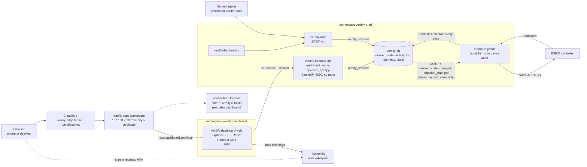

# Operator dashboard architecture

**Summary.** `dashboard.verdify.ai` is the private operator app for the Verdify greenhouse: graphs, every
writable setting, what Iris plans, and irrigation. It is the weather.vallery.net stack (React Router 8 SSR on
an Express BFF, uPlot, polling) in its own namespace and auto-synced Argo app, with native Authentik OIDC and
two roles, operator and viewer. The BFF talks to one backend, `verdify-operator-api` (an internal listener built
from the `verdify-api` image), which reads `verdify-db` and appends to one `desired_state` table. The ingestor's
fenced dispatcher, still the only device writer, converges the controller to each setting's effective value, at
most 12 commands per pass, so values survive ESP32 reboots. A `manual` flag makes Iris's plan lose to a person's
value, and the UI shows requested → confirmed from readbacks. MCP and the dashboard share one service layer,
`verdify_services`, so validation lives in one place; agents write through its new `set_setting` tool, while
Iris's planner keeps writing plans as today. There are no holds, precedence tiers, step-up, dry runs or
kill-switch matrices; one `DASHBOARD_WRITES_ENABLED` flag is the rollback switch.

Status: Draft v2 (2026-11-02; Round 2, 2b and Q-01 to Q-14 applied)

[README](README.md) · [product](product.md) · [screens](screens.md) · [architecture](architecture.md) ·
[irrigation](irrigation.md) · [design system](design-system.md) · [execution plan](execution-plan.md) ·
[OpenAPI](openapi/dashboard-api.v1.yaml) · [ADR-0012](../../adr/0012-operator-dashboard-architecture.md)

Evidence is cited as repo-relative paths at origin/main `0950a3bdb`. Work is tracked as the VD issues in the
[execution plan](execution-plan.md); "Round 2 #n" cites Jason's answers in [decisions](decisions.md).

## 1. Context and goals

**Answer:** put a web tier and a private API around the platform that already exists, keep the single device
writer, and give people and agents one simple write path.

| Goal | What it means | Personas |
|---|---|---|
| G1 See | Now, graphs, equipment and alerts, each value with its age; gaps stay empty, never zero | P1, P2 |
| G2 Control | Change every writable setting. The newest write wins, `manual` keeps Iris off a setting, and values survive reboots | P1, P2 as operator |
| G3 Plan | The current Iris plan, its waypoints, hypothesis and history, and which settings Iris is skipping | P1 |
| G4 Water | Schedules, run now, stop, minutes by zone and mister associations ([irrigation](irrigation.md)) | P1, P2, P3 |
| G5 Agents | Iris and other agents read and write the same things through MCP, on the same functions | P3 |
| G6 Ship | UI releases never ride the device-gated `verdify-prod-dark` sync | P4 |

Kept because they are structural: one device writer (the ingestor), readback before "confirmed", attribution
on every write, and sign-in. Existing protections stay: the SAF-4 ceiling, the direct-wet relay watchdog and
relay guards, and leak detection, which the engine release reduces to the leak alert (Round 2 #3; until then
today's firmware keeps its interlock). The engine release adds the D-IRP-19 mister watchdog (irrigation F10);
the dashboard adds no protections.

| Fact today | Evidence |
|---|---|
| `dashboard.verdify.ai` resolves through the proxied `*.verdify.ai` wildcard. Tier-1 `verdify-tier1-forward` (HostRegexp, priority 50) sends it to tier-2, which has no router for it, so it returns 404 | `deploy/k8s/overlays/prod/traefik/verdify-tier1-apps-forward.yaml` |
| There is no sanctioned human write path. MCP `set_tunable` is planner-only and needs a planner trigger; people use owner SQL | `mcp/server.py:2811` |
| A human value is lost at the next ESP32 reboot. Most policy, schedule and safety globals are `restore_value: no`, and the dispatcher's desired state comes only from plans, band and defaults | `ingestor/tasks/dispatcher.py:782` |
| The bounded writer halted on 2026-10-19 waiting for manual custody and pushed nothing until it was cleared on 2026-11-01 at 22:07Z | `ingestor/tasks/bounded_reconcile.py`; Round 2 #1 |
| The forecast action engine writes `setpoint_plan` rows (source `preemptive`) and pushes them through the `setpoint_changes` fast path, unattributed | `scripts/forecast-action-engine.py:340-349`; task `forecast_actions`, `ingestor/ingestor.py:4505` |
| `api.verdify.ai` forwards every path to the public app on `:8080`, so private routes cannot live there | `deploy/k8s/overlays/prod/traefik/verdify-traefik-routes.yaml:118` |
| Everything in `verdify-prod` ships only through the attended full sync, which runs migrations and can Recreate the ingestor | AGENTS.md "Deliver and verify"; `ARGOCD.md` |

Non-goals: OTA, Argo syncs, migrations or releases from the UI; planner run-now from the UI (MCP `plan_run`
stays admin-only); replacing graphs.verdify.ai; any Home Assistant path beyond occupancy, the hydro probe until
its direct reader (VD-70) lands, and the Lutron switches; Slack changes; more than one greenhouse. Also cut from v1
(README §2 has the rest): command lifecycles and `If-Match`, signed actor assertions, a second database login,
a hash-chained audit ledger, version-skew gates, continuous aggregates, researcher and blinding roles, SLOs,
PDBs and second replicas.

## 2. Topology

**Answer:** browser → Cloudflare → traefik-apps → BFF (`verdify-dashboard`) → operator API (`verdify-prod`) →
`verdify-db`. The ingestor reads desired state from the database and is the only thing that talks to the ESP32.



| Component | Namespace | Image | Listens | Holds | Ships via |
|---|---|---|---|---|---|
| `verdify-dashboard-web` | `verdify-dashboard` | `verdify-dashboard-web` (new, the ninth image) | 3000 | OIDC client secret, cookie secret, operator API token | Argo app `verdify-dashboard`, automated sync |
| `verdify-operator-api` | `verdify-prod` | `verdify-api` (the same digest as the public API) | 8090 | `verdify_dashboard_runtime_login` password, operator API token | release pins plus the gated `verdify-prod-dark` sync |
| `verdify-db` | `verdify-prod` | existing | 5432 | — | migrations through the `verdify-migrate` PreSync hook |
| `verdify-ingestor` | `verdify-prod` | existing | — | `ESP32_API_KEY` (also mounted by the firmware builder) | gated sync |
| `verdify-mcp` | `verdify-prod` | existing | 8000 | MCP login, audience tokens, the agent keys (§5.6) | gated sync |

Why a separate Deployment of the `verdify-api` image: `api.verdify.ai` forwards every path to `:8080`, and a
second container in the public pod would share its network namespace and environment. It costs one manifest and
three `COPY` lines (§6), adds no image or pin site (`release-pins.yaml` pins `verdify-api` by name).

## 3. Web tier

**Answer:** copy weather's web stack and server with provenance and add three things to its Express server:
OIDC sign-in, a same-origin `/api/v1` proxy, and the writes flag.

| Piece | Pin (weather's, except where marked new) |
|---|---|
| Runtime and build | Node 24.22.1, pnpm 12.15.0, Vite 8.3.5, TypeScript 6.0.3 |
| UI | React 19.3.1, React Router 8.5.0 in framework mode with SSR through `@react-router/express` 8.5.0, TanStack Query 5.104.5, zod 4.6.7 (jitless), uPlot 1.6.32, IBM Plex self-hosted |
| Server | Express 5.2.1, `openid-client` 6.8.8 (new) |
| Contract | openapi-typescript 7.13.0 (weather `web/contract-tools/generate.mjs`) |
| Tests | Vitest 4.1.0, Testing Library, Playwright 1.64.1, `@axe-core/playwright` 4.14.0 |

Code layout, one pnpm package like weather's `web/`: `dashboard/server.mjs` (weather's server plus `/auth/*`,
the proxy and the writes flag), `security-headers.mjs` (weather's CSP; `form-action` also allows
`https://auth.vallery.net`, and `Referrer-Policy` is `same-origin`, see 4), `bff/` (`oidc.mjs`, `session.mjs`,
`proxy.mjs`, `origin.mjs`), `app/`, `app/generated/operator-api.ts` (generated, drift-checked), `e2e/` and
`Dockerfile`. What the BFF does:

1. Serves the SSR shell and hashed assets under a per-request nonce CSP (weather `security-headers.mjs`), pins
   `Host: dashboard.verdify.ai`, and caps URL length and header count as weather does.
2. Runs sign-in, the callback and sign-out (§4) and sets the session cookie. A page GET or HEAD without a
   well-formed session cookie (43 base64url characters) answers 302 to `/auth/login?returnTo=<path and query>`,
   or `returnTo=%2F` when the page is longer than BFF-01 keeps or its encoded form would push `/auth/login` past
   the 4,096-character URL cap. React Router's single-fetch request (`*.data`) gets that redirect in its own
   form, 204 with `X-Remix-Redirect` and `X-Remix-Reload-Document: true`, because a hydrated client's fetch would
   follow a 302 to Authentik and fail cross-origin. Hashed assets, fonts and the lazy route manifest
   (`/__manifest`, route ids and module paths that the public assets already hold) skip the check. Another method
   on an `/auth` route answers 405, and another `/auth` path 404.
3. Proxies `/api/v1/*` to `http://verdify-operator-api.verdify-prod.svc:8090/v1/*` with the bearer
   `$OPERATOR_API_TOKEN`, `X-Dashboard-Session: <cookie value>` and `X-Request-Id`. A path with a `.` or `..`
   segment, or containing `%2e`, `%2f`, `%5c` or a backslash (any case), gets 400 before routing; the upstream
   path is concatenated from the validated one. Timeout 15 s, on a new connection per call; a GET is retried once
   on a connection error, and a non-GET is sent once, never retried. Every `/api` and `/auth` response is
   `Cache-Control: no-store`.
4. Requires `Origin: https://dashboard.verdify.ai` exactly on every non-GET/HEAD `/api/*` request and on
   `POST /auth/logout`; anything else gets 403. Responses carry `Referrer-Policy: same-origin`, not weather's
   `no-referrer`: under `no-referrer` a browser sends `Origin: null` on a form POST (Fetch, "append a request
   Origin header"), so the sign-out form would be refused. `same-origin` sends no referrer to any other origin.
5. Answers every non-GET `/api/*` request except `POST /api/v1/irrigation/stop` (matched on the validated path)
   with 503 `writes_disabled` while `DASHBOARD_WRITES_ENABLED` is not `true` (§5.7). `GET /api/v1/me` reads the
   flag as `writes_enabled` on any encoding of its path that the operator API routes to API-01.
6. Serves `/healthz` and `/readyz` (§11).

Settings are read and checked once at start. A missing or malformed value stops the start with one log line that
names the variable, never its value, except `DASHBOARD_WRITES_ENABLED`: anything but `true` turns writes off
(§5.7), so a mistyped flag fails safe instead of stopping the rollout that was meant to switch writes off.

What it never does: hold a database, device, MCP or Home Assistant credential; connect to `verdify-db`, MQTT,
the ESP32 or MCP; re-implement registry rules (min, max and step come from the API); render greenhouse data
into SSR HTML (the shell renders on the server, and data loads in the browser through TanStack Query).

Polling (weather `polling.ts`: paused while the tab is hidden, backing off from 15 s to 120 s on errors):

| Data | Interval |
|---|---|
| Now, the alert count in the nav and the open alerts (API-14) | 15 s |
| Water status (API-IRR-01) and the Equipment board (API-13, API-02 `overrides`) | 15 s |
| A setting or irrigation write still REQUESTED, or a command still pending | 5 s until it settles; an item that waits for the irrigation firmware (`no_engine`, or `engine: false`) keeps its slow cadence, since no poll can settle it before that firmware ships |
| Graph windows that end at "now" | 60 s |
| Plan, settings, schedules, minutes, runs, the activity log and `/v1/me` | 60 s |
| Closed graph windows | never |

## 4. Sign-in and roles

**Answer:** the options-tracker pattern. `openid-client` v6 in the BFF, a confidential client with PKCE S256, a
single-use login cookie, a server-side session in `verdify-db`, `__Host-` cookies, no tokens in the browser,
and two roles from two Authentik groups. MFA happens at sign-in. There is no step-up.

| Authentik setting (agents lane) | Value |
|---|---|
| Provider and application | `verdify-dashboard`, confidential; the client secret is generated in Authentik and sealed by Jason |
| Issuer | `https://auth.vallery.net/application/o/verdify-dashboard/`; the authorize endpoint comes from its discovery document (`https://auth.vallery.net/application/o/authorize/`) |
| Redirect, post-logout redirect | `https://dashboard.verdify.ai/auth/callback`, `https://dashboard.verdify.ai/` |
| Grant types | `[authorization_code]`, set explicitly: Authentik 2026.8's empty default broke `verdify-grafana` on 2026-10-01 |
| Scopes and claims | `openid profile email groups`, with the Groups Claim mapping, as `verdify-grafana` does; the BFF reads `sub`, `preferred_username`, `name` and `groups` |
| Access | Bindings to `verdify-dashboard-operators` and `verdify-dashboard-viewers` with `policy_engine_mode` any; the member-tier authorization flow (`vallery-member-mfa-authorization`), so a second factor (passkey, TOTP or recovery code) at sign-in, which a caretaker enrols at first sign-in (Q-07); the slug is listed in the estate MFA contract |

Flow: `GET /water` with no session → 302 `/auth/login?returnTo=%2Fwater` → the BFF sets the sealed login cookie
(state, nonce, PKCE verifier) and redirects to the authorize endpoint → sign-in with MFA at Authentik → 302
`/auth/callback?code&state` → the BFF exchanges code, verifier and client secret for the ID token (`sub`,
`preferred_username`, `name`, `groups`) → `POST /internal/sessions {username, display_name, role}`
(`SessionCreate`) returns the session token (the database keeps only its sha256) → session cookie (12 h), login
cookie cleared, 302 `/water`.

| Cookie | Content | Attributes | Lifetime |
|---|---|---|---|
| `__Host-verdify_session` | 32 random bytes, base64url; `dashboard_session` stores its sha256 | HttpOnly; Secure; SameSite=Lax; Path=/ | 12 h |
| `__Host-verdify_login` | `{state, nonce, verifier, returnTo}` and a 10-minute expiry, sealed with AES-256-GCM: key from `cookie-secret` by HKDF-SHA256, a fresh 12-byte IV, the cookie name as associated data | same | 10 min, cleared at the callback |

| Authentik group | Role | Can |
|---|---|---|
| `verdify-dashboard-operators` | `operator` | Everything: read, and every write (settings, irrigation, alerts) |
| `verdify-dashboard-viewers` | `viewer` | Read only; write controls are not rendered, and the API refuses writes with 403 |
| Neither | none | Denied at Authentik; the BFF also refuses to create a session |

- Jason is an operator; a caretaker gets whichever role Jason assigns; a member of both groups is an operator.
  `returnTo` must be a same-origin relative path.
- Sign-out (`POST /auth/logout`) deletes the session row, clears the cookie and redirects to Authentik's
  end-session endpoint. A group change applies at the next sign-in (at most 12 h); deleting someone's
  `dashboard_session` rows ends their sessions within 30 s.
- The callback clears the login cookie on every outcome. A missing, expired or tampered login cookie, a state
  mismatch, an Authentik `error` or a refused code exchange answers 400 (`failed`); neither group answers 403
  (`no_access`) and makes no INT-01 call; Authentik unreachable (discovery or the token endpoint) or a failed
  INT-01 answers 503 (`unavailable`). The BFF leaves `{reason, requestId}` in `res.locals.authError` and hands the
  request on, past the page gate, to React Router: `getLoadContext` puts it in the page context (a
  `RouterContextProvider`, as React Router 8 requires), and the root loader answers that status with the SCR-09
  card at the same URL. With discovery unavailable, sign-out still deletes the session and clears the cookie, then
  answers 303 to `/`.
- Trust: only the web pods reach `:8090` (NetworkPolicy), with one shared bearer token; the API trusts the BFF's
  session creation because the BFF verified the ID token, and ignores `X-Authentik-*`. `POST /internal/sessions`
  refuses (403) any request carrying `X-Dashboard-Session`, which the proxy always sends and the session-create
  call never does, so no proxied user request can mint a session.
- Every `/v1` call resolves `X-Dashboard-Session` to a `dashboard_session` row (cached 30 s) and checks the
  role: GET and HEAD for both roles, everything else for operators (403 `forbidden`). No session: 401 on `/api`, 302
  to sign-in on pages. FastAPI answers two things before any check runs: a method the path does not serve and a
  body it cannot parse. The operator API runs the path's checks before those answers too, so a call without the
  bearer or the session is 401 and a viewer's write to any served path is 403, whatever its body. An unknown path
  is 404.

## 5. Control model

**Answer:** every setting write, from a person or an agent, appends one row to `desired_state`; Iris's plans
stay in `setpoint_plan` (R5). Per setting the newest write wins, desired-state row or plan row. A `manual = true`
row beats Iris's plan whatever its age, until someone writes that setting again; only Iris skips manual
settings. `value = NULL` releases to plan, band or default. The dispatcher converges the device to the winner,
at most 12 commands per pass, through its existing fences; the UI shows REQUESTED → CONFIRMED from readbacks.

### 5.1 The table

```sql
CREATE TABLE desired_state (
  id            bigserial PRIMARY KEY,
  greenhouse_id text NOT NULL DEFAULT 'vallery',
  param         text NOT NULL,                  -- canonical tunable_registry name
  value         double precision,               -- validated and snapped; NULL = release to auto
  manual        boolean NOT NULL DEFAULT false, -- true: Iris's plan values lose to this one
  source        text NOT NULL,                  -- 'dashboard' | 'iris' | 'agent:<name>' | 'system' (R4)
  actor         text NOT NULL,                  -- Authentik username, 'iris' or the agent name
  reason        text CHECK (length(reason) <= 500),
  created_at    timestamptz NOT NULL DEFAULT now(),
  CHECK (value IS NOT NULL OR NOT manual)
);
CREATE INDEX desired_state_latest ON desired_state (greenhouse_id, param, created_at DESC, id DESC);
CREATE VIEW v_desired_state_current AS
  SELECT DISTINCT ON (greenhouse_id, param) *
    FROM desired_state ORDER BY greenhouse_id, param, created_at DESC, id DESC;
-- AFTER INSERT ... FOR EACH STATEMENT: pg_notify('desired_state_changed', '')   -- wake only
```

The table is append-only: it is the history behind the Settings and Activity screens. Nothing updates or
deletes rows. Each row's `activity_log` row, written in the same transaction, carries the request id and the
experiment id (§9).

### 5.2 How the dispatcher resolves and converges a setting

```text
d    = v_desired_state_current row for param      plan = v_active_plan row for param
if d is missing, d.value is NULL or param is not writable now -> today's behaviour (plan, band, defaults)
elif d.manual                                -> d.value      Iris's plan value is skipped
elif plan and plan.created_at > d.created_at -> plan.value   a newer plan wins (last write wins)
else                                         -> d.value      beats plan, band and defaults
```

`verdify_schemas.setting_values.resolve_effective(desired, plan)` is this rule as one pure function (VD-29), so the
dispatcher, the API's `applied_from` and the services resolve a setting the same way.

- **Where:** in `setpoint_dispatcher` (`ingestor/tasks/dispatcher.py:782`), where the batch is built from plan,
  band and defaults, before dedupe, the drift probe, C1 and the 12-command limit. A desired value becomes a
  command only when it differs from `_last_pushed` or its readback (the §5.5 comparator), like a plan value, and
  its pushes carry `setpoint_changes.source = 'manual'`; no force-upsert, no `_apply_manual_overlay`. Rows whose
  parameter is no longer writable (§5.3 step 1) are skipped and logged once per parameter, and so are
  `crop_band` and `irrigation_site` rows (§5.3, §5.8).
- **Plain convergence (Round 2 #1).** Each pass sends at most `MAX_RECONNECT_COMMANDS = 12` commands, oldest
  change first, and wakes itself for the rest, so a reboot, a release or a burst of agent writes converges over
  successive passes with readback. Nothing waits for an approval file or halted-run custody: VD-62 replaces the
  halt gate (`ingestor/tasks/bounded_reconcile.py` and the custody steps in
  `docs/runbooks/writer-staged-reconcile.md`), keeps staging only for the C1 qualification overlay and its restore,
  and raises `setpoint_delivery_stuck`, shown as the stuck-delivery banner, when delivery is stuck. The same value
  sent on the same connection in the last 90 s is not sent again while its readback is pending (a new value is a new
  change, and a reconnect sends again). A value already sent on the connection that the controller has not taken
  goes after every value not yet sent, and the dispatcher wakes itself only while a value not yet sent is left
  over, so values the controller never takes cannot keep it waking. The stuck alert stays open while any setting
  differs, across an ingestor restart too. Each change of stage is one `system_state` row, entity
  `dispatcher_stage`: `ordinary`, `paced <sent>/<pending>` or `held:<c1|heap|lease|drift_probe>`.
- **Fences unchanged:** registry clamp (`_coerce_registry_value`), physics invariants (`_validate_physics`),
  the VPD-high moisture guardrails (clamps recorded in `setpoint_clamps`), heap deferral, the writer Lease and
  `VERDIFY_DEVICE_WRITE_ENABLED`.
- **Experiments (Round 2 #2).** Nothing is refused. While `fn_mcp_armed_assignment_context()` returns an
  experiment (`control_experiments` status `armed` or `running`), each write's own `activity_log` row records its
  `experiment_id`; the ingestor writes no deviation rows. In `_experiment_hold_failure` (`ingestor/esp32_push.py:302`)
  desired values pass `component_authority_hold` and wait out `component_bundle_hold`. Under
  `experiment_policy_hold` they are not sent, because the firmware serves the armed vector to the control path and
  the readback (`policy_read`, `firmware/lib/policy_vector.h:1351`): the setting reads `held` and goes out on the
  first pass after disarm.
- **Reboots:** after a reconnect `_last_pushed` is reseeded from that connection's `cfg_*` and native
  Number/Switch readbacks (`dispatcher.py:815-850`), so a value the reboot reset is re-sent within one pass.
  `RECONNECT_UNOBSERVED_RESTORE_PARAMS` is empty today.
- **Wake:** the insert trigger sends `NOTIFY desired_state_changed` with an empty payload. The existing listener
  (`setpoint_listener`, `ingestor/ingestor.py:5012`) also subscribes to `irrigation_changed` (§5.8) and only sets
  `shared.setpoint_dispatch_requested` (or `shared.irrigation_sync_requested`), forcing the next normal, fenced
  pass: dispatch in seconds, confirmation 30-90 s later (`cfg_*` sensors every 30 s, snapshots every 60 s). A
  lost wake waits for the 300 s pass.
- **Never the NOTIFY fast path.** `trg_setpoint_notify` on `setpoint_changes` (`db/migrations/055-realtime-sync.sql`)
  skips the physics invariants, moisture guardrails, heap deferral and the 12-command limit (the Lease, the
  device-write gate and the experiment holds still apply), and the next pass would overwrite the value anyway.
  No dashboard, operator API or MCP login gets INSERT on `setpoint_changes`; a database test asserts it. VD-65
  keeps the ingestor's `forecast_actions` task and takes it off the fast path: its
  `v_runtime_setpoint_changes_write` inserts go, its `setpoint_plan` rows (source `preemptive`) stay, and each plan
  appends one `activity_log` row (source `system`, actor `forecast-engine`, the rule as reason; labelled "Forecast
  rule · system") and applies through the next normal dispatcher pass. The dispatcher admits a forecast-rule plan
  row (`plan_id` `preemptive-*`) for any writable parameter (§5.3 step 1), so `high_wind` still reaches
  `sw_economiser_enabled`, which is not planner-pushable; Iris's rows keep today's filter. Band-owned `temp_low`
  and `temp_high` keep the band.
- **Release.** A released row with no plan, band or dispatcher default gets its registry default
  (`TunableDef.default`). The lighting policy functions treat the newest confirmed non-`esp32` `setpoint_changes`
  row as an override, so a released `gl_*` value would stick. Migration M5 (VD-33) makes them ignore
  `source = 'manual'` rows, so after a release the next pass applies the policy's own value.

### 5.3 Validation on submit

`verdify_services.settings.validate(param, value)` is the only validator for desired state; the operator API
and MCP `set_setting` both call it (Iris's `set_plan` and `set_tunable` keep their own checks, R5). There is no
dry run, preview or confirmation token. A rejection carries a stable `code`, `detail`, the bounds, the current
value and `retryable` (problem+json on REST, the same JSON with `isError` on MCP).

| Step | Rule | Failure code (422) |
|---|---|---|
| 1 Known and writable | A registry row whose `control_class` is `planner_policy`, `scheduled_policy`, `controller_safety` or `crop_band` with an `esp_object_id`, or the new `irrigation_site` (`mister_daily_volume_max_gal`, `sched_mist_rh_max_pct`, `climate_yield_min`: no `esp_object_id`, delivered in the irrigation program, R12). Read-only, with a reason: `readback_context` and `retired` rows; the legacy wide limits `temp_low`, `temp_high`, `vpd_low`, `vpd_high` and `vpd_target_*` (not the band while the controller runs its on-chip curve, §7) and the three activity-mirror values, all derived by the dispatcher; `sw_onchip_band_enabled`, which decides which side owns the band; `crop_band` rows with no `crop_band_anchors` row (zone priorities and window values). `irrig_*_duration_min` and `sw_irrig_*` stay writable for the L01 bridge (§5.8), and the `gl_*` lighting rows stay writable (a release hands them back to the lighting policy, §5.2). The nine weekly-feed commissioning rows (`sw_wall_fertigation_commissioned`, `wall_commissioning_{revision,evidence_mask,valid_until_epoch_s}`, `wall_flow_{lpm,valid_until_epoch_s}`, `wall_{prewet,feed,flush}_liters`) have no row since VD-47, so they answer `unknown_target` | `unknown_target`, or `read_only` with the reason |
| 2 Type and range | Finite; switches 0 or 1; enums in `enum_values`; inside `planner_effective_bounds(param)` (registry min/max intersected with the firmware clamp) | `out_of_range` with `min` and `max` |
| 3 Manual | An `iris` write to a setting whose newest row is manual | `manual` |
| 4 Snap | To the registry `step` (new on `TunableDef`, copied as literals from `firmware/greenhouse/tunables.yaml` and drift-guarded like `fw_clamp`; 1 for a switch; the `_round_for_push` quanta for the anchors, which have no number entity; equal to the `ENTITY_GRIDS` steps for the 48 policy fields; none for a row with no entity, which is not snapped, unless the row sets its own, as the `irrigation_site` rows do), half to even, by `snap_setting()` in `verdify_schemas.setting_values`. A snapped value outside `planner_effective_bounds` takes the bound, so the three minimums off their grid (`gl_lux_threshold`, `gl_main_lux_threshold`, `gl_grow_lux_threshold`) stay reachable. A value equal to the setting's current effective or device value is stored as is, so taking an Iris value manual keeps it | none; the response carries the stored value and `snapped_from` |

A drift test fails when a number or switch in `firmware/greenhouse/tunables.yaml` has no registry row (writable,
or read-only with a reason) and is not retired, so the catalog really is every setting. Each row's name and unit are
`TunableDef.label` and `TunableDef.unit`, which VD-29 adds next to `step`, split from the `name:` of the setting's
entity in `firmware/greenhouse/tunables.yaml` (the entities carry no `unit_of_measurement`; `split_entity_name()`)
and drift-tested the same way. The anchors take theirs from their `cfg_*` readback names in
`firmware/greenhouse/sensors.yaml` ("Cfg • Band VPD Low SR (kPa)"). A row with no entity carries its registry name
and no unit unless it sets its own, as the `irrigation_site` rows do; the drift test skips it. `settings.catalog`
(VD-67) passes them through, and API-09 (VD-55) serves them as `Setting.label` and `Setting.unit`.

`manual` has no default inside `verdify_services`: REST defaults it to true (the dashboard box starts ticked, R3)
and every MCP write tool to false. A write stores exactly the flag it carries, so an agent's write to a manual
setting clears it unless it passes `manual=true`; `manual_before` and the activity detail say so.

Every write accepts an `Idempotency-Key` (MCP `request_id`), stored on its `activity_log` row with a hash of the
canonical request: the same source, key and payload return the stored object, marked as a replay (REST: the header
`Idempotency-Replayed: true`; MCP: a top-level `replayed: true`, §5.6); a different payload gets
`request_id_reused`. `retryable` follows the OpenAPI: true for `line_busy` and `manifold_busy` (with
`retry_after_s` when known), `query_timeout` and `unavailable`, except the pre-engine `unavailable` ("arrives with
the irrigation firmware"), which is false; false everywhere else.

`crop_band` anchor values and widths are the band's single source of truth in `crop_band_anchors`, which the
dispatcher syncs (`ingestor/tasks/band_anchors.py`) and graphs and scoring read through `fn_crop_band_value`. In
its `desired_state` transaction, a value write updates every row for that (`crop_type`, `series`, `anchor`) at
the best season score present (`band_anchors._row_season_score`: current season, else `all`, `any` or empty),
zones mapped to `crop_type` as `band_anchors.py` does; a `zone_vpd_width_*` write updates that column on every
row of the zone crop's `vpd_target` series at that score. The write's `activity_log` row names the rows
(`detail.anchor_rows`); the setting confirms from its `cfg_*` readback. Iris has no band path, so `manual` means
nothing there.

### 5.4 Write path

`PUT /api/v1/settings/mister_engage_kpa {value 1.53, manual true}` with an `Idempotency-Key` → the BFF checks
the path, the exact Origin and the writes flag, then forwards with the bearer, session and `X-Request-Id` → the
operator API checks the operator role, validates and snaps 1.53 to 1.55, and inserts the `desired_state` and
`activity_log` rows in one transaction → `NOTIFY desired_state_changed` wakes the dispatcher → 200 `{value 1.55,
state requested}` → the fenced pass pushes it (at most 12 per pass) → the `cfg_*` readback lands in
`setpoint_snapshot` → the browser's 5 s poll of `GET /v1/settings` reads `confirmed`.

### 5.5 Readback states

`verdify_services.settings.status` computes the state on every read, so a late readback turns NOT CONFIRMED into
CONFIRMED by itself. A readback matches when |readback − value| ≤ max(step/2, the value's binary32 ULP, the
duration tolerance): `readback_matches()` in `verdify_schemas.setting_values`, beside `readback_abs_tolerance` and
`readback_values_equivalent` (moved from `ingestor/tasks/dispatcher.py:486-500`, which imports them back). A missing
or non-finite readback never matches. The dispatcher uses it to decide whether a desired value needs a push,
not its 1 % dead-band (`within_relative_deadband`), which hides one-step changes (`site_pressure_hpa` 840 → 845).
Plan values keep `readback_values_equivalent` and show as Iris stored them.

| State | When | Badge ([design system](design-system.md) §4.1) |
|---|---|---|
| requested | Stored, no matching readback yet, less than 5 min old | REQUESTED |
| confirmed | A readback at or after `created_at` matches: `cfg_*`, a native Number or Switch, a `SWITCH_CONFIRM_EQUIPMENT` mirror in `equipment_state`, or, for `irrigation_site` rows, the program hash of a push compiled after the write | CONFIRMED |
| not_confirmed | 5 min after the request there is no match, or the newest readback disagrees (the ingestor's `setpoint_unconfirmed` window) | NOT CONFIRMED |
| held | The platform applies something else on purpose: a dispatcher clamp (a `setpoint_clamps` row after the request, while the newest readback does not confirm the value, so a guardrail that let go does not hold it forever) or an armed experiment manifest (§5.2) | HELD |
| no_readback | None of those readbacks exists; the value is sent but can never be confirmed | NO READBACK |
| overridden | Not manual, and a newer Iris plan now wins; the UI says "Iris changed this at 14:05" | AI |
| released | The newest row has `value = NULL`; plan, band or default applies | none |

`state_reason` says why a value is not confirmed or held, when known: `clamped` (applied value and guard),
`experiment`, `deferred` (heap) or `push_failed` (`setpoint_changes.delivery_status` after the request),
`writer_down` (the ingestor heartbeat is stale, §7) or `no_match`. Before the engine an `irrigation_site` row
stays requested with `no_engine` ("applies with the irrigation firmware"; `since` is the write). With the engine
it reads confirmed once the confirmed push whose `sha256` starts with the `irr_program_id` hash has
`site_desired_at` at or after the write, with the device value from that record, and not_confirmed 5 min after
the write without one; `no_match` then names the first push compiled at or after it. The states are display only and add no alerts;
`setpoint_unconfirmed` (`ingestor/tasks/confirmation.py`) still covers device writes. With no desired row a
setting's state is its plan value's, else the dispatcher's newest push's (VD-67); a `setpoint_changes` row the
controller reported itself (source `esp32`) is never the push a reason's `since` names.

### 5.6 Iris, agents and `manual`

- **Iris's planner path is unchanged (R5).** `set_plan` and `set_tunable` keep their arguments, responses and
  trigger contract and keep writing `setpoint_plan` (one-shots still expire); each appends one `activity_log` row.
  A manual row wins in the dispatcher (§5.2), so they gain no refusal or response field. The planner context
  gains "MANUAL SETTINGS: held by a person; your plan values for these are ignored" (parameter, value, who,
  since); `set_plan` still requires every Tier-1 parameter.
- **Agents write desired state.** The new `set_setting(param, value=null, release=false, manual=false,
  reason=null, request_id=null, trigger_id=null, planner_instance=null)` validates through
  `verdify_services.settings` (§5.3), needs no trigger, accepts any writable row (the `irrigation_site` values
  included) and returns the API-10 `DesiredSetting`. It is open to `iris`, `agent` and `admin`; Iris is refused
  with `manual` on a manual setting, while people and other agents may overwrite it, attributed (R3). Two new
  reads, every argument optional: `settings(param?, group?, writable_only?, manual_only?, since?, until?)` returns
  the API-09 rows those filters select (`group` takes a `Setting.group` value; `applied_from` shows whose value is
  in force), or the API-12 history when `param`, `since` and `until` are given; `activity(source?, actor?, action?,
  target?, since?, limit?, cursor?)` returns API-17. MCP windows use `since` and `until`, mapped to the REST `from`
  and `to`: FastMCP builds tool arguments from Python signatures, and `from` is a keyword.
- **Triggers.** `set_setting`, `irrigation_schedule_set`, `irrigation_run` and `irrigation_line_set` take an
  optional `trigger_id` and `planner_instance` (Iris always sends the instance), kept only in
  `activity_log.detail`; `irrigation_stop` and `irrigation_clear_fault` take neither. These tools never touch
  `plan_delivery_log` or `planner_trigger_ledger`, nor satisfy or fail a trigger. Iris still ends every trigger
  with `set_plan` or `acknowledge_trigger`.
- **Tool contracts.** New tools take typed arguments (enums, never a JSON string), return the REST JSON from the
  same Pydantic models, and on a refusal the Problem JSON with `isError`. A replayed write returns the stored REST
  JSON with a top-level `replayed: true` (MCP has no headers). Descriptions name the REST twin, the
  `manual` default and the codes, never a literal example uuid; read tools join `_TOOL_READ_ONLY`; the server
  instructions gain one paragraph on these tools. [irrigation](irrigation.md) §8.2 lists the irrigation tools;
  the API-IRR-12 bursts have no tool in MVP.
- **Agents have names.** A new `agent` audience joins `KNOWN_AUDIENCES` (`mcp/server.py:506`). Secret
  `verdify-mcp-agents` holds one key per agent (`<name>`: its token), mounted as an optional volume that MCP
  re-reads at most every 60 s, so adding or removing a key admits or refuses that agent within minutes with no
  restart; the env-token parser is untouched. `call_tool` puts the caller's actor in a request-scoped
  `ContextVar`: `iris` → (`iris`, `iris`), an agent → (`agent:<name>`, `<name>`), `admin` → (`agent:admin`,
  `admin`). Services take the actor only from it and ignore any `actor`, `source` or `*_by` argument (the
  `alerts` adapter included); a write with no resolved actor is refused with `forbidden`.
- **Network.** Agents run in the cluster: they reach `http://verdify-mcp.verdify-prod.svc:8000/mcp` from a pod
  labelled `verdify.ai/mcp-agent: "true"`, admitted by the new additive `allow-mcp-from-named-agents` (VD-59;
  `allow-mcp-internal` is untouched). Jason names the first agent when he seals its key (VD-23).
  Off-cluster agents are out of scope.

| Audience | Tools |
|---|---|
| `iris` | Its 23 tools, plus `settings`, `activity`, `set_setting` and the eight irrigation tools |
| `agent` (new) | `climate`, `forecast`, `equipment_state`, `history`, `plan_status`, `get_setpoints`, `scorecard`, `topology`, `position_current`, `alerts`, `settings`, `activity`, `set_setting` and the eight irrigation tools; never the planner, lessons, crop or Slack writers |
| `admin` | Every tool; its writes are attributed `agent:admin` |
| `experiment`, `observer` | Unchanged; none of the new tools |

- **Lockstep.** New tools update `TOOL_AUDIENCES` (an entry including `admin`, or MCP fails at startup),
  `HERMES_REQUIRED_TOOLS` (`mcp/server.py:904`), `hermes/iris/config.yaml`, `hermes-config.yaml` in
  `deploy/k8s/components/hermes-iris/` and `tests/test_mcp_audience_auth.py` (which asserts the table), with the
  `make planner-dry` cost check and the rule-7 restart line (`verdify-mcp`, plus `verdify-hermes-iris` when the
  include lists change).

### 5.7 The one switch

`DASHBOARD_WRITES_ENABLED` is an environment variable on the BFF, from the `verdify-dashboard-web` ConfigMap that
`deploy/k8s/dashboard/kustomization.yaml` generates (`configMapGenerator`), so any change renames the ConfigMap
and rolls the pod. It is `"false"` until R2 (VD-28), or R3 if that ships first, sets `"true"`. While it is not
`"true"`, the BFF answers every non-GET `/api/*` request except irrigation Stop with 503 `writes_disabled`, and
`/api/v1/me` returns `writes_enabled: false`, so the UI disables its controls and shows a banner; reads and Stop
continue. It gates only the BFF: MCP writes, Iris's included, are live from the sync that ships them. To roll
back, merge a one-line flag change; within 5 minutes the new pod serves `writes_enabled: false`. The superseded
ConfigMap stays, because the app has prune off, and its `IgnoreExtraneous` annotation keeps the app Synced.

### 5.8 Irrigation

[irrigation](irrigation.md) owns the program: lines L01-L11, schedules, pauses, run now and stop, mister
flags, minutes by zone, and the firmware. Architecturally it follows the same rules:

- Its desired state is its own tables (`irrigation_line`, `irrigation_slot`, `irrigation_command`,
  `irrigation_push`, `irrigation_ledger`), with the same attribution, `manual` rule and `activity_log` rows. The
  three site values are `irrigation_site` rows in `desired_state` (R12): written through API-10 or `set_setting`,
  skipped by the dispatcher, compiled into the program by `irrigation_sync` from `v_desired_state_current`.
- The ingestor stays the only writer. `irrigation_sync` (every 60 s, plus a wake) compiles the program, pushes it
  when the controller's published hash differs, and sends pending run, stop, clear-fault and override commands,
  never through `setpoint_changes` (irrigation §6.1). Every irrigation or `irrigation_site` write runs
  `pg_notify('irrigation_changed', '')` in its transaction; the listener sets `irrigation_sync_requested`, the
  task loop force-launches the pass, and pending stops are also polled every 5 s. Stop goes first, as its own push
  ahead of any program push, and is never heap-deferred.
- Commands are `pending` until the ingestor marks the row `sent` in the transaction before it calls the device
  (sent at most once); one not sent within 2 min is `failed`, never sent late. Stop is re-sent each pass until the
  relays that were on read OFF, for at most 2 min. Relay edges and the line's `irr_state` show what happened.
- Before the engine firmware (the live native-API connection has no `irr_command` service), the VD-64 bridge
  works through the ingestor's single session (Round 2 #4, irrigation §6.5). Run now works on L01 only: it
  presses the existing ESPHome button `btn_wall_clean`, and L01 runs for its configured `irrig_wall_duration_min`.
  Stop, on one line or all, turns the open wet relays off (their guards block only turn-on); one that covers L01
  first ends the legacy job by turning `sw_irrig_enabled` off for one 5 s tick. VPD misting may pulse again
  afterwards, and the Stop result says so. Run on other lines, clear-fault and the bursts return 503
  `unavailable`, store nothing and read "arrives with the irrigation firmware"; schedules, lines and site values
  are stored and pushed when `irr_program_id` first appears.
- A program push is confirmed by the device hash and shown with the same badges. `verdify_services.irrigation`
  backs the REST operations (API-IRR-01 to API-IRR-13) and the one irrigation MCP surface.

## 6. Shared service layer

**Answer:** a small package, `verdify_services/`, next to `verdify_schemas/`, holding only the functions that
MCP and the dashboard both need, so validation and writes exist once.

| Module | Functions | Operator API | MCP |
|---|---|---|---|
| `settings` | `catalog`, `validate`, `write`, `release`, `status`, `statuses`, `history`, `desired_states` | API-09 to API-12, API-17's readback state | `settings`, `set_setting` (new) |
| `activity` | `append`, `list` | API-17 | `activity` (new); written by every write tool |
| `alerts` | `list`, `open_count`, `ack`, `resolve`, extracted from the MCP `alerts` tool; the shared resolve never refuses, and the MCP adapter keeps its retrieval check for `planner_tool_dependency_failed` | API-02 (`alerts`), API-14 to API-16 | `alerts` (becomes an adapter) |
| `reads` | `now`, `plan`, `equipment`; `settings_rows`, `setting_history`, `activity_page` (VD-55) | API-02, -07, -13; API-09, -12, -17 | `settings` and `activity` (new) call the last three; the existing read tools keep their LLM formatting |
| `series` | metric registry, `series`, `states`, `band` | API-03 to API-06 | none (`history` stays) |
| `irrigation` | per [irrigation](irrigation.md) | API-IRR-01 to API-IRR-13 | the irrigation tools |

- Functions are `async`, take an asyncpg connection (writes also take an `Actor(source, name, role)`; reads do
  not) and return Pydantic models built on `verdify_schemas`. Actors: `('dashboard', <username>, operator|viewer)`,
  `('iris', 'iris', None)`, `('agent:<name>', <name>, None)` (admin: `agent:admin`) and
  `('system', 'forecast-engine', None)`. Every write runs through `activity.recorded_write`, which inserts its
  domain row and its `activity_log` row (request id, and `experiment_id` while one is armed) in one transaction;
  [`verdify_services/README.md`](../../../verdify_services/README.md) holds the conventions. Existing Hermes tools
  keep their names and output shapes.
- `api/Dockerfile` copies `api/main.py`, `verdify_schemas/`, `verdify_services/` (VD-31) and `verdify_public/`; it
  gains `COPY api/operator_api.py ./operator_api.py` and `COPY api/operator_routes/ ./operator_routes/`, and the
  MCP image copies `verdify_services/` too. Path impact maps
  `verdify_services/**` to both images and `api/operator_api.py` and `api/operator_routes/**` to api. The ingestor
  does not import the package: it reads `desired_state` with SQL.

## 7. Read model

**Answer:** read existing views and functions, add one server-side metric registry, and serve graphs from a
bounded `time_bucket_gapfill` series endpoint. There is no new rollup layer in the first build.

| Need | Source (exists today unless marked new) |
|---|---|
| Now hero | The newest `climate`, `diagnostics` and `system_state` rows plus the band rows (below); not `v_greenhouse_now`, which needs DLI and health-score grants the dashboard login does not get. In SEALED_MIST the firmware publishes `greenhouse_state` as `SEALED_MIST_<stage>`, so API-02 serves the code `SEALED_MIST` and the label's stage (`mister_state` is the mister pulse machine and never reads FOG) |
| Freshness | Newest `climate`, `diagnostics` and `setpoint_snapshot` rows; the ingestor heartbeat (new, VD-54; no migration): a `system_state` row (entity `ingestor_heartbeat`) written every 60 s from the ingestor's own loop, stale after 180 s; `v_data_pipeline_health`, whose `setpoints` age (the newest push or device-reported change) is the writer-health tile; `setpoint_delivery_stuck` drives the stuck-delivery banner (Round 2 #1, VD-62). `writer.differing` judges the planner-policy, scheduled-policy and controller-safety values the dispatcher sends from desired rows and plans; it leaves out crop-band and irrigation-site settings, the plan rows the dispatcher never sends (band-owned, per-circuit lux and dispatcher-default ones), and read-only, retired or unregistered settings |
| Equipment | `equipment_state` for a fixed list: fan1, fan2, vent, heat1, heat2, the 11 wet relays, `grow_light_main`, `grow_light_grow` (Lutron) and `grow_light_{main,grow}_intent`; `v_equipment_relay_map`; runtime and cycles today from collapsed ON/OFF edges |
| Alerts | `alert_log` with the `v_open_alerts` predicate (`resolved_at IS NULL AND disposition <> 'suppressed'`), which both the dashboard and MCP logins can read (MCP has no grant on the view); never `v_greenhouse_now.open_alerts` |
| Plan | Effective `plan_journal` row (hypothesis, experiment, expected outcome, valid window), future `setpoint_plan` waypoints with their `source` (`iris` or `preemptive`), `v_active_plan`; `planner_trigger_ledger` for the 36 h list and `v_planner_trigger_health` for counts. The latest required trigger (Now's Iris tile) is the newest MIDNIGHT, SUNRISE or SUNSET ledger row that has fired (`expected_at` at or before now): the ledger also holds the day's expected rows ahead, which say nothing yet, so the view's first `latest_required` element would read OK over a missed SUNRISE. A health row's `due_at` is the ledger's own deadline: `expected_at` plus the SLA until delivery, then the delivery time plus the SLA, the deadline its `missed` and `timed_out` sweeps use |
| Band | In force: the newest `setpoint_snapshot` rows with `band_role` (zone `house` for the hero and Graphs, each zone for its tile), computed every pass by the dispatcher from `crop_band_anchors` with the controller's formula (`band_anchors.emit_band_audit`), provenance DERIVED, kept 90 days. Older windows use `fn_band_setpoints(ts)` over the step series, which gives the same crop values as `fn_band_timeline`, labelled "reconstructed from today's anchors". The device-reported targets (`climate.house_temp_target_f`, `house_vpd_target`, `vpd_target_<zone>`) are cross-check metrics |
| Settings | `verdify_schemas/tunable_registry.py` (code), `v_desired_state_current`, `v_active_plan`, the newest readbacks in `setpoint_snapshot` and `equipment_state`, `setpoint_changes` and `setpoint_clamps` rows after each request, `irrigation_push` |
| Daily | `daily_summary` (temperature, RH and VPD min, max and mean; `water_used_gal`; mister runtimes) and the new `v_daily_scorecard`: time in band day and night (`mv_zone_band_grade`), gallons, Iris's required plans written and missed (`planner_trigger_ledger`) and alerts by severity |
| Water | `v_water_meter_daily`, `v_water_relay_runs` (API-21); API-IRR-01 and API-IRR-11 read a window's own `equipment_state` rows by that view's rules, never the view, and API-IRR-10 reads `fn_irrigation_minutes_daily`; plus [irrigation](irrigation.md)'s tables |

- **Reporting.** One test says whether the controller is reporting: the ingestor heartbeat is fresh (at most
  180 s old) and the newest `climate` row is at most 300 s old (the `GET /health` threshold in `api/main.py`).
  The banners below, the unknown states of equipment and `irr_state`, Now's band verdicts (none while it is
  false, as none for a reading older than 120 s) and the leak block's flag, flow and gallons (null while it is
  false) all use it.
- **Equipment state** is known while the controller is reporting: the newest row, with `since` at the start of the
  current run of equal states, so reconnect snapshots, HA polls and cycle counts collapse. It reads unknown, with
  its age and no `since`, runtime or cycles today (the open run's length is not known), only while the controller
  is not reporting or there is no row; `irr_state` ages the same way.
  `grow_light_main` and `grow_light_grow` are only the Lutron readback: VD-48 maps the controller's switches to
  `grow_light_{main,grow}_intent` (`EQUIPMENT_SWITCH_MAP` in `ingestor/entity_map.py`, with its rule-7 line), and
  Equipment shows both.
- **Alerts.** There is one open-alert count, `verdify_services.alerts.open_count` (VD-67): the unacknowledged
  (disposition `open`) open rows (the predicate above) after repeats of one `alert_type` and `sensor_id` are
  merged (NULL with NULL: the key the ingestor's monitor keeps one row per probe on; `zone` is NULL on most
  rows and would fold unrelated sensors together), each merged row counted once (a merged row is
  unacknowledged while any of its rows is). It always equals the
  unacknowledged rows API-14 returns, and the nav, Now, Activity, API-02, API-14 and the MCP `alerts` adapter all
  show it. API-14 returns the merged rows (count, first and last seen); "recent" means resolved in the last 24 h.
  VD-72 keeps one row per offline probe (`soil_sensor_offline`, keyed on the probe, and every `v_sensor_staleness`
  `sensor_offline` but the forecast feed's): a probe that stays offline refreshes its open row, a repeat failure
  re-opens the row the system closed (bumping `details.count` and `details.last_seen_at`, keeping its first `ts`
  and any acknowledgement), and neither posts anything new to Slack; a silent soil probe stays open at night, and an
  unpotted zone raises nothing. The row resolves by itself once `details.last_seen_at` (else `ts`) is older than
  `VERDIFY_PROBE_OFFLINE_RESOLVE_DAYS` (default 7; marked `details.long_offline` until the probe reports again).
  The leak alert never auto-resolves: after the flag clears it reads "Flow stopped at HH:MM" (America/Denver) with
  `details.stopped_at` once the meter reads under 0.1 gal/min twice, goes back to the flowing text if flow starts
  again, and stays open until a person or agent resolves it. Severities are `critical`, `warning` and `info` (R6).
- **Banners**, worst first: API down; "Ingestor not running since HH:MM. The controller keeps running on its
  own." (heartbeat stale); "Controller not reporting since HH:MM" (heartbeat fresh, newest `climate` row older
  than 300 s); then the leak banner.

**Metric registry** (`verdify_services/series.py`, served by API-03). Each entry has `key`, `label`, `group`,
`unit`, a raw binding (table and column), an optional daily binding, `cadence_s`, `retention_days` (climate 365,
diagnostics 180, `setpoint_snapshot` 90), `provenance` (MEASURED, DERIVED, PLANNED, MANUAL or AI), `zone` and an
optional `note`. It covers every numeric `climate` column (house, zones, water and soil, the hydro probe, light,
and outdoor from the Tempest via the ESP32), the `diagnostics` heap, largest block, RSSI and uptime, and the
`daily.*` scorecard keys; a unit test parses `CREATE TABLE public.climate` in `db/schema.sql` and fails on a
column with neither a key nor a `series.EXCLUDED_COLUMNS` reason. Heap keys are kB, as stored
(`diagnostics.heap_free_kb` binds `heap_bytes`). DLI waits for the PAR meter (Round 2 #10; VD-71, Next), then binds
`v_dli_current` and `v_dli_daily`. Column names never come from the browser.

| Series rule (API-04) | Value |
|---|---|
| Request | `metric` (repeatable, at most 8), `from` and `to` (half-open), `points` (default 1,500, maximum 2,000) |
| Bucket | The smallest of 1 min, 5 min, 15 min, 1 h, 3 h and 1 d that gives at most `points` buckets |
| Query | `time_bucket_gapfill(bucket, ts)` with `avg`, `min`, `max` and `count`; every hypertable query is bounded by `ts` |
| Long windows | Over 31 days, or when `from` is older than the raw retention of a requested metric with a daily binding, buckets are 1 d: each metric with a daily binding reads `daily_summary` (its `source` and the chart say so); others use raw data. Maximum window 400 days |
| Gaps | `null`, never 0; `count[]` gives coverage. Raw buckets older than `retention_days` are marked "beyond retention (N days kept)", never clamped and never counted as gaps |
| Shape | uPlot columns: `{t: [epoch s], series: {key: {avg, min, max, count, source, retained_from}}, bucket_s, watermark, server_time}` |
| Cost | The dashboard login has `statement_timeout = 10s`; a timeout returns 503 "narrow the window" |

API-05 returns `equipment_state` on/off intervals seeded with the state at `from` (`fn_equip_at`), up to 31 days;
unknown stays unknown. API-06 returns the band-in-force history and the reconstructed crop band, at a step of at
least 5 min. A zone's crop band (Next, VD-57) is the house temperature crop band plus `fn_zone_vpd_targets(ts)` ∓
the zone crop's widths, never `fn_zone_band`, which reads `crop_target_profiles`. Database guardrails: role-level
`statement_timeout = 10s`, `idle_in_transaction_session_timeout = 15s`, `CONNECTION LIMIT 8` and a pool of 4,
because unbounded panel queries OOM-killed the shared database on 2026-07-14/15 (migration 203).

## 8. API surface

**Answer:** 16 core operations, three for the Next screens (API-19 to API-21, served by VD-57) and irrigation's
12, all under `/v1` on the operator API, which the browser reaches as `/api/v1/...` through the BFF. The OpenAPI
operation ids are canonical (R1); API-08, API-18, API-IRR-09 and OPS-03 are reserved (cut).

Conventions: JSON; ISO 8601 times with an offset and `observed_at` on every reading; canonical units (°F, %, kPa,
gal, min); `null` means unavailable; `application/problem+json` errors (§5.3). Every write takes an optional
`Idempotency-Key`. Setting writes return 200 with the stored row and state; run, stop and clear-fault return 202
and a `command_id`. [`openapi/dashboard-api.v1.yaml`](openapi/dashboard-api.v1.yaml) is hand-maintained and
canonical: new operations land there first, every FastAPI route sets `operation_id` to its id, and a test checks
each served method, path, `operationId` and schema against it (unserved committed operations are allowed).

Roles: V = viewer, O = operator. Screens follow [screens](screens.md).

| Id | Method | Path | Purpose | Roles | Screens | MCP parity |
|---|---|---|---|---|---|---|
| API-01 | GET | `/v1/me` | Username, role, `writes_enabled`, `source_revision` | V, O | all | none |
| API-02 | GET | `/v1/now` | Hero: indoor and outdoor climate, band position, mode, Iris status, equipment and bursts running, leak, open alert counts (§7), freshness with the ingestor heartbeat, and the writer | V, O | Now, shell | `climate`, `equipment_state` |
| API-03 | GET | `/v1/metrics` | Metric registry | V, O | Graphs | none |
| API-04 | GET | `/v1/series` | Downsampled series (§7) | V, O | Graphs, Now, Water | `history` |
| API-05 | GET | `/v1/states` | Equipment on/off intervals, up to 31 days | V, O | Graphs, Equipment | `equipment_state` |
| API-06 | GET | `/v1/band` | Band in force (DERIVED) and the reconstructed crop band | V, O | Graphs, Now, Plan | none |
| API-07 | GET | `/v1/plan` | Plan in force, lanes per setting (24 h default, or 72 h) with their source and `applied_from`, manual settings, planner health | V, O | Plan | `plan_status` |
| API-09 | GET | `/v1/settings` | Every registry row: class, unit, min, max, step, writable (and why not), desired row, plan value, `applied_from`, readback (source and age), state; plus the read-only "Band in force" group | V, O | Settings, Plan | `settings` |
| API-10 | PUT | `/v1/settings/{param}` | Write `{value, manual, reason}`: validate, snap, append `desired_state` | O | Settings, Plan, Water | `set_setting` |
| API-11 | DELETE | `/v1/settings/{param}` | Release to auto: appends a `value = NULL` row; optional `?reason=` | O | Settings, Plan | `set_setting(release=true)` |
| API-12 | GET | `/v1/settings/{param}/history` | Desired rows, plan values and readbacks over a window | V, O | Settings, Graphs | `settings(param, since, until)` |
| API-13 | GET | `/v1/equipment` | Equipment now, runtime and cycles today, grow-light Lutron state and intent | V, O | Equipment, Now | `equipment_state` |
| API-14 | GET | `/v1/alerts` | Open alerts (default) or recently resolved ones, repeats merged, each with its runbook | V, O | Activity, Now | `alerts(action=list)` |
| API-15 | POST | `/v1/alerts/{id}/ack` | Acknowledge, with an optional note | O | Activity, Now | `alerts(action=acknowledge)` |
| API-16 | POST | `/v1/alerts/{id}/resolve` | Resolve, with an optional note; never blocked | O | Activity | `alerts(action=resolve)` |
| API-17 | GET | `/v1/activity` | `activity_log`: every write by people, Iris, agents and the system; cursor-paged; filters by source, actor, action and target | V, O | Activity, Settings, Water | `activity` |
| API-19 | GET | `/v1/band/preview` | Next: one day's current and draft curve for a crop-band anchor or width (`param`, `value`, `day`); read-only, Save stays API-10 | V, O | Settings | none |
| API-20 | POST | `/v1/equipment/lights/{light}/{state}` | Next: grow light `main` or `grow` on or off through `verdify-setpoint-server`, attributed (`light.on`, `light.off`); back to automatic is API-10 on `sw_gl_*_auto_mode` | O | Equipment | none |
| API-21 | GET | `/v1/water/daily` | Next: daily water use for 30 or 90 days by line and cause, with water that ran while no valve was open shown apart | V, O | Water | none |
| API-IRR-01 | GET | `/v1/irrigation` | Lines, active runs, program sync and the engine flag, minutes today, cap use, leak, occupancy | V, O | Water, Now | `irrigation_status` |
| API-IRR-02 | GET | `/v1/irrigation/schedules` | Schedules, the 7-day week planned against actual, bounds per line kind | V, O | Water | `irrigation_schedule` |
| API-IRR-03 | POST | `/v1/irrigation/schedules` | Create a schedule | O | Water | `irrigation_schedule_set` |
| API-IRR-04 | PUT | `/v1/irrigation/schedules/{slot_id}` | Edit, enable or disable a schedule; `manual` | O | Water | `irrigation_schedule_set` |
| API-IRR-05 | DELETE | `/v1/irrigation/schedules/{slot_id}` | Delete a schedule | O | Water | `irrigation_schedule_set(delete=true)` |
| API-IRR-06 | POST | `/v1/irrigation/lines/{line_id}/run` | Run now; 202 with `command_id`; L01 only before the engine (§5.8) | O | Water | `irrigation_run` |
| API-IRR-07 | POST | `/v1/irrigation/stop` | Stop one line or all; never blocked | O | Water, Now | `irrigation_stop` |
| API-IRR-08 | PUT | `/v1/irrigation/lines/{line_id}` | Enable with the check, VPD and Schedule flags, caps, pause or resume, `manual` | O | Water | `irrigation_line_set` |
| API-IRR-10 | GET | `/v1/irrigation/minutes` | Minutes, pulses and gallons per day by zone, line or cause | V, O | Water, Graphs | `irrigation_history` |
| API-IRR-11 | GET | `/v1/irrigation/runs` | Run ledger, at most 31 days per page | V, O | Water | `irrigation_history` |
| API-IRR-12 | POST | `/v1/equipment/override` | Fan, humidify and vent-bypass bursts, clear, restart; 202 | O | Equipment, Now | none in MVP |
| API-IRR-13 | POST | `/v1/irrigation/clear-fault` | Clear a mister watchdog latch; 202 | O | Water, Now | `irrigation_clear_fault` |

[irrigation](irrigation.md) §8 owns the irrigation payloads and behaviour. BFF-only internal routes, never
proxied: `POST /internal/sessions` (INT-01) and `DELETE /internal/sessions/current` (INT-02). Unauthenticated:
`/healthz` and `/readyz` (OPS-01, OPS-02). The operator API serves nothing else: FastAPI's docs and schema routes
are off and a trailing slash is not redirected, so any other path is 404 `not_found`. `api/operator_api.py` includes
`/v1/me` and each `api/operator_routes/` module with `include_v1()`, which adds the bearer, session and role checks;
`series` joins as soon as VD-56 adds its module.

## 9. Data model changes

**Answer:** additive migrations, one per PR, numbered at merge time (279 is the last at `0950a3bdb`) and merged
strictly in order, each measured against its merged predecessor (an interleaved merge forces re-measurement and
renumbering). Each registers at every site 279 does in `scripts/c0-migration-delivery.py`: the `SUCCESSOR_NNN`
constants (file, SHA-256, measured api, ingestor and MCP digests), both `reviewed_post_254()` tuples, the post-249
boundary row and the `expected_mcp` chain. It also adds `sealed_sql_NNN()` to `sealed_sql()` in
`scripts/bootstrap-six-runtime-roles.py` and to `contract_sql()` in `scripts/bootstrap-maintenance-runtime-roles.py`;
`seal_profile_sql()` pins `max(seq)`, so a missing entry fails the next sync. It joins the unapplied set in
`tests/test_experiment_schema_migration.py` and carries its rolled-back native qualification fixture and
`tests/test_NNN_*.py`. Each asserts every runtime receipt equals its digest (276's preflight), applies its grants,
then recomputes in the same transaction each receipt they change: `fn_runtime_ordinary_boundary_digest` hashes
every grantee on every relation the api and ingestor logins read, so any grant on a shared relation re-seals both,
while `fn_mcp_runtime_boundary_digest` moves only with MCP's own grants. Applied migrations are never edited.
The native qualification is `scripts/qualify-migration-successor.py <file> --fixture <fixture>` (VD-30), run
against production before the merge: three sessions that each end in ROLLBACK (the file up to its `$successor$`
block, whose live digests are the literals; the exact file with its receipts read back inside; a read-only pass
after). It writes the fixture only when all of them hold, and `tests/test_NNN_*.py` fails until it does.
It measures against the predecessor that is applied in production, because the `$predecessor$` block reads the
live ledger row and receipts. A file whose merged predecessors are not applied yet names each one with
`--apply-first <file>` (VD-39), in filename order: both write sessions apply and stamp it first, as
`db/apply-migrations.sh` would, under the same bounds, and the fixture records the files (`applied_first`) and the
seals they leave (`applied_first_seals`). `--native-fixture <file>` runs a migration's own checks at the end of the
final session; M4's calls each login's attestor after the re-seal. Neither option can measure a grant
to a role that an unapplied migration creates: the ordinary digest hashes each grantee's OID, and each
rolled-back session allocates the role a new OID that is never reused (migration 258's note), so no measurement
can match the real run. A migration that creates a role grants only on objects it creates, and the role's grants
on objects a sealed digest hashes land in a later migration measured once the role exists in production, as 259
followed 258. M2 and M2b split this way, and M3, whose irrigation tables the ingestor also reads, is measured
after M2 is applied too.

| # | Issue | Contents |
|---|---|---|
| M1 | VD-30 | `desired_state`, its index, `v_desired_state_current` and the statement-level NOTIFY trigger (§5.1); `activity_log`. Grants: the ingestor login gets SELECT on `desired_state` and the view and INSERT on `activity_log` (forecast-rule rows); the MCP login gets SELECT and INSERT on both tables, SELECT on the view and UPDATE on `crop_band_anchors` (`value`, `width_below`, `width_above`). Sequence USAGE where INSERT is granted. Re-seals the api, ingestor and MCP receipts |
| M2 | VD-66 | `verdify_dashboard_runtime` and `verdify_dashboard_runtime_login` (no password) with 276's role, schema and `fn_attest_login` shape (not its unchanged-boundary postflight); the attestation also checks the guardrails and, in place of 276's denials, requires no write on `setpoint_changes` or `setpoint_plan` and nothing on `control_experiments`, `control_assignments`, `effective_policy_vectors`, `policy_delivery_outbox` or `policy_exposures`; `dashboard_session` with SELECT, INSERT, UPDATE and DELETE. Role settings `statement_timeout = 10s`, `idle_in_transaction_session_timeout = 15s`, `CONNECTION LIMIT 8`. It grants on nothing it did not create, so every receipt keeps its predecessor's value, as 276's did. SQL only: its bootstrap Job entry (`secretKeyRef` optional) lands in the R1 wiring PR (§10) |
| M2b | VD-66 follow-up | Measured once M2 is applied in production. Grants to `verdify_dashboard_runtime`, each listed in the file and covered by a database test: SELECT on every relation and function the MVP reads (§7; not `v_greenhouse_now`), `v_water_attribution_daily`, `data_gaps`, `desired_state`, the view, `activity_log`, `setpoint_changes` and `setpoint_clamps`, and those of M4's `v_irrigation_minutes_daily`, `v_irrigation_day_coverage` and `fn_irrigation_minutes_daily(date, date)` (EXECUTE) and M6's `v_daily_scorecard` that exist when it merges, through per-login wrappers where migration 268's pattern needs them; EXECUTE on `fn_mcp_armed_assignment_context()` (no SELECT on `control_experiments`); INSERT on `desired_state` and `activity_log` with USAGE on their sequences; UPDATE on `alert_log` (ack and resolve columns) and `crop_band_anchors` (the three columns); no INSERT on `setpoint_changes`. Re-seals the api and ingestor receipts |
| M3 | VD-38 | Per [irrigation](irrigation.md): the irrigation tables, granted to the dashboard, MCP and ingestor logins; SELECT on `v_water_event_attribution` (per-run gallons) for the dashboard and MCP logins; EXECUTE on `fn_mcp_armed_assignment_context()` for the ingestor login (Iris's irrigation context says whether an experiment is armed) |
| M4 | VD-39 | `v_irrigation_minutes_daily` and `v_irrigation_day_coverage` (each day complete, partial or no data), and `fn_irrigation_minutes_daily(from, to)`, the minutes for a day range with the scan bounded by it (the view rebuilds every run on each read; [irrigation](irrigation.md) §6.2). SELECT on the views and EXECUTE on the function for the MCP and ingestor duties (the dashboard login exists only after M2; M2b grants all three); none for the api login. Re-seals the api, ingestor and MCP receipts |
| M5 | VD-33 | The lighting policy functions ignore `source = 'manual'` rows (§5.2), keeping 275's `SET jit = off` on `fn_lighting_minutes_policy` (`CREATE OR REPLACE FUNCTION` resets it) |
| M6 | VD-56 | `v_daily_scorecard` (§7), granted to the dashboard login |
| PAR | VD-71 (Next) | The PAR meter's PPFD `climate` column. It re-creates the `v_runtime_climate_write` facade with the column and re-seals the api and ingestor receipts, or every climate write fails once the firmware publishes PPFD. It drops 195's `dli_validity_release_unavailable` CHECK and opens a new validity interval; the DLI views rebind to the column (§7) |

```sql
CREATE TABLE activity_log (
  id bigserial PRIMARY KEY, greenhouse_id text NOT NULL DEFAULT 'vallery',
  ts timestamptz NOT NULL DEFAULT now(),
  source text NOT NULL, actor text NOT NULL,      -- same vocabulary as desired_state (R4)
  action text NOT NULL,                          -- setting.write, setting.release, plan.write, alert.ack,
                                                 -- alert.resolve, irrigation.*, light.on, light.off
  target text NOT NULL,                          -- param, plan id, alert id, line or slot id, grow_light_*
  detail jsonb NOT NULL DEFAULT '{}',            -- e.g. {"value": 1.55, "requested": 1.53,
                                                 --       "manual": {"before": false, "after": true}}
  reason text,
  request_id uuid, request_sha256 bytea,         -- Idempotency-Key and the canonical request's hash (§5.3)
  experiment_id uuid,                            -- set while an experiment is armed (§5.2)
  UNIQUE (source, request_id));
CREATE INDEX activity_log_ts ON activity_log (greenhouse_id, ts DESC);

CREATE TABLE dashboard_session (
  token_sha256 bytea PRIMARY KEY, username text NOT NULL, display_name text,
  role text NOT NULL CHECK (role IN ('operator', 'viewer')),
  created_at timestamptz NOT NULL DEFAULT now(), expires_at timestamptz NOT NULL);
```

The operator API deletes expired session rows hourly. No changes to `setpoint_changes`, `setpoint_plan` or the
telemetry tables.

## 10. Delivery

**Answer:** the web tier is its own auto-synced Argo app. The operator API, migrations and tier-1 exclusion ride
the release pins and the gated `verdify-prod-dark` full sync. jvallery/agents takes two PRs (live once the
coordinator's train and consolidated pin PR deliver them); network-infra and monitoring-stack take one each.

| Piece | Where | Ships via |
|---|---|---|
| BFF image `verdify-dashboard-web` | `dashboard/Dockerfile`, context `.`: Node 24 base pinned by digest, non-root, read-only root filesystem; `ARG GIT_SHA` baked into `/etc/verdify/source-revision` and `SOURCE_REVISION`; plain `COPY` only (no `ADD`, `--chown`, `--chmod`, `--link` or `$VAR`, which make path impact rebuild every image) | a `build-dashboard-web` step in the `verdify-platform-ci` WorkflowTemplate, selected by path impact on `dashboard/**` |
| Web manifests | `deploy/k8s/dashboard/`: a `Namespace` labelled `pod-security.kubernetes.io/enforce: restricted`; a tokenless ServiceAccount; `Deployment verdify-dashboard-web` (pod label `app.kubernetes.io/name: verdify-dashboard-web`, which the operator API's ingress policy selects; replicas 0 and no digest until R1's pin PR, VD-26, sets the image and scales it to 1; `maxSurge` 1, `maxUnavailable` 0, requests 50m and 128Mi, memory limit 384Mi, non-root, read-only root filesystem, all capabilities dropped, RuntimeDefault seccomp, pull secret `zot-origin-cluster-pull`); a `Service` on 3000; an `IngressRoute` (`websecure`, `` Host(`dashboard.verdify.ai`) ``, `tls: {}` so the default TLSStore serves the `*.verdify.ai` wildcard, no middlewares); the generated, hash-suffixed `ConfigMap verdify-dashboard-web` (`PUBLIC_ORIGIN`, `OIDC_ISSUER`, `OIDC_CLIENT_ID=verdify-dashboard`, `OPERATOR_API_URL`, `DASHBOARD_WRITES_ENABLED`), annotated `argocd.argoproj.io/compare-options: IgnoreExtraneous` because prune is off and each superseded copy stays in the namespace; the NetworkPolicies below | Argo `verdify-dashboard`: automated, self-heal, prune off (as weather) |
| Web pin | `images:` digest in `deploy/k8s/dashboard/kustomization.yaml`, and nowhere else | a digest-only pin PR (resolve the `sha-<12>` tag on zot), as planner's pins are (the first, VD-26, also sets replicas 1); the web ships when it merges |
| Operator API | `deploy/k8s/components/operator-api/`: `Deployment verdify-operator-api` (`app.kubernetes.io/component: operator-api`, the `verdify-api` image, `uvicorn operator_api:app --port 8090 --no-access-log` from `api/operator_api.py`, which avoids shadowing the stdlib `operator` (uvicorn's access line carries the query string; the app logs its own line, §11); 1 replica, requests 50m and 192Mi, memory limit 512Mi, the securityContext of `verdify-api`, no service account token, a 5 s preStop drain), a ClusterIP `Service` on 8090 with no IngressRoute, ConfigMap `verdify-operator-api` (`DB_USER=verdify_dashboard_runtime_login`) and NetworkPolicy `allow-operator-api-from-dashboard-web`. The `overlays/prod` line and the `allow-db-from-app` change land in the R1 wiring PR, because a new Secret reference reaches `overlays/prod` only in the release issue that waits for its sealing | `release-pins.yaml` (same digest as `verdify-api`) plus the gated `verdify-prod-dark` full sync |
| Migrations | `db/migrations/` | the `verdify-migrate` PreSync hook in that same sync |
| Tier-1 exclusion | `` && !Host(`dashboard.verdify.ai`) `` in `verdify-tier1-apps-forward.yaml`, and `"dashboard"` in the expected set of `tests/test_verdify_tier1_owner_exclusions.py`, in one commit. Required: the HostRegexp has priority 50, a plain `Host` rule would lose to it, and priority is not an ownership mechanism (AGENTS.md hazards) | that same sync |

| NetworkPolicy | Port | Namespace |
|---|---|---|
| traefik-apps pods → web | 3000 | `verdify-dashboard` ingress (default-deny ingress otherwise) |
| web egress: `egress-deny-management` | any but the management set | `verdify-dashboard`: network-infra#839's vendored policy, as in `verdify-prod` (#1114) and `verdify-descheduler` (#1116). kube-dns, the operator API and `auth.vallery.net` (traefik-apps) lie outside the set, so no `egress-allow-management-*` policy is needed; from the pod, the issuer's `.well-known/openid-configuration` returns 200 |
| web → `verdify-operator-api` | 8090 | `verdify-prod` ingress (namespace and pod selector) |
| operator API → `verdify-db` | 5432 | `verdify-prod`: `allow-db-from-app` (`deploy/k8s/base/networkpolicy.yaml`) gains `operator-api`; it needs no other egress, so `egress-deny-management` keeps covering it |
| named agents → `verdify-mcp` | 8000 | `verdify-prod`: the new `allow-mcp-from-named-agents` (VD-59, §5.6) |

Secrets, by name only, added to `deploy/k8s/SECRETS.md` with a Rotate line each (who seals it, what restarts).
Values live in the agents KSOPS lanes and are sealed by Jason.

| Secret | Namespace | Keys | Used by |
|---|---|---|---|
| `verdify-dashboard-web` | `verdify-dashboard` | `oidc-client-secret`, `cookie-secret`, `operator-api-token` | BFF |
| `verdify-operator-api` | `verdify-prod` | `operator-api-token` (same value; one agents PR changes both, then both pods restart) | operator API |
| `verdify-dashboard-runtime-db` | `verdify-prod` | `password` (user `verdify_dashboard_runtime_login`; rotated by an owner-run `ALTER ROLE`, since the bootstrap never rotates) | operator API and its role bootstrap |
| `verdify-mcp-agents` | `verdify-prod` | one key per agent name, mounted as an optional volume and re-read within 60 s (§5.6) | MCP |

| Repo | PR contents |
|---|---|
| jvallery/agents PR 1 (VD-23) | Identity: provider and application `verdify-dashboard` (§4) and the two groups from a `prepare-verdify-dashboard.py` helper (preview by default, `--apply`); the slug in the application-MFA contract and app conformance (class A). KSOPS: `secrets-ksops/verdify-dashboard/` with a Secret-only AppProject and Application `verdify-dashboard-secrets` (`CreateNamespace=false`), and the three `verdify-prod` Secrets with the governs annotation. No dependency on platform code |
| jvallery/agents PR 2 (VD-24) | CI: a `dashboard-web` path-impact profile and its test; the build step; and, in `verdify-platform-pr-ci`, a `dashboard` check step (a digest-pinned Node 24 and Playwright 1.64.1 image: `pnpm install --frozen-lockfile`, lint, typecheck, vitest, the client drift check, Playwright with axe) and a `campaign` step that runs `tests/test_dashboard_db_*.py` on a private TimescaleDB, either of which fails `Verdify Platform / Argo PR CI`. GitOps: AppProject `verdify-dashboard` (source verdify-platform; destination `verdify-dashboard` only; cluster-scoped Namespace `verdify-dashboard`; Deployment, Service, ServiceAccount, ConfigMap, NetworkPolicy and IngressRoute; Secret denied) and Application `verdify-dashboard`; the reflector regex for `zot-origin-cluster-pull`; estate-ownership rows |
| Both agents PRs | Done when the coordinator's consolidated pin PR has moved the roots that deliver them, an exact-target sync of the new children has run, and both apps are Synced and Healthy |
| jvallery/network-infra | An exact zone row for `dashboard.verdify.ai` in the verdify.ai zone (internal A 192.168.7.10, auth mode native OIDC), applied through network-infra's own path. The public answer stays the proxied `*.verdify.ai` wildcard, whose tunnel rule already covers the host, so no Cloudflare record and no cloudflared change |
| jvallery/monitoring-stack | One target in the `blackbox-route-coverage` job: `https://dashboard.verdify.ai/`, with a new module, `verdify_dashboard_login` (302 with a `Location` check for `/auth/login?returnTo=%2F`, modeled on `verdify_grafana_login`), instead of `edge_redirect302`, which accepts any 302 and which the endpoint-matrix renderer files as Authentik forward-auth. Its existing `RouteCoverageProbeDown` alert covers failures. Added after the host answers |

First production delivery (R1, VD-26):
1. Both agents PRs are live and Jason has sealed the values. The R1 wiring PR (operator-api line,
   `allow-db-from-app`, M2's bootstrap entry) merges once `kubectl -n verdify-prod get secret
   verdify-dashboard-runtime-db verdify-operator-api` succeeds.
2. `python3 scripts/promote-release-pins.py`, merged, then the gated full sync. It carries every backend change
   merged since the last promotion; each one's live check runs after it.
3. Verify: Synced and Healthy at the revision; `scripts/k3s-smoke.sh smoke` (which gains an operator-API check:
   Ready, the `verdify-api` digest, `/readyz` revision), then `device-monitor`; five quiet minutes of ingestor logs.
4. Merge the web pin PR (the first digest and replicas 1). Live check: `scripts/dashboard-smoke.sh` (any kubectl
   host; prints no cookie, token or body) mints a viewer session in the web pod through INT-01, reads `/api/v1/me`
   and a fresh `/api/v1/now`, and sees a cross-Origin write refused (403) and `https://api.verdify.ai/v1/me` 404.
   Anonymous `GET /` answers 302 to `/auth/login?returnTo=%2F`, which answers 302 to
   `https://auth.vallery.net/application/o/authorize/` with `client_id=verdify-dashboard` and
   `code_challenge_method=S256`. Jason signs in once.

Rollback: revert the web pin commit; for `verdify-prod`, a digest-only `release-pins.yaml` commit to the
promotion receipt's rollback pins (with a `verdify-migrate` digest containing every applied migration) and the
full sync. VD-22 adds `docs/runbooks/dashboard.md`, the `ARGOCD.md` row and the dashboard-namespace `OWNERSHIP.md`
rows; VD-32 adds the operator-API rows.

## 11. Observability

**Answer:** health, readiness with the source revision and one JSON log line per request on both tiers; one probe.

| Signal | BFF | Operator API |
|---|---|---|
| `/healthz` | static 200 | static 200 |
| `/readyz` | 200 once config is loaded. OIDC discovery is fetched at the first `/auth/login` and retried; Authentik and operator API reachability (the issuer's discovery document and the operator API's `/healthz`, checked at start and every 30 s) are reported in the body, not gating, so a restart while Authentik is down keeps existing sessions' reads and Stop. `{status, source_revision}` comes from `SOURCE_REVISION`, baked at build | `SELECT 1` on its pool, answered within 3 s; each connection attests with `verdify_dashboard_runtime.fn_attest_login()` (§9). The pool opens no connection at start, so the pod starts while `verdify-db` is down or the login does not attest and stays unready until a connection attests; the first outcome and each change are logged once (`event` `ready` or `not_ready`, with the error type). `{status, source_revision}` comes from `/etc/verdify/source-revision`, which `api/Dockerfile` already bakes |
| Logs | JSON: service, route template (`/api/v1/*` for every proxied path), status, `duration_ms` and `request_id` on every line; `user` (the first 12 hex characters of the username's SHA-256) on callback lines and `session` (the same of the session token) on proxied and sign-out lines, because the BFF never resolves a session, so sign-out cannot name the user (the operator API's INT-02 line, joined by `request_id`, does); a bounded `failure` when the BFF turns a render away (`overloaded`), cuts it at its deadline (`deadline`) or its render handler fails (`render_error`), and `aborted` when a response closes unfinished. A start stopped by a setting logs `failure: "config"` with the variable's name. Never cookies, tokens, bodies or query strings. Successful probes are not logged (weather #147) | the same fields, without `failure` and `aborted`; `user` on every line whose session it resolved and on INT-01's. uvicorn's access log is off. A start stopped by a setting names the variable, never its value |

The request id is the `X-Request-Id` the BFF sends on every proxied call; for a write it is the `Idempotency-Key`
(generated by the BFF when the browser sent none), so it is also `activity_log.request_id` and
`Problem.request_id`. monitoring-stack owns the probe (§10); a `PrometheusRule` under this repository's
`deploy/k8s/**` is inert and forbidden (`scripts/check-prometheus-rule-source.py`).

## 12. Testing

**Answer:** unit tests where logic lives, contract tests against the committed OpenAPI, Playwright on a fixture API
and axe at 320, 768 and 1440 px. Builds, browser suites and the CI database run in-cluster, never on the Mac.

| Layer | What it proves | Tooling | Where |
|---|---|---|---|
| Python unit | Validate (codes, range, snap per class, the read-only list, the site rows); resolution (manual, newer plan, release, no plan, a retired parameter); readback states including binary32 and the grid comparator; idempotency (replay and `request_id_reused`); role checks; Iris's `set_setting` refused on manual settings; one `set_setting` call and one API-10 write giving identical `desired_state` and `activity_log` rows apart from source and actor; actors taken only from the request context | pytest | Mac (small) and CI |
| Dispatcher | 20 desired rows that match the device send 0 commands; 20 new ones converge in passes of at most 12, with no stage preview or approval file; a value a reboot reset is re-sent within one pass; a policy-held field sends nothing until disarm; the wake only sets the flags; a released `gl_*` value returns to the policy's | pytest, existing ingestor style | CI |
| Database | Each migration on an ephemeral TimescaleDB: the test creates the runtime roles it needs and checks grants and denials as each login (the dashboard and MCP logins can INSERT `desired_state`, never `setpoint_changes`). Attestation needs the production catalog, so the rolled-back native qualification and the first sync prove it | pytest | in-cluster CI |
| Contract | Each served method, path, `operationId` and schema equals the committed `openapi/dashboard-api.v1.yaml` (unserved committed operations allowed); openapi-typescript output equals `dashboard/app/generated/operator-api.ts`; fixture responses parse with the generated types; each route's response validates against its schema | pytest, vitest, drift script | CI |
| Web unit | Components, formatting (America/Denver, including the 2026-11-01 DST fall-back hour), polling and backoff, BFF Origin and path checks, cookie attributes, session handling, writes flag, proxy | Vitest, Testing Library, supertest | Mac and CI |
| End to end | Fixture API (weather `e2e/fixture-api.mjs` pattern) with a fixture session: Now, Graphs, a setting going REQUESTED → CONFIRMED, Water run and stop, a viewer seeing no write controls, the API-down banner | Playwright | in-cluster CI browser image |
| Accessibility | axe WCAG 2.2 AA at 320, 768 and 1440 px on every screen | `@axe-core/playwright` | in-cluster CI |
| Live | `scripts/dashboard-smoke.sh` and the §10 live check after each delivery | browser, curl | production |

`make test` and `make check` touch the live stack and are never part of dashboard validation.
