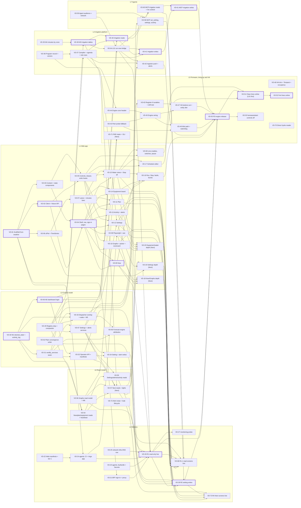

# Dashboard and irrigation execution plan

This plan builds the v2 design as 71 GitHub issues under one program epic, in seven lanes and four waves, arranged
for speed rather than ceremony. Contracts come first so lanes work in parallel from day one: screens build against the
committed OpenAPI file, a generated client and a fixture API, and the firmware builds against the irrigation program
record and its golden vectors. Thirteen issues can start today, at least one in every lane, and the wall
drip goes first: a run-now bridge (VD-64) waters L01 through the existing ESPHome button, and stops the wet lines
L01-L10, before the engine firmware exists. Production ships through the paths the repository already has: the web app
on its own auto-synced Argo app when its digest-pin PR merges, everything in `verdify-prod` through promote-and-sync,
and firmware through `make firmware-deploy`. Five releases mark the milestones: R1 puts the read-only dashboard live
at dashboard.verdify.ai with Now, R1.1 puts the other read screens, the water reads and the MCP irrigation reads live,
R2 turns on setting writes from people and agents, R3 ships the irrigation engine, so schedules set on the dashboard
run on the controller and the clean and fertilizer lines come online, and R4 puts the Next screens live. Each release
merges the web pin its screens need. There are no holds, soaks, observe modes or approval steps; the one switch is
`DASHBOARD_WRITES_ENABLED`.

Status: Draft v2 (2026-11-02; Round 2, 2b and the Q-01 to Q-14 defaults applied)

[README](README.md) · [product](product.md) · [screens](screens.md) · [architecture](architecture.md) ·
[irrigation](irrigation.md) · [design system](design-system.md) · **execution plan** ·
[OpenAPI](openapi/dashboard-api.v1.yaml) · [decisions](decisions.md) · [audit](audit.md)

Issue keys `VD-01` to `VD-73` and the program epic `VD-E0` are stable; `VD-35` and `VD-49` are retired and
never reused (§10). Lanes and waves are labels the filer applies on verdify-platform issues (`lane:dash-L1-web` to
`lane:dash-L7-agents`, `wave:dash-W1` to `wave:dash-W4`, `size:S`, `size:M` or `size:L`, and `epic:dashboard`;
namespaced because the repository already has `lane:L1-climate` and `wave:W1` from another plan, plus the existing
`area:web`, `area:ingestor` or `area:firmware` by lane). Every verdify-platform issue is a sub-issue of `VD-E0`; the
cross-repo issues (VD-23, VD-24, VD-25, VD-27 and VD-53) name it in their header and appear in its list, because
GitHub sub-issues need the same owner. Issues are filed from the machine-readable issue plan (each issue's summary,
stories, design references, dependencies and acceptance criteria) and link the design at the docs PR's head commit
(permalinks), so filing does not wait for the merge (Round 2 item 12, as applied 2026-11-02). Story ids are
[product](product.md) §6. Sizes S, M and L are relative; critical paths count them as 1, 2 and 3 points.

## 1. The answer

| Question | Answer |
|---|---|
| How is the work split? | Seven lanes with their own files: L1 Web app, L2 Delivery, L3 Control model, L4 Irrigation platform, L5 Firmware, bring-up and HA, L6 Read model, L7 Agents (§2) |
| What decouples them? | Four seams: the OpenAPI file with a generated client and fixture API, the irrigation program record with golden vectors, the desired-state schema, and the `verdify_services` conventions (§3) |
| Waves | W1 foundations (31 issues), W2 read-only dashboard live (20), W3 writes, schedules and the engine firmware (14), W4 the Next screens and the light meter (6) (§4) |
| Releases | R1 read-only dashboard with Now (VD-26), R1.1 every other read screen with the water and MCP irrigation reads (VD-68), R2 setting writes (VD-28), R3 engine firmware (VD-50), R4 the Next screens (VD-73); the web app ships when its digest-pin PR merges, and each release merges the pin its screens need (§5) |
| What waters first? | L01, through the run-now bridge (VD-64, 8 points), which also stops the wet lines L01-L10 before the engine (fog stays with the climate controller): MCP can run L01 and stop any wet line after the first promote-and-sync that follows its merge (R1's at the latest), the dashboard's Stop all water works on Now from R1 and on Water from R1.1, Run… on L01 works from the web pin that carries VD-16 once the writes flag is on (R2), and L01 is the first line scheduled once the engine ships (VD-51) |
| Critical path to the read-only dashboard | VD-01 → VD-02 → VD-04 → VD-09 → VD-26, 12 points, plus the coordinator's merge train and consolidated pin PR for VD-23 and VD-24 (§6) |
| Critical path to schedules from the dashboard | VD-30 → VD-66 → VD-38 → VD-40 → VD-41 → VD-61 → VD-50 → VD-51, 17 points; the release chain through R1 and R2 ties it at R3 (§6) |
| What starts today? | 13 issues in all seven lanes (§7) |
| What does Jason do? | Seal the Secrets and name the first agent, which runs in the cluster (VD-23; off-cluster agents are out of scope); one sign-in at R1 (VD-26); a look at the screens at R1.1 (VD-68) and R4 (VD-73); answer Q-11 (where the firmware compiles) before the R3 and PAR OTAs (VD-50, VD-71); the checks in VD-51 and VD-52; confirm the YINMIK meter is online and seal its device id and local key (VD-70); fit the PAR meter (VD-71). Nothing else waits on him |
| What is not here? | Holds, soak periods, observe or shadow modes, approval queues, review timers, calibration gates and OTA cadence rules |

## 2. Lanes

**Answer:** seven lanes, each owning its files, so most PRs never touch another lane's code. A lane runs more agents
when its files split cleanly; L1 holds the critical paths and runs three agents from day one and four once the
screens unlock.

| Lane | Owns | Provides to others | Issues | Agents |
|---|---|---|---|---|
| L1 Web app | `dashboard/` except the BFF files: `app/**` (routes, components, charts, `generated/`), `public/**`, `e2e/**`, `package.json`, `pnpm-lock.yaml`, Vite and TS config, `VENDORED-FROM-WEATHER.md` | Screens, components, charts, the typed client, the fixture API, the browser suite | VD-01 to VD-20, VD-69 (21) | 3, then 4 from VD-04's merge: foundation and charts; shell and controls; Water, which takes two agents once VD-15 lands |
| L2 Delivery | `dashboard/bff/**`, `dashboard/server.mjs`, `dashboard/security-headers.mjs`, `dashboard/Dockerfile`; `deploy/k8s/dashboard/**`; `verdify-tier1-apps-forward.yaml` and its test; `scripts/dashboard-smoke.sh`; the AGENTS.md, ARGOCD.md and OWNERSHIP.md rows and the dashboard runbooks; jvallery/agents, jvallery/network-infra, jvallery/monitoring-stack; the releases R1, R1.1, R2 and R4 (R3 is VD-50, in L5) | Sign-in and the proxy, the host and namespace, identity and Secrets, CI and the Argo app, the probe, releases R1, R1.1, R2 and R4 | VD-21 to VD-28, VD-68, VD-73 (10) | 1 |
| L3 Control model | The registry fields, `snap()` and the readback comparator in `verdify_schemas`; `verdify_services/{actor,activity,alerts,settings}.py`; `api/operator_api.py` and `api/operator_routes/writes.py`; the COPY lines in `api/Dockerfile` and `mcp/Dockerfile`; migrations M1, M2 and M5; `deploy/k8s/components/operator-api/**`; `deploy/k8s/base/networkpolicy.yaml`; `ingestor/tasks/dispatcher.py` and `bounded_reconcile.py`; `scripts/forecast-action-engine.py`; `docs/runbooks/writer-staged-reconcile.md` | `desired_state`, `activity_log` and the dashboard login; the services; the operator API; plain convergence; the dispatcher overlay and wake | VD-29 to VD-34, VD-62, VD-65 to VD-67 (10) | 3 in W1 (migrations and services; the operator API; plain convergence and the dispatcher), then 1 |
| L4 Irrigation platform | `verdify_schemas/irrigation.py` and its vectors; `verdify_services/irrigation/**`; `api/operator_routes/irrigation_{reads,writes}.py`; `ingestor/tasks/irrigation.py`; migrations M3 and M4; the irrigation alerts | The program record, compiler and agenda; the L01 bridge; minutes by zone and the ledger; irrigation reads and writes; push and commands | VD-36 to VD-42, VD-64 (8) | 2 |
| L5 Firmware, bring-up and HA | `firmware/**`; `ingestor/entity_map.py`; the HA code in `ingestor/tasks/ha.py` and `ingestor/tasks/_common.py`; `ingestor/occupancy.py`; the HA scripts; `deploy/k8s/components/ha-gap-backfill/`; the three control docs; jvallery/homeassistant; R3; field work | The engine firmware, the Home Assistant removal, the tunables drift test, the hydro reader, the light meter, the lines online | VD-43 to VD-48, VD-50 to VD-53, VD-63, VD-70, VD-71 (13) | 2: firmware (two firmware agents from VD-45's merge, so VD-46 and VD-47 run in parallel); HA and field |
| L6 Read model | `verdify_services/{reads,series}.py`; `api/operator_routes/{reads,series}.py`; migration M6; the ingestor heartbeat task; the probe-offline and leak-lifecycle sections of `ingestor/tasks/alerts.py` | Now, plan, equipment, settings, alerts, activity and graph reads | VD-54 to VD-57, VD-72 (5) | 1 |
| L7 Agents | `mcp/server.py` and `tests/test_mcp_*.py`; `hermes/iris/config.yaml`; `deploy/k8s/components/hermes-iris/hermes-config.yaml`; `scripts/gather-plan-context.sh` (its ConfigMap copy re-rendered by `scripts/gen-gather-configmap.py`); `ingestor/iris_planner.py`; `deploy/k8s/base/mcp-deployment.yaml` and the `allow-mcp-from-named-agents` policy | MCP tools for every agent, named agents, Iris's context | VD-58 to VD-61 (4) | 1 |

### 2.1 Shared files

| File | Rule |
|---|---|
| `db/migrations/` and the delivery files (`scripts/c0-migration-delivery.py`, `scripts/bootstrap-*-runtime-roles.py`, `deploy/k8s/components/runtime-role-boundary/`, `db/qualification/`, `tests/fixtures/*-native-qualification.json`, the unapplied set in `tests/test_experiment_schema_migration.py`) | Six additive migrations: M1 (VD-30), M2 (VD-66), M3 (VD-38), M4 (VD-39), M5 (VD-33) and M6 (VD-56), and later the light meter's (VD-71). Numbered at merge (279 is the last at design time); one per PR; never edit an applied one. Migration PRs merge one at a time: each registers at every site 279 uses (the next `SUCCESSOR_NNN`, both `reviewed_post_254()` tuples, the post-249 boundary row, the `expected_mcp` chain, `sealed_sql_NNN()` in both bootstrap scripts and the unapplied set), measured against its merged predecessor, so one merged in between forces re-measurement and renumbering. Each grants its new objects to the runtime logins that exist when it merges and re-seals the receipts its grants change; M2 grants the dashboard login every MVP and Next read that exists then |
| `verdify_services/__init__.py` | Whichever lane lands first creates it, empty |
| `api/operator_api.py` | L3 (VD-32). Route modules live in `api/operator_routes/` (not `api/operator/`, which would shadow the stdlib module) and carry no auth: VD-32 includes each with the session and role dependencies, and whichever PR lands first creates a module's stub |
| `ingestor/ingestor.py` | Registrations only: the L3 `desired_state_changed` channel; the L4 `irrigation_changed` channel and `irrigation_sync` task; the L6 heartbeat task; the L5 removals (the HA `tempest_sync` task, and `mqtt_loop` with its line in the main gather, VD-48) |
| `ingestor/tasks/irrigation.py` | L4 (VD-64 creates it, VD-42 extends it); L7 adds the context entry point (VD-60) |
| `ingestor/esp32_push.py` | L3 changes `_experiment_hold_failure` (VD-33); L4 adds the bridge, the program push and the command functions (VD-64, VD-42) |
| `ingestor/tasks/alerts.py`, `verdify_schemas/alerts.py` | Additive sections: the stuck-delivery alert (L3, VD-62), the irrigation alerts (L4, VD-42), the probe-offline cleanup and the leak alert's lifecycle (L6, VD-72). The leak `stopped_at` helper in `verdify_schemas/alerts.py` comes with VD-54 or VD-72, whichever merges first. A PR that adds an alert type adds its words to the dashboard words table once VD-04 has merged |
| `ingestor/entity_map.py` | L5; L4 adds the `irr_*` routes (VD-42) |
| `verdify_schemas/tunable_registry.py` | L3 adds fields (VD-29); L4 adds the `irrigation_site` rows (VD-37); L5 adds and retires rows (VD-63, VD-47) |
| Shared pure functions in `verdify_schemas` | VD-29 adds `snap()`, the readback comparator and `resolve_effective()`, the architecture §5.2 rule that VD-33, VD-54 and VD-67 all call; VD-40 adds `verdify_schemas.irrigation.line_state()`, which VD-60's Iris context also calls (the ingestor image has `verdify_schemas`, not `verdify_services`) |
| `scripts/ci-local.sh` | The only script the in-cluster validate step runs. Every PR that adds a test file adds it here (the curated pytest list, or the native firmware step, where VD-43 adds `make test-zone-vpd` and VD-44 `make test-irrigation-program`); VD-22 adds the four network tests CI skips today (`test_verdify_tier1_owner_exclusions.py`, `test_egress_deny_management.py`, `test_writer_outbound_boundary.py`, `test_mcp_egress_boundary.py`); VD-48 drops the deleted HA and Tempest tests. The fleet checks `firmware-logic` and `firmware-secretless-compile` do not run on this repository's PRs, so VD-43 also puts `make test-greenhouse-logic` and `make firmware-invariants` in the native firmware step; a firmware PR records its ESPHome compile with `scripts/firmware-release-job.py build`. Database tests are `tests/test_dashboard_db_*.py`, which run in VD-24's campaign step |
| `scripts/gather-plan-context.sh` | L7: VD-60 rewrites section 11 and VD-58 adds the MANUAL SETTINGS section; whichever merges second rebases. Its ConfigMap copy is re-rendered with `scripts/gen-gather-configmap.py` and the annotation with `scripts/gen-config-revision.sh`, never by hand |
| `deploy/k8s/overlays/prod/allow-ingestor-device-egress.yaml` | L5: VD-48 drops TCP 1883 to the Home Assistant broker; VD-70 adds the hydro meter's TCP 6668 rule; `tests/test_writer_outbound_boundary.py` follows each |
| `mcp/server.py` | L7; the L01 bridge (VD-64, L4) adds `irrigation_run` and `irrigation_stop` first, and VD-61 extends them |
| `deploy/k8s/overlays/prod/kustomization.yaml` | Component lines only (the operator-api line arrives in VD-26's wiring PR); the candidate `images:` entries belong to the pin actuator |
| `deploy/k8s/overlays/prod/release-pins.yaml` | Changed by `python3 scripts/promote-release-pins.py`, or by a digest-only rollback commit taken from a promotion receipt |
| `deploy/k8s/overlays/prod/egress-*.yaml`, `tests/test_egress_deny_management.py` | Additive changes; VD-48 removes `ha-gap-backfill` |
| `deploy/k8s/base/networkpolicy.yaml` | L3; VD-26's wiring PR adds operator-api to `allow-db-from-app`; VD-59's `allow-mcp-from-named-agents` is a new file |
| `deploy/k8s/SECRETS.md`, `OWNERSHIP.md` | Additive rows, each Secret with its Rotate line, in the PR that adds the consumer |
| `docs/design/dashboard/openapi/dashboard-api.v1.yaml` | Hand-maintained and canonical (R1). New operations and fields land here first, and any PR that changes it re-renders `dashboard/app/generated/operator-api.ts` with `contract-tools/generate.mjs` in the same PR, whatever its lane |
| `dashboard/package.json`, `dashboard/pnpm-lock.yaml` | L1. The lockfile comes from `pnpm install`, never a hand merge |
| `.agent-fleet/ci.yaml` | Generated in jvallery/agents and mirrored here only by its exact-copy commit (VD-24's); never hand-edited |

### 2.2 Working rules (existing ones; nothing new)

- One PR per issue where it fits. Batch fixes into one push, and rebase only when GitHub reports a conflict.
- Rule 6 (a `cfg_*` readback for every new tunable) and rule 7 (a restart line for PRs touching `verdify_schemas/**`,
  `ingestor/entity_map.py` or `mcp/server.py`) apply as usual.
- Image builds, browser suites, firmware compiles and the CI database run in-cluster; the Mac runs lint, type checks
  and small unit tests. The OTA compile inside `make firmware-deploy` follows Q-11: R3 and the PAR OTA ask Jason first,
  and nothing compiles on the Mac until he answers. `make test` and `make check` touch the live stack and are not part
  of this work.
- Every new test file is added to `scripts/ci-local.sh` in the same PR (the curated pytest list, or the native
  firmware step), because the in-cluster validate step runs only that script; the program's database tests are named
  `tests/test_dashboard_db_*.py` and run in VD-24's campaign step.
- Secret values live in the jvallery/agents KSOPS lanes; this repository names Secrets and keys only.
- A blocker counts as met once it merges to `main`. A cross-repo blocker (VD-23, VD-24, VD-25), a release blocker
  (VD-26, VD-68, VD-28, VD-50, VD-73) or a field blocker (VD-51) counts once its live check passes: the three
  `verdify-prod` Secrets present and read back value-blind (VD-23; R1 confirms `verdify-dashboard-web` once VD-24's
  Application has created its namespace), the Application Synced and Healthy after the consolidated pin PR (VD-24),
  DNS answering (VD-25), the release's live check (VD-26, VD-68, VD-28, VD-50, VD-73), the first scheduled L01 run and
  the promotion (VD-51). An issue is done when its acceptance holds live: the release issues run the live check of
  every backend issue they ship and record it on that issue, and an independent verifier closes it.
- The web ships only through a digest-only pin PR in `deploy/k8s/dashboard/kustomization.yaml`, and each release
  merges the one its screens need: R1 (VD-26) the first, carrying Now; R1.1 (VD-68) one carrying VD-10 to VD-15;
  R2 (VD-28) one carrying VD-12 and VD-13, if R1.1's did not; R3 (VD-50) one carrying VD-16; VD-51 one carrying
  VD-17 and VD-69, if R3's did not; and R4 (VD-73) one carrying VD-18 to VD-20. Each confirms `/readyz` reports the
  pinned commit.
- Releases follow the estate coordination rules: read the coordinator's steer and in-flight state before any
  jvallery/agents merge or Argo sync; hold the edge-write lock for a sync that changes NetworkPolicies or the tier-1
  route (R1 does); jvallery/agents PRs go through the coordinator's merge train, and their roots move only in its
  consolidated pin PR.

## 3. Seams

**Answer:** four contracts land first, so the lanes on each side build at the same time.

| Seam | Owner, issue | Unblocks |
|---|---|---|
| The OpenAPI file (hand-maintained, canonical), the generated TS client and the fixture API | The docs PR adds the file; L1, VD-02 renders the client and the fixture API | Every screen before its endpoint exists; the BFF proxy; the browser suite; the operator API's contract test |
| The irrigation program record and golden vectors | L4, VD-36 | The firmware decoder (VD-44), the compiler (VD-37) and the ingestor push (VD-42) in parallel |
| `desired_state` and `activity_log` | L3, VD-30 | The services, the dispatcher overlay, M2 and M3 in parallel |
| `verdify_services` conventions: `Actor`, one transaction per write with its activity row and request id, the Problem shape, auth-free route modules | L3, VD-31 | L4, L6 and L7 write services and adapters the same way, before the operator API exists |

## 4. Waves

**Answer:** four waves. A wave is a goal, not a gate: an issue starts as soon as its blockers are met (§2.2),
whatever its wave.

| Wave | Goal | Issues | Done when |
|---|---|---|---|
| W1 Foundations | Start every lane: contracts, scaffolds, migrations M1 to M4, services, the operator API, plain convergence, the L01 bridge, the cross-repo PRs, the engine core and the HA trim | VD-01 to VD-07, VD-21 to VD-25, VD-29 to VD-32, VD-36 to VD-39, VD-43, VD-44, VD-48, VD-54, VD-56, VD-59, VD-62 to VD-64, VD-66, VD-67 (31) | The shell runs on fixtures in CI; M1 to M4 and the operator API are merged; the Authentik app, Secrets, CI and Argo app are delivered; the program record and the engine core are merged; the L01 bridge is merged and, after its first promote-and-sync, runs L01 and stops any wet line from MCP |
| W2 Read-only dashboard live | R1 and R1.1, every read screen and endpoint, irrigation and MCP reads; the dispatcher overlay, the forecast-engine fix, the alert cleanup and the engine wiring continue | VD-08 to VD-15, VD-26, VD-27, VD-33, VD-40, VD-45 to VD-47, VD-55, VD-60, VD-65, VD-68, VD-72 (20) | R1 (VD-26) and R1.1 (VD-68) are done: R1 puts Now live, and R1.1's web pin puts Graphs, Plan, Settings, Activity, Equipment and Water (its reads and Stop all water) live, with every served read answering the viewer; MCP irrigation reads match the Water screen; the probe is green |
| W3 Writes, schedules and the engine firmware | R2, irrigation writes and the ingestor step, MCP writes, Water controls and the schedule editor, R3, the lines online, the Home Assistant side and the hydro reader | VD-16, VD-17, VD-28, VD-34, VD-41, VD-42, VD-50 to VD-53, VD-58, VD-61, VD-69, VD-70 (14) | R2 and R3 are done; L01, L04, L07 and L09 run on schedules set on the dashboard; L02, L08 and L10 feed with prewet and flush, and L05 and L06 stay reserved; Home Assistant keeps only occupancy, Lutron and, until VD-70, the hydro probe |
| W4 Next | The 9 Next stories, the light meter included, and R4 | VD-18 to VD-20, VD-57, VD-71, VD-73 (6) | R4 (VD-73) is done: the Next stories are live; DLI comes from the PAR meter once Jason fits it |

## 5. How it ships

**Answer:** through the paths that exist today. The web app ships when its digest-pin PR merges, `verdify-prod` by
promote-and-sync, and firmware by `make firmware-deploy`. Five releases carry the live checks.

| What | Path | Verified by |
|---|---|---|
| Web: `dashboard/**`, `deploy/k8s/dashboard/**` | Merge; in-cluster Kaniko builds `verdify-dashboard-web` (VD-24); a digest-only pin PR (the `sha-<12>` tag resolved on zot, as planner's pins are) updates `deploy/k8s/dashboard/kustomization.yaml`; the web ships when that PR merges and the `verdify-dashboard` app auto-syncs. Each release merges the pin its screens need (§2.2) | Argo Synced and Healthy at a revision that contains the pin; pods on the pinned digest; `/readyz` and the footer report the build commit; `scripts/dashboard-smoke.sh` |
| `verdify-prod`: operator API, MCP, ingestor, migrations, the tier-1 route | `python3 scripts/promote-release-pins.py`, merge, then the `verdify-prod-dark` full sync with prune off (ARGOCD.md, `docs/runbooks/laptop-operator.md` §2) | `scripts/k3s-smoke.sh smoke` (with its new operator-API check), then `device-monitor`; five minutes of ingestor logs without `ValidationError`; the live check of each shipped issue |
| Firmware | `make firmware-deploy`, which passes `FIRMWARE_DB_BACKEND` (default `kube`) to the preflight, the version wait and the sweep; where it compiles follows Q-11 | The `diagnostics.firmware_version` query (`docs/runbooks/laptop-operator.md` §3) and `irr_program_id` |
| Other repositories | Two PRs in jvallery/agents (VD-23, VD-24) through the coordinator's merge train; one each in jvallery/network-infra (VD-25), jvallery/monitoring-stack (VD-27) and jvallery/homeassistant (VD-53) | Merged and delivered: for jvallery/agents, the consolidated pin PR has moved the roots and the new Applications are Synced and Healthy; the others are applied through their own paths |

Merge rule: anything rendered by `overlays/prod` or built into the release-pinned images must be safe to run as soon
as it merges, because the next sync ships all of `main`. Inert until their data exists: M1 to M4 and M6, the
dispatcher overlay (no `desired_state` rows yet) and the irrigation push (no `irr_program_id` yet). Live at the next
sync: plain convergence (VD-62), the forecast-engine change (VD-65), M5, the HA trim with the MQTT removal (VD-48),
the alert cleanup (VD-72), VD-47's registry and route retirement (its follow-up, which retires the bridge's rows and
routes, merges only in VD-51 after the engine is promoted to last-good, because until then a rollback relies on the
bridge), Iris's context (VD-60), the L01 bridge (VD-64) and the MCP tools: `set_setting` from the first sync after
VD-58 (it reaches the device once VD-33 is live) and the irrigation write tools after VD-61. A new Secret reference
reaches `overlays/prod` only in the release issue that waits for its sealing (VD-26's wiring PR) or as an optional
reference that a missing Secret leaves idle (VD-70's hydro key), and a retired Secret leaves the role bootstrap before
it leaves KSOPS.

| Release | Issue | Waits for | Live check |
|---|---|---|---|
| R1 read-only | VD-26 | VD-09, VD-21, VD-23, VD-24, VD-25, VD-32, VD-55, VD-64 | The wiring PR once the Secrets exist; promote and sync (it carries the L01 bridge if that has not shipped, so Now's Stop all water works); smoke; `verdify-dashboard-secrets` Synced with `verdify-dashboard-web` present, then the first web pin; `dashboard-smoke`, whose minted viewer session reads `writes_enabled` false and gets 403 on a write; anonymous `/` answers 302 to `/auth/login`, which answers 302 to Authentik's authorize endpoint; Jason's one sign-in renders Now with live data. `DASHBOARD_WRITES_ENABLED` stays `"false"`; Stop is never gated by it |
| R1.1 read screens | VD-68 | VD-10, VD-11, VD-12, VD-13, VD-14, VD-15, VD-26, VD-56, VD-60 | Promote and sync the server side merged since R1; the web pin carrying VD-10 to VD-15, with `/readyz` reporting its commit; `dashboard-smoke`'s read sweep gets 200 from every served read as the viewer; Graphs, Plan, Settings, Activity, Equipment and Water show live data; MCP `irrigation_status` matches Water; Iris's section 11 renders with no Home Assistant call. If R1 already shipped the server side, R1.1 needs only the pin and the sweep |
| R2 setting writes | VD-28 | VD-12, VD-13, VD-26, VD-34, VD-58, VD-62, VD-65 | Promote and sync; VD-65's check that no forecast rule pushes over a MANUAL setting; the web pin carrying VD-12 and VD-13 if R1.1's did not; the one-line flag PR rolls the web pod to `writes_enabled: true` within 5 minutes; an operator setting goes REQUESTED → CONFIRMED and is released; an agent write from a labelled in-cluster Job shows as `agent:<name>`; a viewer write returns 403 |
| R3 irrigation engine | VD-50 | VD-16, VD-26, VD-28, VD-42, VD-46, VD-47, VD-61 | Platform first (inert until `irr_program_id` appears); the web pin carrying VD-16 (and VD-17 and VD-69 if merged); a manual setting written before the OTA; then the OTA, compiled where Q-11 says (R3 asks Jason first): `irr_engine` true, `src=rom`, then `src=nvs` after the first push; center VPD misting carries on; L01 run-now and stop from the dashboard and, as the named agent, MCP; the manual setting confirmed after the reconnect; bursts and Restart; the HA buttons gone. Writes are on from R2 |
| R4 Next screens | VD-73 | VD-18, VD-19, VD-20, VD-28, VD-57 | Promote and sync VD-57's server side (API-19 to API-21, API-06 zone, API-13 reasons, the forecast keys and `allow-setpoint-from-operator-api`) under the edge-write lock; smoke; the web pin carrying VD-18 to VD-20, with `/readyz` reporting its commit; `dashboard-smoke --sweep` gets 200 from API-19, API-21 and API-06 `zone=south` as the viewer; Jason looks at the Next screens; the API legs of the light switch and Revert run on `dashboard-smoke`'s operator session |

Every release reads the coordinator's steer first, lists the backend issues merged since the previous promotion
(the `release-pins.yaml` diff and `git log`) and records each one's live check on its issue.

**L01 first (Round 2 item 4).** VD-64 merges in W1. Ship it with its own promote-and-sync as soon as it merges; R1
waits for it and carries it if it has not shipped. A named agent can then run L01 and stop any wet line (L01-L10)
through MCP, the dashboard's Stop all water works on Now from R1 and on Water from R1.1, Run… on L01 works from the
web pin that carries VD-16 once the writes flag is on (R2), and L01 is the first line scheduled once the engine ships
(VD-51).

Rollback: for the web, merge a PR that reverts the offending commit or the pin commit; within one Argo refresh
`verdify-dashboard` runs the previous digest and `/readyz` reports the previous revision. To back out behaviour
without a release, merge a one-line change setting `DASHBOARD_WRITES_ENABLED` to `"false"` (Stop keeps working). For
`verdify-prod`, return api, mcp and ingestor (and the orchestrator if needed) to the promotion receipt's rollback
pins in a digest-only `release-pins.yaml` commit, keep a `verdify-migrate` digest whose image contains every applied
migration, then run the full sync and `scripts/k3s-smoke.sh smoke` against the rolled-back API digest. For firmware,
run `make firmware-rollback`; until VD-51 promotes the engine to last-good, that flashes pre-engine firmware: the
ingestor writes `irr_engine` false on the reconnect and falls back to the L01 bridge ("engine not on controller"), so
L01 runs and every wet line stops through it, while other runs, clear-fault and the bursts answer `unavailable`. VD-26
writes these steps into AGENTS.md "Deliver and verify".

## 6. Critical paths

**Answer:** the web shell sits on the R1, R1.1 and R2 paths, so L1 runs three agents from day one and four once the
screens unlock. R3 runs through the platform chain (16 points; schedules 17; feeds 19), tied by the release chain
through R1 and R2; the web chain through VD-16 is 1 point behind, and the firmware chain 3 behind if L5 runs two
firmware agents.

| Target | Chain | Points | Next longest |
|---|---|---|---|
| R1 read-only (VD-26) | VD-01 → VD-02 → VD-04 → VD-09 → VD-26 | 12, plus the coordinator's train for VD-23 and VD-24 | VD-30 → VD-31 → VD-67 → VD-55 → VD-26 (10); VD-30 → VD-66 → VD-38 → VD-64 → VD-26 (10); VD-30 → VD-66 → VD-32 → VD-26 (9); VD-01 → VD-21 → VD-26 (8) |
| L01 runs and every wet line stops from MCP (VD-64) | VD-30 → VD-66 → VD-38 → VD-64 | 8, then a promote-and-sync (R1's at the latest) | VD-30 → VD-31 → VD-64 (5) |
| R1.1 every read screen (VD-68) | VD-01 → VD-02 → VD-04 → VD-09 → VD-26 → VD-68 | 14 | VD-01 → VD-02 → VD-04 → VD-15 → VD-68 (13); VD-30 → VD-66 → VD-38 → VD-40 → VD-60 → VD-68 (13) |
| R2 setting writes (VD-28) | VD-01 → VD-02 → VD-04 → VD-09 → VD-26 → VD-28 | 14 | VD-01 → VD-02 → VD-04 → VD-12 → VD-28 (13) |
| R3 engine (VD-50) | VD-30 → VD-66 → VD-38 → VD-40 → VD-41 → VD-61 → VD-50 | 16 | Release chain, tied: VD-01 → VD-02 → VD-04 → VD-09 → VD-26 → VD-28 → VD-50 (16); web: VD-01 → VD-02 → VD-04 → VD-15 → VD-16 → VD-50 (15); firmware: VD-36 → VD-44 → VD-45 → VD-46 → VD-50 (13) |
| Schedules from the dashboard (VD-51) | VD-30 → VD-66 → VD-38 → VD-40 → VD-41 → VD-61 → VD-50 → VD-51 | 17 | The release chain through VD-28 ties it; VD-01 → VD-02 → VD-04 → VD-15 → VD-17 → VD-51 (15) |
| Feeds online (VD-52) | VD-30 → VD-66 → VD-38 → VD-40 → VD-41 → VD-61 → VD-50 → VD-51 → VD-52 | 19 | The release chain ties it |
| R4 Next screens (VD-73) | VD-01 → VD-02 → VD-04 → VD-09 → VD-26 → VD-28 → VD-73 | 16 | VD-01 → VD-02 → VD-04 → VD-10 → VD-18 → VD-73 (15) |

What keeps them short:

- After VD-01, run VD-02 and VD-03 side by side and start VD-06, then VD-07, on another agent. VD-04 then unlocks
  seven screens at once, so L1 adds its fourth agent there.
- Water takes two L1 agents once VD-15 lands: VD-16 and VD-17 run in parallel, then VD-69.
- L3 runs three agents in W1 (migrations and services; the operator API; plain convergence and the dispatcher) until
  VD-32 merges.
- L4 starts VD-36 and VD-39 today; VD-64 and VD-40 run side by side once M3 lands; VD-42 follows VD-64, and VD-41
  follows VD-40 on the platform chain to R3.
- L5 writes VD-44's logic from irrigation §4-§5 while VD-36's vectors are in review, and runs two firmware agents from
  VD-45's merge so VD-46 and VD-47 run in parallel. With one firmware agent the firmware chain reaches
  14 points before R3, so R3 keeps 16 but loses its slack.
- Raise VD-23 in jvallery/agents on day one, and VD-24 once VD-01 and VD-22 merge: the coordinator's merge train and
  consolidated pin PR are the one wait that points do not show.
- R1 waits only for Now, its endpoints and the L01 bridge (Now's Stop all water). R1.1 (VD-68) pins the other read
  screens and promotes their endpoints; R2 and R3 pin the write screens they turn on, and R4 (VD-73) the Next
  screens.

## 7. Start today

**Answer:** these 13 W1 issues have no blockers, at least one in every lane.

| Issue | Title | Lane |
|---|---|---|
| VD-01 | Scaffold dashboard/ from weather.vallery.net | L1 Web app |
| VD-22 | Add deploy/k8s/dashboard/ and exclude dashboard.verdify.ai from the tier-1 route | L2 Delivery |
| VD-23 | Add the Authentik application, dashboard groups and sealed Secrets in jvallery/agents | L2 Delivery |
| VD-25 | Add dashboard.verdify.ai to the verdify.ai zone in jvallery/network-infra | L2 Delivery |
| VD-29 | Add the registry step, snapping and the grid-aware readback comparator | L3 Control model |
| VD-30 | Add migration M1: desired state and the activity log | L3 Control model |
| VD-62 | Replace the bounded-reconcile halt gate with plain convergence | L3 Control model |
| VD-36 | Freeze the irrigation program record: layout, packer, parsers and golden vectors | L4 Irrigation platform |
| VD-39 | Add migration M4: minutes by zone from today's relay runs | L4 Irrigation platform |
| VD-43 | Add the peer-probe VPD fallback to the firmware | L5 Firmware, bring-up and HA |
| VD-48 | Trim Home Assistant on the platform side to occupancy, Lutron and the hydro probe | L5 Firmware, bring-up and HA |
| VD-56 | Serve graphs: metric registry, series, equipment states, band and the scorecard view (API-03 to -06) | L6 Read model |
| VD-59 | Add the agent audience: named agent keys, request actors and the MCP network path | L7 Agents |

Also unblocked, for when a lane has room: VD-70 (W3), VD-72 (W2).

The docs PR adds `docs/design/dashboard/openapi/dashboard-api.v1.yaml` and is the first merge once the B-POWER freeze
clears. VD-02 (the client and fixture API) and VD-32 (the operator API's contract test) branch from it and merge after
it; everything else that needs the file waits through them.

## 8. Dependency graph

Edges point from a blocker to what it unblocks; thick borders mark the critical paths to R1, R3 and the feeds (§6),
both tying R3 chains included. These 9 edges are implied by others and kept on purpose, because each names a direct
use: VD-29 → VD-12 (the fixture generator reads TunableDef.label and unit directly); VD-05 → VD-17 (the schedule
editor uses VD-05's drawer and hooks directly); VD-62 → VD-28 (R2's live check needs plain convergence); VD-37 → VD-41
(the writes validate with VD-37's models and bounds); VD-43 → VD-46 (zone choice uses VD-43's fallback); VD-26 → VD-50
(R3 reuses R1's wiring and dashboard-smoke); VD-67 → VD-58 (set_setting and alerts wrap VD-67's services); VD-05 →
VD-69 (the line controls use VD-05's hooks directly); VD-57 → VD-73 (R4 ships VD-57's server side).

## 9. Story coverage

**Answer:** every MVP and Next story in [product](product.md) has at least one issue: 75 MVP and 9 Next
stories. The 9 Later stories have none.

| Area | MVP stories | Next stories | Issues |
|---|---|---|---|
| NOW | 7: NOW-01, NOW-02, NOW-03, NOW-04, NOW-06, NOW-07, NOW-08 | 1: NOW-05 | VD-03, VD-04, VD-08, VD-09, VD-14 to VD-16, VD-18, VD-26, VD-39, VD-40, VD-54, VD-55, VD-57, VD-62, VD-64, VD-68, VD-72, VD-73 |
| GRF | 6: GRF-01, GRF-02, GRF-03, GRF-04, GRF-07, GRF-09 | 3: GRF-05, GRF-06, GRF-10 | VD-01, VD-03, VD-06, VD-07, VD-10, VD-18, VD-39, VD-40, VD-48, VD-56, VD-57, VD-68, VD-71, VD-73 |
| PLN | 3: PLN-01, PLN-02, PLN-03 | 0: — | VD-07, VD-09, VD-11, VD-54, VD-65, VD-68 |
| WAT | 22: WAT-01, WAT-02, WAT-03, WAT-04, WAT-05, WAT-06, WAT-07, WAT-08, WAT-09, WAT-10, WAT-11, WAT-12, WAT-13, WAT-14, WAT-15, WAT-16, WAT-17, WAT-18, WAT-19, WAT-21, WAT-22, WAT-23 | 1: WAT-20 | VD-04, VD-05, VD-07, VD-09, VD-12, VD-13, VD-15 to VD-17, VD-20, VD-36 to VD-46, VD-48, VD-50 to VD-52, VD-54, VD-57, VD-61, VD-64, VD-68, VD-69, VD-72, VD-73 |
| SET | 5: SET-01, SET-02, SET-03, SET-04, SET-05 | 2: SET-06, SET-07 | VD-03, VD-05, VD-11, VD-12, VD-19, VD-28 to VD-30, VD-33, VD-34, VD-47, VD-50, VD-54, VD-55, VD-57, VD-58, VD-62, VD-63, VD-65 to VD-68, VD-73 |
| ACT | 4: ACT-01, ACT-02, ACT-03, ACT-04 | 0: — | VD-03, VD-05, VD-09, VD-13, VD-30, VD-31, VD-34, VD-55, VD-58, VD-65 to VD-68, VD-72 |
| EQP | 2: EQP-01, EQP-06 | 2: EQP-02, EQP-05 | VD-14, VD-16, VD-20, VD-41, VD-42, VD-47, VD-48, VD-50, VD-54, VD-57, VD-68, VD-73 |
| AUTH | 4: AUTH-01, AUTH-02, AUTH-03, AUTH-04 | 0: — | VD-04, VD-12, VD-21, VD-23, VD-26, VD-32, VD-34, VD-66 |
| AGT | 8: AGT-01, AGT-02, AGT-03, AGT-04, AGT-05, AGT-06, AGT-07, AGT-08 | 0: — | VD-11 to VD-13, VD-17, VD-23, VD-28, VD-30, VD-31, VD-34, VD-37, VD-40, VD-41, VD-55, VD-58 to VD-61, VD-64, VD-67, VD-68 |
| PLAT | 14: PLAT-01, PLAT-02, PLAT-03, PLAT-04, PLAT-05, PLAT-06, PLAT-07, PLAT-08, PLAT-09, PLAT-10, PLAT-11, PLAT-12, PLAT-13, PLAT-14 | 0: — | VD-01, VD-02, VD-04 to VD-06, VD-08, VD-10, VD-21 to VD-28, VD-30 to VD-33, VD-36, VD-38, VD-42, VD-47, VD-48, VD-50, VD-53, VD-56, VD-58, VD-60, VD-62, VD-64, VD-66 to VD-68, VD-70, VD-73 |

## 10. Work items

Filed 2026-11-02: the program epic is [#1120](https://github.com/VerdifyConsultancy/verdify-platform/issues/1120); the Issue column links every issue.

One epic, `VD-E0` (Program: dashboard.verdify.ai and the irrigation program). Every verdify-platform issue is its
sub-issue; the cross-repo issues (VD-23, VD-24, VD-25, VD-27 and VD-53) name it in their header and appear in its
list, because GitHub sub-issues need the same owner. Its body carries §2, §4, §6 and §8. Lanes and waves are labels.
Retired keys, never reused: VD-35 (replan now is Later; its grow-light route moved to VD-57, revert reuses API-10 and
API-11, and the band preview read moved to VD-57), VD-49 (merged into VD-48: the Tempest already reaches the platform
through the ESP32, Round 2 item 6) and the lane epics VD-E1 to VD-E7 (replaced by labels). Design references name the
doc section each issue builds; the issue bodies follow the issue template (What, Why it matters, User stories,
Technical design, Architecture requirements, Acceptance criteria, Dependencies, References, Definition of done).

| Id | Issue | Title | Repo | Lane | Wave | Size | Depends on | Design |
|---|---|---|---|---|---|---|---|---|
| VD-01 | [#1121](https://github.com/VerdifyConsultancy/verdify-platform/issues/1121) | Scaffold dashboard/ from weather.vallery.net | verdify-platform | L1 | W1 | L | none | design-system §8, design-system §2, architecture §3, architecture §10 |
| VD-02 | [#1122](https://github.com/VerdifyConsultancy/verdify-platform/issues/1122) | Generate the typed API client and a fixture API from the committed OpenAPI | verdify-platform | L1 | W1 | M | VD-01 | architecture §8, architecture §12, screens §1.5 |
| VD-03 | [#1123](https://github.com/VerdifyConsultancy/verdify-platform/issues/1123) | Build the content components and the state vocabulary | verdify-platform | L1 | W1 | M | VD-01 | design-system §4, design-system §4.1, design-system §4.2, design-system §4.5 |
| VD-04 | [#1124](https://github.com/VerdifyConsultancy/verdify-platform/issues/1124) | Build the app shell, navigation, global status and sign-in pages | verdify-platform | L1 | W1 | L | VD-02, VD-03 | screens §1.1, screens §1.2, screens §1.3, screens SCR-09, design-system §3, design-system §6 |
| VD-05 | [#1125](https://github.com/VerdifyConsultancy/verdify-platform/issues/1125) | Build the form controls, edit drawer, water confirm dialog and write hooks | verdify-platform | L1 | W1 | M | VD-02, VD-03 | design-system §4.3, design-system §4.4, design-system §4.5, screens §1.4 |
| VD-06 | [#1126](https://github.com/VerdifyConsultancy/verdify-platform/issues/1126) | Build the uPlot chart foundation and the TimeSeries chart | verdify-platform | L1 | W1 | L | VD-01 | design-system §5, design-system §5.1, design-system §5.2, design-system §5.3, design-system §5.4 |
| VD-07 | [#1127](https://github.com/VerdifyConsultancy/verdify-platform/issues/1127) | Add the equipment and plan lanes and the minutes-by-zone bars | verdify-platform | L1 | W1 | M | VD-06 | design-system §5.2 |
| VD-08 | [#1128](https://github.com/VerdifyConsultancy/verdify-platform/issues/1128) | Run Playwright and axe against the fixture API in in-cluster CI | verdify-platform | L1 | W2 | M | VD-04, VD-24 | design-system §7, architecture §12 |
| VD-09 | [#1129](https://github.com/VerdifyConsultancy/verdify-platform/issues/1129) | Build the Now screen (SCR-01) | verdify-platform | L1 | W2 | M | VD-04, VD-05 | screens SCR-01, design-system §4 |
| VD-10 | [#1130](https://github.com/VerdifyConsultancy/verdify-platform/issues/1130) | Build the Graphs screen (SCR-02) with the metric picker and the daily scorecard | verdify-platform | L1 | W2 | L | VD-04, VD-07 | screens SCR-02, design-system §5.2 |
| VD-11 | [#1131](https://github.com/VerdifyConsultancy/verdify-platform/issues/1131) | Build the Plan screen (SCR-03) | verdify-platform | L1 | W2 | M | VD-04, VD-07 | screens SCR-03 |
| VD-12 | [#1132](https://github.com/VerdifyConsultancy/verdify-platform/issues/1132) | Build the Settings screen (SCR-05) with the edit drawer | verdify-platform | L1 | W2 | L | VD-04, VD-05, VD-29, VD-37 | screens SCR-05, design-system §4.2, design-system §4.6 |
| VD-13 | [#1133](https://github.com/VerdifyConsultancy/verdify-platform/issues/1133) | Build the Activity and alerts screen (SCR-06) | verdify-platform | L1 | W2 | M | VD-04, VD-05 | screens SCR-06 |
| VD-14 | [#1134](https://github.com/VerdifyConsultancy/verdify-platform/issues/1134) | Build the Equipment board (SCR-07) | verdify-platform | L1 | W2 | M | VD-04, VD-07 | screens SCR-07 |
| VD-15 | [#1135](https://github.com/VerdifyConsultancy/verdify-platform/issues/1135) | Build the Water screen (SCR-04): read views and Stop all water | verdify-platform | L1 | W2 | L | VD-04, VD-05, VD-07 | screens SCR-04, irrigation §9, design-system §4.6 |
| VD-16 | [#1136](https://github.com/VerdifyConsultancy/verdify-platform/issues/1136) | Add Run now, Stop, Clear fault, bursts and restart | verdify-platform | L1 | W3 | M | VD-08, VD-09, VD-14, VD-15 | screens SCR-04, screens SCR-07, screens SCR-01, screens §1.4 |
| VD-17 | [#1137](https://github.com/VerdifyConsultancy/verdify-platform/issues/1137) | Build the schedule editor with the week-view preview | verdify-platform | L1 | W3 | L | VD-05, VD-15 | screens SCR-04, irrigation §4.3 |
| VD-18 | [#1138](https://github.com/VerdifyConsultancy/verdify-platform/issues/1138) | Add Now and Graphs depth: coming up, zones and outdoor | verdify-platform | L1 | W4 | M | VD-08, VD-09, VD-10, VD-57 | screens SCR-01, screens SCR-02 |
| VD-19 | [#1139](https://github.com/VerdifyConsultancy/verdify-platform/issues/1139) | Add Settings depth: setting history, revert and the band preview | verdify-platform | L1 | W4 | M | VD-06, VD-12, VD-57 | screens SCR-05 |
| VD-20 | [#1140](https://github.com/VerdifyConsultancy/verdify-platform/issues/1140) | Add Equipment and water depth: why, grow lights and daily water use | verdify-platform | L1 | W4 | M | VD-08, VD-13, VD-14, VD-15, VD-57 | screens SCR-07, screens SCR-04 |
| VD-21 | [#1141](https://github.com/VerdifyConsultancy/verdify-platform/issues/1141) | Add BFF sign-in, sessions, the Origin check, the writes flag and the /api/v1 proxy | verdify-platform | L2 | W1 | L | VD-01 | architecture §3, architecture §4, architecture §11 |
| VD-22 | [#1142](https://github.com/VerdifyConsultancy/verdify-platform/issues/1142) | Add deploy/k8s/dashboard/ and exclude dashboard.verdify.ai from the tier-1 route | verdify-platform | L2 | W1 | M | none | architecture §10, architecture §5.7 |
| VD-23 | [jvallery/agents#5993](https://github.com/jvallery/agents/issues/5993) | Add the Authentik application, dashboard groups and sealed Secrets in jvallery/agents | jvallery/agents | L2 | W1 | M | none | architecture §4, architecture §10 |
| VD-24 | [jvallery/agents#5994](https://github.com/jvallery/agents/issues/5994) | Register the web image, its checks and the verdify-dashboard Argo app in jvallery/agents | jvallery/agents | L2 | W1 | L | VD-01, VD-22 | architecture §10, architecture §12 |
| VD-25 | [jvallery/network-infra#933](https://github.com/jvallery/network-infra/issues/933) | Add dashboard.verdify.ai to the verdify.ai zone in jvallery/network-infra | jvallery/network-infra | L2 | W1 | S | none | architecture §10 |
| VD-26 | [#1143](https://github.com/VerdifyConsultancy/verdify-platform/issues/1143) | Ship R1: put the read-only dashboard live at dashboard.verdify.ai | verdify-platform | L2 | W2 | M | VD-09, VD-21, VD-23, VD-24, VD-25, VD-32, VD-55, VD-64 | architecture §10, product J8 |
| VD-27 | [jvallery/monitoring-stack#1371](https://github.com/jvallery/monitoring-stack/issues/1371) | Add dashboard.verdify.ai to the route-coverage probe in jvallery/monitoring-stack | jvallery/monitoring-stack | L2 | W2 | S | VD-26 | architecture §10, architecture §11 |
| VD-28 | [#1144](https://github.com/VerdifyConsultancy/verdify-platform/issues/1144) | Ship R2: turn on dashboard setting writes and verify agent writes | verdify-platform | L2 | W3 | M | VD-12, VD-13, VD-26, VD-34, VD-58, VD-62, VD-65 | architecture §5.7, architecture §10 |
| VD-29 | [#1145](https://github.com/VerdifyConsultancy/verdify-platform/issues/1145) | Add the registry step, snapping and the grid-aware readback comparator | verdify-platform | L3 | W1 | M | none | architecture §5.3, architecture §5.5 |
| VD-30 | [#1146](https://github.com/VerdifyConsultancy/verdify-platform/issues/1146) | Add migration M1: desired state and the activity log | verdify-platform | L3 | W1 | M | none | architecture §5.1, architecture §9 |
| VD-31 | [#1147](https://github.com/VerdifyConsultancy/verdify-platform/issues/1147) | Create verdify_services with Actor, activity and the shared write conventions | verdify-platform | L3 | W1 | S | VD-30 | architecture §6, architecture §5.3 |
| VD-32 | [#1148](https://github.com/VerdifyConsultancy/verdify-platform/issues/1148) | Stand up the operator API on :8090 with sessions, roles and its verdify-prod manifests | verdify-platform | L3 | W1 | L | VD-31, VD-66 | architecture §2, architecture §8, architecture §10, architecture §11 |
| VD-33 | [#1149](https://github.com/VerdifyConsultancy/verdify-platform/issues/1149) | Apply desired state in the dispatcher and wake it on desired_state_changed | verdify-platform | L3 | W2 | L | VD-29, VD-30, VD-62 | architecture §5.2 |
| VD-34 | [#1150](https://github.com/VerdifyConsultancy/verdify-platform/issues/1150) | Add the setting and alert write endpoints (API-10, -11, -15, -16) | verdify-platform | L3 | W3 | M | VD-32, VD-67 | architecture §5.4, architecture §8 |
| VD-36 | [#1151](https://github.com/VerdifyConsultancy/verdify-platform/issues/1151) | Freeze the irrigation program record: layout, packer, parsers and golden vectors | verdify-platform | L4 | W1 | M | none | irrigation §5, irrigation §6.2 |
| VD-37 | [#1152](https://github.com/VerdifyConsultancy/verdify-platform/issues/1152) | Write the irrigation compiler, bounds and agenda | verdify-platform | L4 | W1 | M | VD-29, VD-36 | irrigation §4.1, irrigation §4.2, irrigation §4.3 |
| VD-38 | [#1153](https://github.com/VerdifyConsultancy/verdify-platform/issues/1153) | Add migration M3: irrigation tables, seeds and grants | verdify-platform | L4 | W1 | M | VD-39, VD-66 | irrigation §4.1, irrigation §3, architecture §9 |
| VD-39 | [#1154](https://github.com/VerdifyConsultancy/verdify-platform/issues/1154) | Add migration M4: minutes by zone from today's relay runs | verdify-platform | L4 | W1 | M | none | irrigation §6.2, irrigation §4.1 |
| VD-40 | [#1155](https://github.com/VerdifyConsultancy/verdify-platform/issues/1155) | Serve the irrigation reads (API-IRR-01, -02, -10, -11) | verdify-platform | L4 | W2 | L | VD-37, VD-38, VD-67 | irrigation §8.1, irrigation §6.2, architecture §5.5, architecture §7 |
| VD-41 | [#1156](https://github.com/VerdifyConsultancy/verdify-platform/issues/1156) | Add the irrigation write services and API-IRR-03 to -08, -12 and -13 | verdify-platform | L4 | W3 | L | VD-37, VD-40, VD-64 | irrigation §8.3, irrigation §4.7, irrigation §8.1 |
| VD-42 | [#1157](https://github.com/VerdifyConsultancy/verdify-platform/issues/1157) | Compile, push and command from the ingestor, and add the irrigation alerts | verdify-platform | L4 | W3 | L | VD-33, VD-37, VD-64 | irrigation §6.1, irrigation §6.2, irrigation §6.3 |
| VD-43 | [#1158](https://github.com/VerdifyConsultancy/verdify-platform/issues/1158) | Add the peer-probe VPD fallback to the firmware | verdify-platform | L5 | W1 | M | none | irrigation §5, irrigation §4.4 |
| VD-44 | [#1159](https://github.com/VerdifyConsultancy/verdify-platform/issues/1159) | Write the engine core header irrigation_program.h with native tests | verdify-platform | L5 | W1 | L | VD-36 | irrigation §4.5, irrigation §4.6, irrigation §4.7, irrigation §5 |
| VD-45 | [#1160](https://github.com/VerdifyConsultancy/verdify-platform/issues/1160) | Wire the engine: irrigation_engine.yaml, services, published state, NVS and relay grants | verdify-platform | L5 | W2 | L | VD-43, VD-44 | irrigation §5, irrigation §4.7 |
| VD-46 | [#1161](https://github.com/VerdifyConsultancy/verdify-platform/issues/1161) | Rework the mist path: membership, scheduled pulses, occupancy, survival fog and the D-IRP-19 watchdog | verdify-platform | L5 | W2 | L | VD-43, VD-45 | irrigation §5, irrigation §4.4, irrigation §4.6, irrigation §4.7 |
| VD-47 | [#1162](https://github.com/VerdifyConsultancy/verdify-platform/issues/1162) | Remove the Home Assistant buttons, add manual_override and retire the old irrigation entities | verdify-platform | L5 | W2 | L | VD-45, VD-63 | irrigation §5, irrigation §7 |
| VD-48 | [#1163](https://github.com/VerdifyConsultancy/verdify-platform/issues/1163) | Trim Home Assistant on the platform side to occupancy, Lutron and the hydro probe | verdify-platform | L5 | W1 | M | none | irrigation §7, decisions Round 2 |
| VD-50 | [#1164](https://github.com/VerdifyConsultancy/verdify-platform/issues/1164) | Ship R3: deploy the irrigation platform and flash the engine firmware | verdify-platform | L5 | W3 | M | VD-16, VD-26, VD-28, VD-42, VD-46, VD-47, VD-61 | irrigation §5, architecture §10 |
| VD-51 | [#1165](https://github.com/VerdifyConsultancy/verdify-platform/issues/1165) | Bring the clean lines online: L01 first, then L04, L07 and L09 | verdify-platform | L5 | W3 | S | VD-17, VD-50, VD-69 | irrigation §3, decisions Round 2 |
| VD-52 | [#1166](https://github.com/VerdifyConsultancy/verdify-platform/issues/1166) | Bring the fertilizer lines online: L02 with L03, then L08 and L10 | verdify-platform | L5 | W3 | M | VD-51 | irrigation §3, decisions Round 2 |
| VD-53 | [jvallery/homeassistant#1096](https://github.com/jvallery/homeassistant/issues/1096) | Remove the greenhouse controls from Home Assistant | jvallery/homeassistant | L5 | W3 | S | VD-50 | irrigation §7 |
| VD-54 | [#1167](https://github.com/VerdifyConsultancy/verdify-platform/issues/1167) | Serve the Now, plan and equipment reads (API-02, -07, -13) and the ingestor heartbeat | verdify-platform | L6 | W1 | L | VD-29, VD-30 | architecture §7, architecture §8 |
| VD-55 | [#1168](https://github.com/VerdifyConsultancy/verdify-platform/issues/1168) | Serve the settings, alerts and activity reads (API-09, -12, -14, -17) | verdify-platform | L6 | W2 | M | VD-54, VD-67 | architecture §8, architecture §5.5, architecture §7 |
| VD-56 | [#1169](https://github.com/VerdifyConsultancy/verdify-platform/issues/1169) | Serve graphs: metric registry, series, equipment states, band and the scorecard view (API-03 to -06) | verdify-platform | L6 | W1 | L | none | architecture §7, architecture §9 |
| VD-57 | [#1170](https://github.com/VerdifyConsultancy/verdify-platform/issues/1170) | Serve the Next screens' reads and the grow-light switch | verdify-platform | L6 | W4 | M | VD-32, VD-38, VD-54, VD-56, VD-67 | screens SCR-01, screens SCR-02, screens SCR-04, screens SCR-05, screens SCR-07 |
| VD-58 | [#1171](https://github.com/VerdifyConsultancy/verdify-platform/issues/1171) | Add set_setting, settings and activity to MCP | verdify-platform | L7 | W3 | L | VD-55, VD-59, VD-67 | architecture §5.6, architecture §6 |
| VD-59 | [#1172](https://github.com/VerdifyConsultancy/verdify-platform/issues/1172) | Add the agent audience: named agent keys, request actors and the MCP network path | verdify-platform | L7 | W1 | M | none | architecture §5.6, architecture §10 |
| VD-60 | [#1173](https://github.com/VerdifyConsultancy/verdify-platform/issues/1173) | Add the irrigation read tools and Iris's irrigation context | verdify-platform | L7 | W2 | M | VD-40, VD-64 | irrigation §8.2, irrigation §6.4, irrigation §7 |
| VD-61 | [#1174](https://github.com/VerdifyConsultancy/verdify-platform/issues/1174) | Add the irrigation write tools for every agent | verdify-platform | L7 | W3 | M | VD-41, VD-60 | irrigation §8.2, irrigation §8.3, architecture §5.6 |
| VD-62 | [#1175](https://github.com/VerdifyConsultancy/verdify-platform/issues/1175) | Replace the bounded-reconcile halt gate with plain convergence | verdify-platform | L3 | W1 | M | none | architecture §5.2, decisions Round 2 |
| VD-63 | [#1176](https://github.com/VerdifyConsultancy/verdify-platform/issues/1176) | Register or retire the firmware tunables outside the registry, and add the tunables drift test | verdify-platform | L5 | W1 | S | VD-29 | architecture §5.3 |
| VD-64 | [#1177](https://github.com/VerdifyConsultancy/verdify-platform/issues/1177) | Run L01 now and stop any wet line through the bridge, ahead of the engine | verdify-platform | L4 | W1 | M | VD-31, VD-38, VD-59 | irrigation §6.5, irrigation §6.1, architecture §5.8, decisions Round 2 |
| VD-65 | [#1178](https://github.com/VerdifyConsultancy/verdify-platform/issues/1178) | Attribute the forecast action engine and take it off the fast path | verdify-platform | L3 | W2 | S | VD-31, VD-33 | architecture §5.2 |
| VD-66 | [#1179](https://github.com/VerdifyConsultancy/verdify-platform/issues/1179) | Add migration M2: the dashboard login and sessions | verdify-platform | L3 | W1 | M | VD-30 | architecture §9, architecture §7 |
| VD-67 | [#1180](https://github.com/VerdifyConsultancy/verdify-platform/issues/1180) | Add the settings and alerts services | verdify-platform | L3 | W1 | L | VD-29, VD-31 | architecture §5.3, architecture §5.5, architecture §5.2, architecture §6 |
| VD-68 | [#1181](https://github.com/VerdifyConsultancy/verdify-platform/issues/1181) | Ship R1.1: put every read screen, the water reads and the MCP irrigation reads live | verdify-platform | L2 | W2 | M | VD-10, VD-11, VD-12, VD-13, VD-14, VD-15, VD-26, VD-56, VD-60 | architecture §10, architecture §8 |
| VD-69 | [#1182](https://github.com/VerdifyConsultancy/verdify-platform/issues/1182) | Add line enables, mister switches, caps and pause | verdify-platform | L1 | W3 | M | VD-05, VD-15 | screens SCR-04, design-system §4.6 |
| VD-70 | [#1183](https://github.com/VerdifyConsultancy/verdify-platform/issues/1183) | Read the YINMIK hydroponic probe directly, without Home Assistant | verdify-platform | L5 | W3 | M | none | irrigation §7, decisions Round 2 |
| VD-71 | [#1184](https://github.com/VerdifyConsultancy/verdify-platform/issues/1184) | Add a PAR light meter: hardware, firmware, ingest and DLI | verdify-platform | L5 | W4 | L | VD-56, VD-66 | decisions Round 2, architecture §7 |
| VD-72 | [#1185](https://github.com/VerdifyConsultancy/verdify-platform/issues/1185) | Clean up alert noise, and keep the leak alert open until someone resolves it | verdify-platform | L6 | W2 | M | none | decisions Round 2, architecture §7, product J6 |
| VD-73 | [#1186](https://github.com/VerdifyConsultancy/verdify-platform/issues/1186) | Ship R4: put the Next screens live | verdify-platform | L2 | W4 | M | VD-18, VD-19, VD-20, VD-28, VD-57 | architecture §10, screens SCR-01, screens SCR-05, screens SCR-07 |
