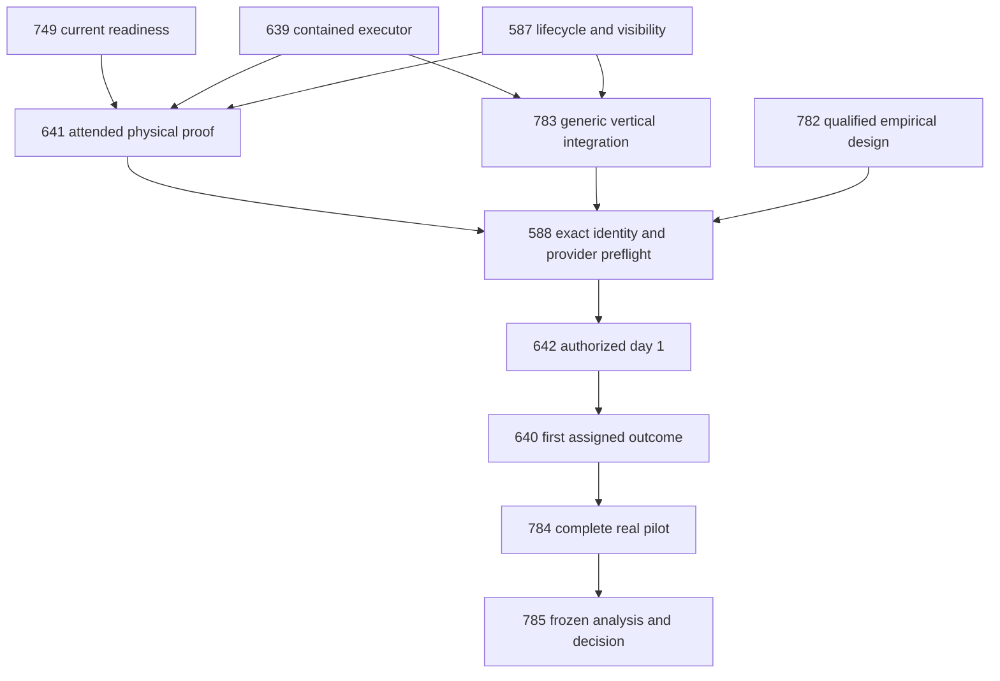

# Campaign implementation strategy

The [October 17 replan](reviews/2026-10-17-replan/README.md) governs current execution. The source is `planning/backlog.yaml`; generated root views, issue bodies and the native graph are projections of that source. Earlier dated plans remain history. Preserve their receipts and failures without treating old source identities, authorizations or schedules as current.

## Current pull order

S3 runs October 19–30 with 80 shared hours. Its eight packets are #749, #981, #980, #639, #587, #802, #977 and #782, estimated at 29–58 hours with 22 hours contingency against the upper bound. [The sprint plan](reviews/2026-10-17-replan/NEXT-SPRINT.md) defines owner roles, cadence and stop conditions. Closed #396, #419, #643, #644, #801 and other accepted predecessors are not repeated.

Use one product delivery lane, one independent infrastructure owner lane and one preparation lane. Queue order limits work in progress; it is not a false technical dependency. If #749 is waiting for an actual owner disposition, continue ready diagnosis or containment preparation. #368 is an alternate bounded source repair, charged against the same capacity.

## Parallel qualification paths

#639 and #587 share one admitted device-denied run. #641 owns their former real-device epoch, rescue, exclusivity and final handoff clauses; this prevents a hidden successor/predecessor cycle. #783 can qualify the generic interface before the final science input decision, while #588 rebinds and checks exact final design compatibility and actual provider behavior before one draw. [The scope ledger](reviews/2026-10-17-replan/SCOPE-TRANSFERS.md) records these boundaries.

The current candidate calendar is June 1–July 30, 2027, with an exploratory nine-control-state endpoint. It is not an approved launch commitment. Missing authentic input evidence keeps #782 open; a prospective collection decision is only the bounded sprint result. #981 still gates claims that actually use energy and #787's future economics; it is not a blanket prerequisite for the selected control-state design.

## Delivery and evidence

Use current source, actual operational identities, approved custody and repository-supported in-cluster execution. Confirm capacity, namespace, target, admission and data access before intensive work. Serialize schema migrations, product writers, shared CI and promotions. Preserve original source, build, runtime, failed-attempt and recovery evidence.

Current source/image delivery, current runtime behavior, real physical proof and scientific acceptance are separate claims. A healthy Application does not settle #749's original readiness criteria, and a healthy exporter does not settle backup freshness. A physical abort can be safely recovered while still failing proof acceptance.

## Deferred work

C6/C7 control and physical commissioning work remains issue-specific and condition-triggered. Maintain actual missing sensor visibility; do not make every hardware repair a prerequisite for truthful three-probe readiness. Future twin, comparator, economics and optional database cutover work has an explicit selection decision and no current implementation commitment.

The seven earlier retired alternatives remain closed with their successor/no-build dispositions. Parentage expresses ownership. Closed predecessor records remain history and do not block active execution. The current exact graph is [here](reviews/2026-10-17-replan/DEPENDENCIES.md).
