# Complete blocking dependency graph

The [current reviewed native graph](reviews/2026-10-17-s3-execution/DEPENDENCIES.md) includes independent local issues and transitive cross-repository predecessors. The canonical 93-issue/73-edge campaign graph is retained below.

Generated from [backlog.yaml](backlog.yaml). An arrow means **predecessor must finish before dependent acceptance/activation**, not parentage. Isolated nodes are included so coverage is auditable. Read [CAMPAIGN.md](CAMPAIGN.md) for the smaller critical path.

```mermaid
flowchart TD
  subgraph C0["C0: Measurement and incident truth"]
    i775["#775 (open) Campaign: trustworthy greenhouse outcomes → qualified pilo"]
    i778["#778 (closed) Investigate September 4 hot/dry peak and three-hour wettin"]
    i371["#371 (closed) Repair climate score semantics and publish physical outcom"]
    i424["#424 (closed) Resolve served, consumed and raw-readback band lineage wit"]
    i779["#779 (closed) Re-run historical planner comparisons on a fixed sensor pa"]
    i780["#780 (closed) Score as-of outdoor forecasts against outdoor truth and se"]
    i781["#781 (closed) Commission a claim-safe water and electricity endpoint con"]
    i782["#782 (open) Finish the empirical inputs and frozen exploratory scienti"]
  end
  subgraph C1["C1: Recovery and integrated physical qualification"]
    i750["#750 (open) Recovery/proof campaign: rebaseline current state and seal"]
    i747["#747 (closed) Verify corrected scheduled backups and current production "]
    i749["#749 (open) Qualify current three-probe readiness and explicit safety "]
    i641["#641 (open) Complete one fresh attended physical baseline–target–basel"]
    i639["#639 (open) Qualify the component executor, exclusivity and recovery b"]
    i587["#587 (open) Qualify lifecycle authority and blinded monitoring in cont"]
    i783["#783 (open) Qualify the complete current-login selector-to-frozen-anal"]
  end
  subgraph C2["C2: Seasonal design lock and randomized start"]
    i581["#581 (open) Complete the bounded AI-admission pilot and publish a deci"]
    i588["#588 (open) Bind exact scientific/runtime identity and finalize one in"]
    i642["#642 (open) Activate and verify one randomized day 1 from the locked p"]
  end
  subgraph C3["C3: Complete pilot and decision report"]
    i640["#640 (open) Freeze and reconcile the first real assigned-day outcome a"]
    i784["#784 (open) Operate the full blinded assigned-day pilot with immutable"]
    i785["#785 (open) Reveal once, reproduce the frozen analysis and decide the "]
  end
  subgraph C4["C4: Delivery and runtime reliability"]
    i644["#644 (closed) Integrate exact-SHA, path-aware and device-safe delivery r"]
    i322["#322 (closed) Replace remaining VM-era tests with current k3s delivery c"]
    i304["#304 (closed) Provide reproducible least-authority firmware and database"]
    i303["#303 (closed) Run real portable ESPHome compilation for declared firmwar"]
    i390["#390 (open) Gate firmware releases on topology, cycling, runtime safet"]
    i433["#433 (closed) Finish truthful single-writer command lifecycle and no-rec"]
    i427["#427 (closed) Prove active Hermes/MCP recovery and truthful non-authorit"]
    i75["#75 (open) Observability program: prove actionable health from source"]
    i563["#563 (closed) Enforce the actual ConfigMap-based alert delivery contract"]
    i394["#394 (closed) Deliver and fault-test live split-brain and no-writer aler"]
    i89["#89 (closed) Verify exact-source post-deploy smoke and device-route hea"]
    i671["#671 (closed) Make Lab publishing failures and cache contention observab"]
    i399["#399 (closed) Prove the HA grow-light writer remains within the single-w"]
    i419["#419 (closed) Populate real outdoor freshness in replay and enforce bran"]
    i386["#386 (open) Prove grow-light minimum-on behavior at the solar-window b"]
    i949["#949 (closed) Bound planner-policy drift holds and prove autonomous safe"]
    i950["#950 (closed) Restore the ingestor Slack credential-file contract and op"]
    i951["#951 (closed) Restore authenticated greenhouse camera snapshots after co"]
    i952["#952 (closed) Preserve Verdify Grafana monitoring identity across pod re"]
    i953["#953 (closed) Reconcile Iris planning skill lookup and required referenc"]
    i835["#835 (closed) Fix reconnect equipment snapshot provenance and stale rela"]
    i862["#862 (closed) Lab publisher: warm-cache init rescans the public tree for"]
    i964["#964 (closed) Recover failed production promotion and schedulable Lab/ba"]
    i965["#965 (closed) Separate API grow-light command intent from observed equip"]
    i963["#963 (open) Bound moisture-exchange state and preserve structured cons"]
    i976["#976 (closed) Qualify safe recovery of Lab publication receipt metadata"]
    i980["#980 (open) Resolve backup-exporter readiness timeouts without obscuri"]
    i981["#981 (open) Restore truthful energy source freshness and trace stale m"]
    i802["#802 (open) Adopt the enforcing descheduler under manual Argo ownershi"]
  end
  subgraph C5["C5: Durability and least privilege"]
    i218["#218 (open) Durability program: recoverable backups, measured RPO/RTO "]
    i670["#670 (closed) Make backup artifacts sufficient to restore roles, ownersh"]
    i672["#672 (closed) Make compressed-chunk ownership restoration a supported bl"]
    i382["#382 (closed) Persist ingestor queue and spool across restart and node l"]
    i396["#396 (closed) Design and rehearse CNPG alongside the live database on cu"]
    i245["#245 (open) Execute a separately bounded database cutover only after p"]
    i643["#643 (closed) Extend least-privilege database roles beyond the already-r"]
    i49["#49 (closed) Audit and close historical suppressed sensor alerts withou"]
    i977["#977 (closed) Decide the database replica policy before November 12; kee"]
  end
  subgraph C6["C6: Evidence-led control and irrigation"]
    i359["#359 (open) Control program: truthful crop corridors before evidence-l"]
    i430["#430 (open) Simplify firmware only while preserving autonomous control"]
    i428["#428 (open) Diagnose heap/watchdog risk and qualify the actual last-go"]
    i368["#368 (open) Define shared sensor jump, flatline and contributor-integr"]
    i367["#367 (open) Consolidate anti-chatter into one explicit dwell contract"]
    i370["#370 (open) Consolidate equipment conflict resolution into one pure ar"]
    i369["#369 (open) Remove dead tunables and code from a verified consumer inv"]
    i324["#324 (closed) Extend zonal band lineage compatibly for future determinis"]
    i410["#410 (open) Measure realized solar-night dry-out before changing the c"]
    i378["#378 (open) Decide corridor widths from fixed-target crop and resource"]
    i361["#361 (closed) Reassess diurnal anchors only after solar parity and measu"]
    i214["#214 (closed) Prove crop-deviation trigger → valid plan on the sole oper"]
    i350["#350 (open) Irrigation program: topology truth, overwatering protectio"]
    i434["#434 (open) Enforce center-only climate mist and commissioned wall-onl"]
    i299["#299 (open) Preserve center-mister re-fire protection through topology"]
    i297["#297 (open) Add saturation alerts and a commissioned dispatcher-side d"]
    i296["#296 (closed) Consider slow-hysteresis firmware irrigation feedback only"]
  end
  subgraph C7["C7: Physical and seasonal commissioning"]
    i16["#16 (open) Hardware program: commission only the sensing and equipmen"]
    i751["#751 (open) Replace the failed south climate probe and diagnose hydro "]
    i298["#298 (open) Rebaseline actual crop, pot and probe topology before feed"]
    i398["#398 (open) Replace stale soil threshold seeds with commissioned crop/"]
    i45["#45 (open) Commission soil and runoff feedback before enabling irriga"]
    i51["#51 (open) Calibrate CO2 against a real reference and publish measure"]
    i52["#52 (open) Define species-appropriate seasonal dormancy care from ope"]
    i412["#412 (open) Close the seasonal door screen only when measured night co"]
  end
  subgraph C8["C8: Comparator and full resource claim"]
    i174["#174 (closed) Rehome only current Verdify admin surfaces to global SSO, "]
    i14["#14 (open) Twin program: qualify declared oracle coverage before usin"]
    i31["#31 (open) Close twin setpoint and actuator coverage gaps with genera"]
    i606["#606 (closed) Register the twin build profile only through its owning fl"]
    i638["#638 (closed) Unify future manifest/vector wire schema and content ident"]
    i586["#586 (closed) Qualify a future atomic firmware policy engine with crash-"]
    i786["#786 (open) Decide whether a deterministic forecast comparator merits "]
    i379["#379 (open) Gate grey-box forecasting and MPC on validated response mo"]
    i787["#787 (open) Decide and scope a measured heating/overnight/resource stu"]
  end
  i371 --> i779
  i424 --> i749
  i778 --> i749
  i949 --> i749
  i749 --> i641
  i639 --> i641
  i587 --> i641
  i747 --> i641
  i371 --> i782
  i779 --> i782
  i780 --> i782
  i781 --> i782
  i639 --> i783
  i587 --> i783
  i641 --> i588
  i782 --> i588
  i783 --> i588
  i588 --> i642
  i642 --> i640
  i640 --> i784
  i784 --> i785
  i964 --> i644
  i304 --> i303
  i322 --> i303
  i303 --> i390
  i419 --> i390
  i433 --> i427
  i563 --> i394
  i563 --> i89
  i303 --> i386
  i670 --> i672
  i670 --> i396
  i672 --> i396
  i382 --> i245
  i396 --> i245
  i670 --> i643
  i433 --> i428
  i424 --> i368
  i390 --> i367
  i367 --> i370
  i390 --> i369
  i433 --> i369
  i424 --> i324
  i371 --> i324
  i371 --> i410
  i419 --> i410
  i424 --> i410
  i785 --> i378
  i371 --> i378
  i378 --> i361
  i410 --> i361
  i427 --> i214
  i780 --> i214
  i299 --> i434
  i390 --> i299
  i45 --> i297
  i297 --> i296
  i434 --> i296
  i45 --> i296
  i298 --> i398
  i398 --> i45
  i638 --> i586
  i390 --> i586
  i785 --> i586
  i785 --> i786
  i780 --> i786
  i786 --> i379
  i371 --> i379
  i419 --> i379
  i785 --> i787
  i410 --> i787
  i981 --> i787
  i781 --> i787
```

## Exact edge list

| Predecessor | Dependent |
|---|---|
| [#371](https://github.com/VerdifyConsultancy/verdify-platform/issues/371) (closed) | [#779](https://github.com/VerdifyConsultancy/verdify-platform/issues/779) (closed) |
| [#424](https://github.com/VerdifyConsultancy/verdify-platform/issues/424) (closed) | [#749](https://github.com/VerdifyConsultancy/verdify-platform/issues/749) (open) |
| [#778](https://github.com/VerdifyConsultancy/verdify-platform/issues/778) (closed) | [#749](https://github.com/VerdifyConsultancy/verdify-platform/issues/749) (open) |
| [#949](https://github.com/VerdifyConsultancy/verdify-platform/issues/949) (closed) | [#749](https://github.com/VerdifyConsultancy/verdify-platform/issues/749) (open) |
| [#749](https://github.com/VerdifyConsultancy/verdify-platform/issues/749) (open) | [#641](https://github.com/VerdifyConsultancy/verdify-platform/issues/641) (open) |
| [#639](https://github.com/VerdifyConsultancy/verdify-platform/issues/639) (open) | [#641](https://github.com/VerdifyConsultancy/verdify-platform/issues/641) (open) |
| [#587](https://github.com/VerdifyConsultancy/verdify-platform/issues/587) (open) | [#641](https://github.com/VerdifyConsultancy/verdify-platform/issues/641) (open) |
| [#747](https://github.com/VerdifyConsultancy/verdify-platform/issues/747) (closed) | [#641](https://github.com/VerdifyConsultancy/verdify-platform/issues/641) (open) |
| [#371](https://github.com/VerdifyConsultancy/verdify-platform/issues/371) (closed) | [#782](https://github.com/VerdifyConsultancy/verdify-platform/issues/782) (open) |
| [#779](https://github.com/VerdifyConsultancy/verdify-platform/issues/779) (closed) | [#782](https://github.com/VerdifyConsultancy/verdify-platform/issues/782) (open) |
| [#780](https://github.com/VerdifyConsultancy/verdify-platform/issues/780) (closed) | [#782](https://github.com/VerdifyConsultancy/verdify-platform/issues/782) (open) |
| [#781](https://github.com/VerdifyConsultancy/verdify-platform/issues/781) (closed) | [#782](https://github.com/VerdifyConsultancy/verdify-platform/issues/782) (open) |
| [#639](https://github.com/VerdifyConsultancy/verdify-platform/issues/639) (open) | [#783](https://github.com/VerdifyConsultancy/verdify-platform/issues/783) (open) |
| [#587](https://github.com/VerdifyConsultancy/verdify-platform/issues/587) (open) | [#783](https://github.com/VerdifyConsultancy/verdify-platform/issues/783) (open) |
| [#641](https://github.com/VerdifyConsultancy/verdify-platform/issues/641) (open) | [#588](https://github.com/VerdifyConsultancy/verdify-platform/issues/588) (open) |
| [#782](https://github.com/VerdifyConsultancy/verdify-platform/issues/782) (open) | [#588](https://github.com/VerdifyConsultancy/verdify-platform/issues/588) (open) |
| [#783](https://github.com/VerdifyConsultancy/verdify-platform/issues/783) (open) | [#588](https://github.com/VerdifyConsultancy/verdify-platform/issues/588) (open) |
| [#588](https://github.com/VerdifyConsultancy/verdify-platform/issues/588) (open) | [#642](https://github.com/VerdifyConsultancy/verdify-platform/issues/642) (open) |
| [#642](https://github.com/VerdifyConsultancy/verdify-platform/issues/642) (open) | [#640](https://github.com/VerdifyConsultancy/verdify-platform/issues/640) (open) |
| [#640](https://github.com/VerdifyConsultancy/verdify-platform/issues/640) (open) | [#784](https://github.com/VerdifyConsultancy/verdify-platform/issues/784) (open) |
| [#784](https://github.com/VerdifyConsultancy/verdify-platform/issues/784) (open) | [#785](https://github.com/VerdifyConsultancy/verdify-platform/issues/785) (open) |
| [#964](https://github.com/VerdifyConsultancy/verdify-platform/issues/964) (closed) | [#644](https://github.com/VerdifyConsultancy/verdify-platform/issues/644) (closed) |
| [#304](https://github.com/VerdifyConsultancy/verdify-platform/issues/304) (closed) | [#303](https://github.com/VerdifyConsultancy/verdify-platform/issues/303) (closed) |
| [#322](https://github.com/VerdifyConsultancy/verdify-platform/issues/322) (closed) | [#303](https://github.com/VerdifyConsultancy/verdify-platform/issues/303) (closed) |
| [#303](https://github.com/VerdifyConsultancy/verdify-platform/issues/303) (closed) | [#390](https://github.com/VerdifyConsultancy/verdify-platform/issues/390) (open) |
| [#419](https://github.com/VerdifyConsultancy/verdify-platform/issues/419) (closed) | [#390](https://github.com/VerdifyConsultancy/verdify-platform/issues/390) (open) |
| [#433](https://github.com/VerdifyConsultancy/verdify-platform/issues/433) (closed) | [#427](https://github.com/VerdifyConsultancy/verdify-platform/issues/427) (closed) |
| [#563](https://github.com/VerdifyConsultancy/verdify-platform/issues/563) (closed) | [#394](https://github.com/VerdifyConsultancy/verdify-platform/issues/394) (closed) |
| [#563](https://github.com/VerdifyConsultancy/verdify-platform/issues/563) (closed) | [#89](https://github.com/VerdifyConsultancy/verdify-platform/issues/89) (closed) |
| [#303](https://github.com/VerdifyConsultancy/verdify-platform/issues/303) (closed) | [#386](https://github.com/VerdifyConsultancy/verdify-platform/issues/386) (open) |
| [#670](https://github.com/VerdifyConsultancy/verdify-platform/issues/670) (closed) | [#672](https://github.com/VerdifyConsultancy/verdify-platform/issues/672) (closed) |
| [#670](https://github.com/VerdifyConsultancy/verdify-platform/issues/670) (closed) | [#396](https://github.com/VerdifyConsultancy/verdify-platform/issues/396) (closed) |
| [#672](https://github.com/VerdifyConsultancy/verdify-platform/issues/672) (closed) | [#396](https://github.com/VerdifyConsultancy/verdify-platform/issues/396) (closed) |
| [#382](https://github.com/VerdifyConsultancy/verdify-platform/issues/382) (closed) | [#245](https://github.com/VerdifyConsultancy/verdify-platform/issues/245) (open) |
| [#396](https://github.com/VerdifyConsultancy/verdify-platform/issues/396) (closed) | [#245](https://github.com/VerdifyConsultancy/verdify-platform/issues/245) (open) |
| [#670](https://github.com/VerdifyConsultancy/verdify-platform/issues/670) (closed) | [#643](https://github.com/VerdifyConsultancy/verdify-platform/issues/643) (closed) |
| [#433](https://github.com/VerdifyConsultancy/verdify-platform/issues/433) (closed) | [#428](https://github.com/VerdifyConsultancy/verdify-platform/issues/428) (open) |
| [#424](https://github.com/VerdifyConsultancy/verdify-platform/issues/424) (closed) | [#368](https://github.com/VerdifyConsultancy/verdify-platform/issues/368) (open) |
| [#390](https://github.com/VerdifyConsultancy/verdify-platform/issues/390) (open) | [#367](https://github.com/VerdifyConsultancy/verdify-platform/issues/367) (open) |
| [#367](https://github.com/VerdifyConsultancy/verdify-platform/issues/367) (open) | [#370](https://github.com/VerdifyConsultancy/verdify-platform/issues/370) (open) |
| [#390](https://github.com/VerdifyConsultancy/verdify-platform/issues/390) (open) | [#369](https://github.com/VerdifyConsultancy/verdify-platform/issues/369) (open) |
| [#433](https://github.com/VerdifyConsultancy/verdify-platform/issues/433) (closed) | [#369](https://github.com/VerdifyConsultancy/verdify-platform/issues/369) (open) |
| [#424](https://github.com/VerdifyConsultancy/verdify-platform/issues/424) (closed) | [#324](https://github.com/VerdifyConsultancy/verdify-platform/issues/324) (closed) |
| [#371](https://github.com/VerdifyConsultancy/verdify-platform/issues/371) (closed) | [#324](https://github.com/VerdifyConsultancy/verdify-platform/issues/324) (closed) |
| [#371](https://github.com/VerdifyConsultancy/verdify-platform/issues/371) (closed) | [#410](https://github.com/VerdifyConsultancy/verdify-platform/issues/410) (open) |
| [#419](https://github.com/VerdifyConsultancy/verdify-platform/issues/419) (closed) | [#410](https://github.com/VerdifyConsultancy/verdify-platform/issues/410) (open) |
| [#424](https://github.com/VerdifyConsultancy/verdify-platform/issues/424) (closed) | [#410](https://github.com/VerdifyConsultancy/verdify-platform/issues/410) (open) |
| [#785](https://github.com/VerdifyConsultancy/verdify-platform/issues/785) (open) | [#378](https://github.com/VerdifyConsultancy/verdify-platform/issues/378) (open) |
| [#371](https://github.com/VerdifyConsultancy/verdify-platform/issues/371) (closed) | [#378](https://github.com/VerdifyConsultancy/verdify-platform/issues/378) (open) |
| [#378](https://github.com/VerdifyConsultancy/verdify-platform/issues/378) (open) | [#361](https://github.com/VerdifyConsultancy/verdify-platform/issues/361) (closed) |
| [#410](https://github.com/VerdifyConsultancy/verdify-platform/issues/410) (open) | [#361](https://github.com/VerdifyConsultancy/verdify-platform/issues/361) (closed) |
| [#427](https://github.com/VerdifyConsultancy/verdify-platform/issues/427) (closed) | [#214](https://github.com/VerdifyConsultancy/verdify-platform/issues/214) (closed) |
| [#780](https://github.com/VerdifyConsultancy/verdify-platform/issues/780) (closed) | [#214](https://github.com/VerdifyConsultancy/verdify-platform/issues/214) (closed) |
| [#299](https://github.com/VerdifyConsultancy/verdify-platform/issues/299) (open) | [#434](https://github.com/VerdifyConsultancy/verdify-platform/issues/434) (open) |
| [#390](https://github.com/VerdifyConsultancy/verdify-platform/issues/390) (open) | [#299](https://github.com/VerdifyConsultancy/verdify-platform/issues/299) (open) |
| [#45](https://github.com/VerdifyConsultancy/verdify-platform/issues/45) (open) | [#297](https://github.com/VerdifyConsultancy/verdify-platform/issues/297) (open) |
| [#297](https://github.com/VerdifyConsultancy/verdify-platform/issues/297) (open) | [#296](https://github.com/VerdifyConsultancy/verdify-platform/issues/296) (closed) |
| [#434](https://github.com/VerdifyConsultancy/verdify-platform/issues/434) (open) | [#296](https://github.com/VerdifyConsultancy/verdify-platform/issues/296) (closed) |
| [#45](https://github.com/VerdifyConsultancy/verdify-platform/issues/45) (open) | [#296](https://github.com/VerdifyConsultancy/verdify-platform/issues/296) (closed) |
| [#298](https://github.com/VerdifyConsultancy/verdify-platform/issues/298) (open) | [#398](https://github.com/VerdifyConsultancy/verdify-platform/issues/398) (open) |
| [#398](https://github.com/VerdifyConsultancy/verdify-platform/issues/398) (open) | [#45](https://github.com/VerdifyConsultancy/verdify-platform/issues/45) (open) |
| [#638](https://github.com/VerdifyConsultancy/verdify-platform/issues/638) (closed) | [#586](https://github.com/VerdifyConsultancy/verdify-platform/issues/586) (closed) |
| [#390](https://github.com/VerdifyConsultancy/verdify-platform/issues/390) (open) | [#586](https://github.com/VerdifyConsultancy/verdify-platform/issues/586) (closed) |
| [#785](https://github.com/VerdifyConsultancy/verdify-platform/issues/785) (open) | [#586](https://github.com/VerdifyConsultancy/verdify-platform/issues/586) (closed) |
| [#785](https://github.com/VerdifyConsultancy/verdify-platform/issues/785) (open) | [#786](https://github.com/VerdifyConsultancy/verdify-platform/issues/786) (open) |
| [#780](https://github.com/VerdifyConsultancy/verdify-platform/issues/780) (closed) | [#786](https://github.com/VerdifyConsultancy/verdify-platform/issues/786) (open) |
| [#786](https://github.com/VerdifyConsultancy/verdify-platform/issues/786) (open) | [#379](https://github.com/VerdifyConsultancy/verdify-platform/issues/379) (open) |
| [#371](https://github.com/VerdifyConsultancy/verdify-platform/issues/371) (closed) | [#379](https://github.com/VerdifyConsultancy/verdify-platform/issues/379) (open) |
| [#419](https://github.com/VerdifyConsultancy/verdify-platform/issues/419) (closed) | [#379](https://github.com/VerdifyConsultancy/verdify-platform/issues/379) (open) |
| [#785](https://github.com/VerdifyConsultancy/verdify-platform/issues/785) (open) | [#787](https://github.com/VerdifyConsultancy/verdify-platform/issues/787) (open) |
| [#410](https://github.com/VerdifyConsultancy/verdify-platform/issues/410) (open) | [#787](https://github.com/VerdifyConsultancy/verdify-platform/issues/787) (open) |
| [#981](https://github.com/VerdifyConsultancy/verdify-platform/issues/981) (open) | [#787](https://github.com/VerdifyConsultancy/verdify-platform/issues/787) (open) |
| [#781](https://github.com/VerdifyConsultancy/verdify-platform/issues/781) (closed) | [#787](https://github.com/VerdifyConsultancy/verdify-platform/issues/787) (open) |

Closed #676 remains historical qualification evidence, not an open blocker. Cross-repository fleet/monitoring delivery is a concrete implementation interface in the relevant issues, not a fabricated in-repository node. Physical windows and minimum live-state invariants remain explicit issue conditions.
