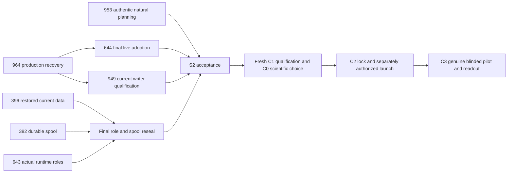

# S2 completion sprint — recover production and finish qualification

Finish the existing S2 milestone rather than start a new platform rewrite. Seven open issues, **46–88 remaining engineering hours**, with one shared production delivery lane. These are judgment ranges after reusing landed work, not a promised calendar duration; the earlier 24-hour target was not achieved and is not silently reset.

| Order / issue | Remaining hours | Concrete exit |
|---|---:|---|
| 1 — #964 promotion and placement recovery | 8–16 | Supported owner-coordinated Lab/band placement; exact intended render/running images and successful full hooks/operation; Synced/Healthy; three natural fresh publisher runs and band-refresh cadence; current passive writer proof. |
| 2 — #949 halted policy regression | 8–12 | Preserve exact halted-run/error/approval custody; bounded current disposition/recovery; authentic natural or scoped new plan convergence, terminal delivery truth and two steady hours at exact source. Never raise the 12-command cap or replay expired approval. |
| #644 exact-source delivery | 8–16 | Finish bounded owner PR #4747 integration, actual authority separation, success/failure/cancel/retry/concurrency and immutable deployed-consumer/rollback receipts. #964 precedes final live adoption acceptance; do independent owner work earlier. |
| #396 current recovery | 8–16 | Reuse intact current-275 A/B reseals; complete authentic endpoint reversal, final whole-data/77-sequence/42-study reseal and measured restore/PITR/failover/cutover-option packet. No production DB cutover. |
| #382 durable events | 6–12 | Final adopted-image committed replay/crash/conflict and restart/node-loss/capacity/backlog/format inverse, no unexplained loss/fabricated confirmation, measured recovery and full post-fixture reseal. |
| #643 real runtime roles | 6–12 | Every actual runtime login completes allowed/denied operations, endpoint reversal/pool-close and rollback proof without credential output; recovery data remains intact. |
| #953 Iris natural cycle | 2–4 | Reuse102/102 mounted inventory; join an authentic required trigger/session/valid persisted plan, prove zero required-reference/alias retries and preserve ledger integrity. No forced provider calls. |
| **Total** | **46–88** | **All seven complete original acceptance; no partial closure to meet an estimate.** |

#49 is removed from open sprint work because its exact cleanup is accepted. It retains closed membership/history in S2. #949 and #964 are added. The five other existing S2 issues remain. Stage labels and original owner/parent/dependency semantics are retained. #963/#965 are explicit subsequent C4 work, not forgotten or implicitly accepted.

The join diagram is an execution schedule, not extra native gates between mutually dependent tasks. Native #644→#964 blocking and #749→#949 predecessor relationships are explicit. Neither containing epic nor an entire fleet umbrella is made a blocker. Independent evidence/source work can proceed while one production change is attended; serialize migrations, image promotions and writer changes.

Pull #964 first: source/live recovery is a current service defect, not another speculative qualification framework. Refresh exact UID/RV/spec/cache/PVC identities before executing the existing recovery assessment. Coordinate NFS/node/CSI changes in their owner; if unavailable, continue independent qualifications without touching those resources. Preserve old Ready Lab pods/cache and original DB/PVCs. Do not use full sync to smuggle unrelated drift.

S2 acceptance requires each original clause, exact source/config/digests, appropriate ledger/hooks, successful Argo operation, product behavior, real recovery evidence and unambiguous single-writer proof. Publish failed attempts as well as passes. An UNKNOWN census, Ready-only CNPG proof, completed-only Job, fixture-only physical claim or stale Lab200 is not accepted.

After S2, complete #963/#965 and the remaining C4 criteria, fresh #639/#587/#749, empirical #782 and whole-path #783. Readiness/executor/lifecycle qualification supports separately attended #641; physical proof and scientific/vertical evidence meet at immutable #588 before #642. Follow the native graph rather than adding a design gate to independent physical proof. #640/#784/#785 then require genuine assigned-day time and blinded reproducibility. C6–C8 stay owned with their actual seasonal/physical/study boundaries. [STATUS.md](STATUS.md) preserves the full original-goal scope; [GOAL.md](GOAL.md) is the fresh-session execution contract.
