# S3 execution dependency graph

Full native readback at 2026-10-18T03:24:33Z: **48 open Verdify issues**, **27 active completion edges** (26 local and one actual Home Assistant dependency), plus **25 retained closed predecessor records**. Every issue and dependency connection was untruncated. All local active edges equal planning source. [Native receipt](native-graph-readback.json); [normalized graph](graph.json).

An arrow gates dependent acceptance, not all preparation. Home Assistant #878 is an external native predecessor, not a fabricated campaign node. #977 and #980 are accepted closed deliveries; the sprint remains in progress.

```mermaid
flowchart TD
  i14["#14 Twin program: qualify declared oracle coverage before using "]
  i16["#16 Hardware program: commission only the sensing and equipment "]
  i31["#31 Close twin setpoint and actuator coverage gaps with generate"]
  i45["#45 Commission soil and runoff feedback before enabling irrigati"]
  i51["#51 Calibrate CO2 against a real reference and publish measureme"]
  i52["#52 Define species-appropriate seasonal dormancy care from opera"]
  i75["#75 Observability program: prove actionable health from source t"]
  i218["#218 Durability program: recoverable backups, measured RPO/RTO an"]
  i245["#245 Execute a separately bounded database cutover only after par"]
  i297["#297 Add saturation alerts and a commissioned dispatcher-side dri"]
  i298["#298 Rebaseline actual crop, pot and probe topology before feedba"]
  i299["#299 Preserve center-mister re-fire protection through topology a"]
  i350["#350 Irrigation program: topology truth, overwatering protection "]
  i359["#359 Control program: truthful crop corridors before evidence-led"]
  i367["#367 Consolidate anti-chatter into one explicit dwell contract"]
  i368["#368 Define shared sensor jump, flatline and contributor-integrit"]
  i369["#369 Remove dead tunables and code from a verified consumer inven"]
  i370["#370 Consolidate equipment conflict resolution into one pure arbi"]
  i378["#378 Decide corridor widths from fixed-target crop and resource e"]
  i379["#379 Gate grey-box forecasting and MPC on validated response mode"]
  i386["#386 Prove grow-light minimum-on behavior at the solar-window bou"]
  i390["#390 Gate firmware releases on topology, cycling, runtime safety "]
  i398["#398 Replace stale soil threshold seeds with commissioned crop/su"]
  i410["#410 Measure realized solar-night dry-out before changing the con"]
  i412["#412 Close the seasonal door screen only when measured night cond"]
  i428["#428 Diagnose heap/watchdog risk and qualify the actual last-good"]
  i430["#430 Simplify firmware only while preserving autonomous control a"]
  i434["#434 Enforce center-only climate mist and commissioned wall-only "]
  i581["#581 Complete the bounded AI-admission pilot and publish a decisi"]
  i587["#587 Qualify lifecycle authority and blinded monitoring in contai"]
  i588["#588 Bind exact scientific/runtime identity and finalize one inte"]
  i639["#639 Qualify the component executor, exclusivity and recovery beh"]
  i640["#640 Freeze and reconcile the first real assigned-day outcome and"]
  i641["#641 Complete one fresh attended physical baseline–target–baselin"]
  i642["#642 Activate and verify one randomized day 1 from the locked pil"]
  i749["#749 Qualify current three-probe readiness and explicit safety de"]
  i750["#750 Recovery/proof campaign: rebaseline current state and seal o"]
  i751["#751 Replace the failed south climate probe and diagnose hydro te"]
  i775["#775 Campaign: trustworthy greenhouse outcomes → qualified pilot "]
  i782["#782 Finish the empirical inputs and frozen exploratory scientifi"]
  i783["#783 Qualify the complete current-login selector-to-frozen-analys"]
  i784["#784 Operate the full blinded assigned-day pilot with immutable c"]
  i785["#785 Reveal once, reproduce the frozen analysis and decide the pr"]
  i786["#786 Decide whether a deterministic forecast comparator merits a "]
  i787["#787 Decide and scope a measured heating/overnight/resource study"]
  i802["#802 Adopt the enforcing descheduler under manual Argo ownership"]
  i963["#963 Bound moisture-exchange state and preserve structured consum"]
  i981["#981 Restore truthful energy source freshness and trace stale met"]
  ha878["jvallery/homeassistant#878: qualify per-channel source clock"]
  i45 --> i297
  i298 --> i398
  i299 --> i434
  i367 --> i370
  i390 --> i299
  i390 --> i367
  i390 --> i369
  i398 --> i45
  i410 --> i787
  i587 --> i641
  i587 --> i783
  i588 --> i642
  i639 --> i641
  i639 --> i783
  i640 --> i784
  i641 --> i588
  i642 --> i640
  i749 --> i641
  i782 --> i588
  i783 --> i588
  i784 --> i785
  i785 --> i378
  i785 --> i786
  i785 --> i787
  i786 --> i379
  i981 --> i787
  ha878 --> i981
```

## Exact relationship records

| Predecessor | State | Dependent |
|---|---|---|
| [#398](https://github.com/VerdifyConsultancy/verdify-platform/issues/398) | open | #45 |
| [#396](https://github.com/VerdifyConsultancy/verdify-platform/issues/396) | closed | #245 |
| [#382](https://github.com/VerdifyConsultancy/verdify-platform/issues/382) | closed | #245 |
| [#45](https://github.com/VerdifyConsultancy/verdify-platform/issues/45) | open | #297 |
| [#390](https://github.com/VerdifyConsultancy/verdify-platform/issues/390) | open | #299 |
| [#390](https://github.com/VerdifyConsultancy/verdify-platform/issues/390) | open | #367 |
| [#424](https://github.com/VerdifyConsultancy/verdify-platform/issues/424) | closed | #368 |
| [#433](https://github.com/VerdifyConsultancy/verdify-platform/issues/433) | closed | #369 |
| [#390](https://github.com/VerdifyConsultancy/verdify-platform/issues/390) | open | #369 |
| [#367](https://github.com/VerdifyConsultancy/verdify-platform/issues/367) | open | #370 |
| [#785](https://github.com/VerdifyConsultancy/verdify-platform/issues/785) | open | #378 |
| [#371](https://github.com/VerdifyConsultancy/verdify-platform/issues/371) | closed | #378 |
| [#786](https://github.com/VerdifyConsultancy/verdify-platform/issues/786) | open | #379 |
| [#419](https://github.com/VerdifyConsultancy/verdify-platform/issues/419) | closed | #379 |
| [#371](https://github.com/VerdifyConsultancy/verdify-platform/issues/371) | closed | #379 |
| [#303](https://github.com/VerdifyConsultancy/verdify-platform/issues/303) | closed | #386 |
| [#419](https://github.com/VerdifyConsultancy/verdify-platform/issues/419) | closed | #390 |
| [#303](https://github.com/VerdifyConsultancy/verdify-platform/issues/303) | closed | #390 |
| [#298](https://github.com/VerdifyConsultancy/verdify-platform/issues/298) | open | #398 |
| [#424](https://github.com/VerdifyConsultancy/verdify-platform/issues/424) | closed | #410 |
| [#419](https://github.com/VerdifyConsultancy/verdify-platform/issues/419) | closed | #410 |
| [#371](https://github.com/VerdifyConsultancy/verdify-platform/issues/371) | closed | #410 |
| [#433](https://github.com/VerdifyConsultancy/verdify-platform/issues/433) | closed | #428 |
| [#299](https://github.com/VerdifyConsultancy/verdify-platform/issues/299) | open | #434 |
| [#783](https://github.com/VerdifyConsultancy/verdify-platform/issues/783) | open | #588 |
| [#782](https://github.com/VerdifyConsultancy/verdify-platform/issues/782) | open | #588 |
| [#641](https://github.com/VerdifyConsultancy/verdify-platform/issues/641) | open | #588 |
| [#642](https://github.com/VerdifyConsultancy/verdify-platform/issues/642) | open | #640 |
| [#749](https://github.com/VerdifyConsultancy/verdify-platform/issues/749) | open | #641 |
| [#747](https://github.com/VerdifyConsultancy/verdify-platform/issues/747) | closed | #641 |
| [#639](https://github.com/VerdifyConsultancy/verdify-platform/issues/639) | open | #641 |
| [#587](https://github.com/VerdifyConsultancy/verdify-platform/issues/587) | open | #641 |
| [#588](https://github.com/VerdifyConsultancy/verdify-platform/issues/588) | open | #642 |
| [#949](https://github.com/VerdifyConsultancy/verdify-platform/issues/949) | closed | #749 |
| [#778](https://github.com/VerdifyConsultancy/verdify-platform/issues/778) | closed | #749 |
| [#424](https://github.com/VerdifyConsultancy/verdify-platform/issues/424) | closed | #749 |
| [#781](https://github.com/VerdifyConsultancy/verdify-platform/issues/781) | closed | #782 |
| [#780](https://github.com/VerdifyConsultancy/verdify-platform/issues/780) | closed | #782 |
| [#779](https://github.com/VerdifyConsultancy/verdify-platform/issues/779) | closed | #782 |
| [#371](https://github.com/VerdifyConsultancy/verdify-platform/issues/371) | closed | #782 |
| [#639](https://github.com/VerdifyConsultancy/verdify-platform/issues/639) | open | #783 |
| [#587](https://github.com/VerdifyConsultancy/verdify-platform/issues/587) | open | #783 |
| [#640](https://github.com/VerdifyConsultancy/verdify-platform/issues/640) | open | #784 |
| [#784](https://github.com/VerdifyConsultancy/verdify-platform/issues/784) | open | #785 |
| [#785](https://github.com/VerdifyConsultancy/verdify-platform/issues/785) | open | #786 |
| [#780](https://github.com/VerdifyConsultancy/verdify-platform/issues/780) | closed | #786 |
| [#981](https://github.com/VerdifyConsultancy/verdify-platform/issues/981) | open | #787 |
| [#785](https://github.com/VerdifyConsultancy/verdify-platform/issues/785) | open | #787 |
| [#781](https://github.com/VerdifyConsultancy/verdify-platform/issues/781) | closed | #787 |
| [#410](https://github.com/VerdifyConsultancy/verdify-platform/issues/410) | open | #787 |
| [jvallery/agents#4459](https://github.com/jvallery/agents/issues/4459) | closed | #802 |
| [jvallery/homeassistant#878](https://github.com/jvallery/homeassistant/issues/878) | open | #981 |

#782 stays independent of #981 for its selected nine-state endpoint; #787 retains its energy dependency. #783 generic integration follows contained #639/#587 independently of final #782 inputs, with exact design binding at #588. #641 retains successful attended physical proof and safe handoff.
