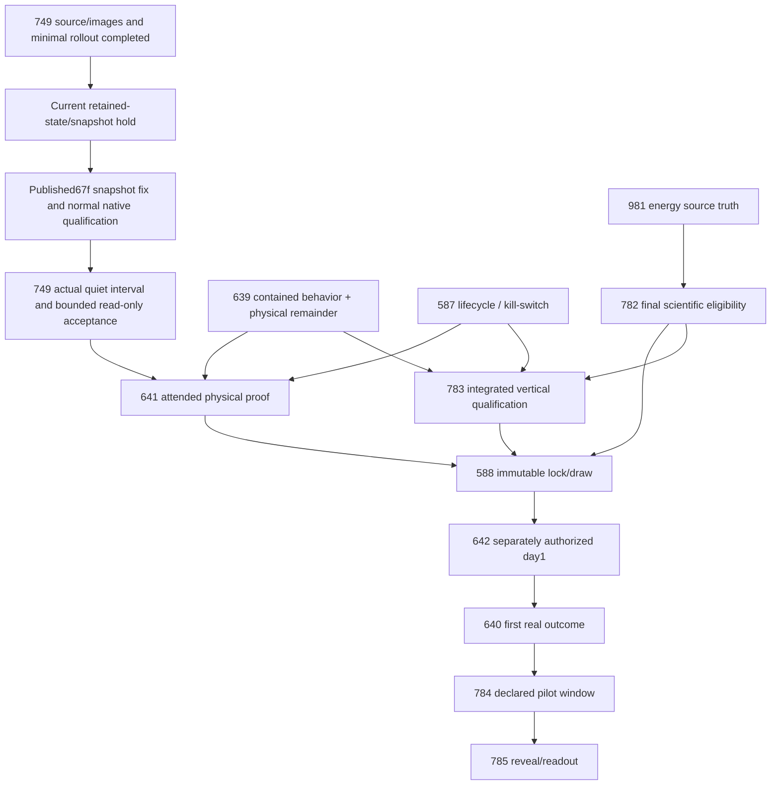

# Current dependency graph — October 17, 2026

All58 open issues are represented below. 41 open native blocking edges remain after the reviewed additions; 27 closed predecessor edges are retained as scoped satisfied history. Closed evidence is not an active blocker. Parentage is ownership only. No parent/child completion loop is introduced.

## Critical path

The delivery steps above are internal to #749, not new native issue dependencies. Source10dd/image6e and release11cd are deployed with runtime basic checks passing. A real current retained-state/snapshot hold blocks final readiness; the exact two-file producer fix is published as67f, with normal native/image qualification pending before its minimal rollout and a new current quiet interval. The consumed policy run is not replayed and missing historical reports are not retroactively repaired. The existing Agents owner returned the finite shared window; SAME Retry owns this product delivery and returns it at promotion terminal. The final read-only packet observes actual authority/exposure without inventing an experiment. Agents4977 remains outside this route. The981→782 edge applies to final eligibility for electricity already included in the chosen contract; independent climate/design preparation proceeds before it. Hardware repair751 and broad soil commissioning45 are not blanket prerequisites for truthful bounded readiness; warnings and absent values remain visible. No source fixture, green container or ordinary reconciliation grants experiment authority.

## Exact native relationships

| Issue | Parent (ownership) | Open predecessors | Closed predecessors (scoped evidence) |
|---|---|---|---|
| [#14](https://github.com/VerdifyConsultancy/verdify-platform/issues/14) | #775 | None | None |
| [#16](https://github.com/VerdifyConsultancy/verdify-platform/issues/16) | #775 | None | None |
| [#31](https://github.com/VerdifyConsultancy/verdify-platform/issues/31) | #14 | None | None |
| [#45](https://github.com/VerdifyConsultancy/verdify-platform/issues/45) | #16 | #398 | None |
| [#51](https://github.com/VerdifyConsultancy/verdify-platform/issues/51) | #16 | None | None |
| [#52](https://github.com/VerdifyConsultancy/verdify-platform/issues/52) | #16 | None | None |
| [#75](https://github.com/VerdifyConsultancy/verdify-platform/issues/75) | #775 | None | None |
| [#218](https://github.com/VerdifyConsultancy/verdify-platform/issues/218) | #775 | None | None |
| [#245](https://github.com/VerdifyConsultancy/verdify-platform/issues/245) | #218 | None | #396, #382 |
| [#296](https://github.com/VerdifyConsultancy/verdify-platform/issues/296) | #350 | #434, #297, #45 | None |
| [#297](https://github.com/VerdifyConsultancy/verdify-platform/issues/297) | #350 | #398, #45 | None |
| [#298](https://github.com/VerdifyConsultancy/verdify-platform/issues/298) | #16 | None | None |
| [#299](https://github.com/VerdifyConsultancy/verdify-platform/issues/299) | #350 | #390 | None |
| [#317](https://github.com/VerdifyConsultancy/verdify-platform/issues/317) | #75 | None | None |
| [#324](https://github.com/VerdifyConsultancy/verdify-platform/issues/324) | #359 | None | #424, #371 |
| [#350](https://github.com/VerdifyConsultancy/verdify-platform/issues/350) | #775 | None | None |
| [#359](https://github.com/VerdifyConsultancy/verdify-platform/issues/359) | #775 | None | None |
| [#361](https://github.com/VerdifyConsultancy/verdify-platform/issues/361) | #359 | #410, #378 | None |
| [#367](https://github.com/VerdifyConsultancy/verdify-platform/issues/367) | #430 | #390 | None |
| [#368](https://github.com/VerdifyConsultancy/verdify-platform/issues/368) | #359 | None | #424 |
| [#369](https://github.com/VerdifyConsultancy/verdify-platform/issues/369) | #430 | #390 | #433 |
| [#370](https://github.com/VerdifyConsultancy/verdify-platform/issues/370) | #430 | #390, #367 | None |
| [#378](https://github.com/VerdifyConsultancy/verdify-platform/issues/378) | #359 | #785 | #371 |
| [#379](https://github.com/VerdifyConsultancy/verdify-platform/issues/379) | #359 | #786 | #419, #371 |
| [#386](https://github.com/VerdifyConsultancy/verdify-platform/issues/386) | #359 | None | #303 |
| [#390](https://github.com/VerdifyConsultancy/verdify-platform/issues/390) | #644 | None | #419, #303 |
| [#398](https://github.com/VerdifyConsultancy/verdify-platform/issues/398) | #16 | #298 | None |
| [#410](https://github.com/VerdifyConsultancy/verdify-platform/issues/410) | #359 | None | #424, #419, #371 |
| [#412](https://github.com/VerdifyConsultancy/verdify-platform/issues/412) | #16 | None | None |
| [#428](https://github.com/VerdifyConsultancy/verdify-platform/issues/428) | #430 | None | #433 |
| [#430](https://github.com/VerdifyConsultancy/verdify-platform/issues/430) | #359 | None | None |
| [#434](https://github.com/VerdifyConsultancy/verdify-platform/issues/434) | #350 | #390, #299 | None |
| [#581](https://github.com/VerdifyConsultancy/verdify-platform/issues/581) | #775 | None | None |
| [#586](https://github.com/VerdifyConsultancy/verdify-platform/issues/586) | #775 | #785, #638, #390 | None |
| [#587](https://github.com/VerdifyConsultancy/verdify-platform/issues/587) | #581 | None | None |
| [#588](https://github.com/VerdifyConsultancy/verdify-platform/issues/588) | #581 | #783, #782, #641 | None |
| [#606](https://github.com/VerdifyConsultancy/verdify-platform/issues/606) | #14 | None | None |
| [#638](https://github.com/VerdifyConsultancy/verdify-platform/issues/638) | #775 | None | None |
| [#639](https://github.com/VerdifyConsultancy/verdify-platform/issues/639) | #581 | None | None |
| [#640](https://github.com/VerdifyConsultancy/verdify-platform/issues/640) | #581 | #642 | None |
| [#641](https://github.com/VerdifyConsultancy/verdify-platform/issues/641) | #750 | #749, #639, #587 | #747 |
| [#642](https://github.com/VerdifyConsultancy/verdify-platform/issues/642) | #581 | #588 | None |
| [#749](https://github.com/VerdifyConsultancy/verdify-platform/issues/749) | #750 | None | #949, #778, #424 |
| [#750](https://github.com/VerdifyConsultancy/verdify-platform/issues/750) | #581 | None | None |
| [#751](https://github.com/VerdifyConsultancy/verdify-platform/issues/751) | #16 | None | None |
| [#775](https://github.com/VerdifyConsultancy/verdify-platform/issues/775) | None | None | None |
| [#782](https://github.com/VerdifyConsultancy/verdify-platform/issues/782) | #581 | #981 | #781, #780, #779, #371 |
| [#783](https://github.com/VerdifyConsultancy/verdify-platform/issues/783) | #581 | #782, #639, #587 | None |
| [#784](https://github.com/VerdifyConsultancy/verdify-platform/issues/784) | #581 | #640 | None |
| [#785](https://github.com/VerdifyConsultancy/verdify-platform/issues/785) | #581 | #784 | None |
| [#786](https://github.com/VerdifyConsultancy/verdify-platform/issues/786) | #775 | #785 | #780 |
| [#787](https://github.com/VerdifyConsultancy/verdify-platform/issues/787) | #775 | #785, #410, #981 | #781 |
| [#801](https://github.com/VerdifyConsultancy/verdify-platform/issues/801) | jvallery/agents#4493 | jvallery/agents#4461 | None |
| [#802](https://github.com/VerdifyConsultancy/verdify-platform/issues/802) | jvallery/agents#4493 | jvallery/agents#4451 | jvallery/agents#4459 |
| [#963](https://github.com/VerdifyConsultancy/verdify-platform/issues/963) | #75 | None | None |
| [#977](https://github.com/VerdifyConsultancy/verdify-platform/issues/977) | #218 | None | None |
| [#980](https://github.com/VerdifyConsultancy/verdify-platform/issues/980) | #75 | None | None |
| [#981](https://github.com/VerdifyConsultancy/verdify-platform/issues/981) | #75 | None | None |

## Changed relationships
Added977 under218; added980/981 and317 under75. Added981 as a final source-quality predecessor for782 and787. Added the original explicit802→Agents4451 ownership-record requirement to native metadata. Kept801→Agents4461 and satisfied802→Agents4459. Old4457/4487 were consolidated, not fixed; link actual successor scope when needed, without adding the4830 umbrella as a blocking gate.
All pre-existing issue clauses and closed predecessor receipts remain. The92-issue canonical stage graph retains historical work; this58-issue native execution graph distinguishes currently open dependencies and cross-repository ownership. GitHub APIs for [sub-issues](https://docs.github.com/en/rest/issues/sub-issues) and [blocking dependencies](https://docs.github.com/en/rest/issues/issue-dependencies) supply the actual native relationships.
