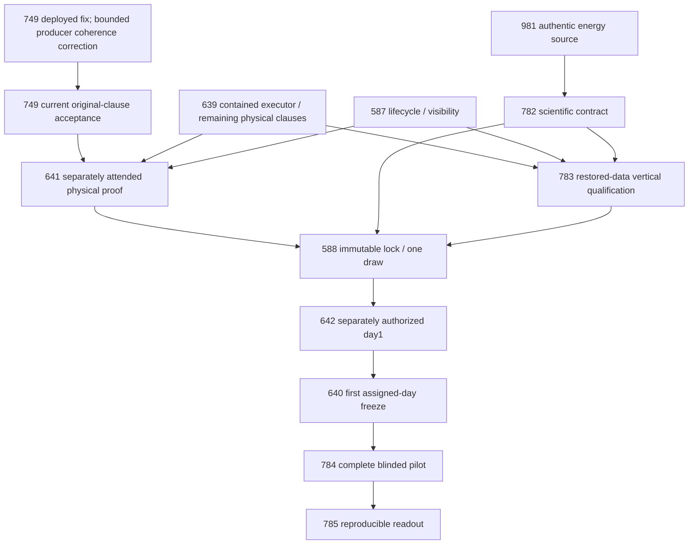

# Current active dependency graph — October17,2026

**51open issues;31active native blocking edges;25accepted closed predecessor edges;acyclic.** All parents/blockers were read back from GitHub. Canonical92nodes/9stages/78edges retain full historical scope, including retired alternatives; they are not31current blockers. Parentage meansownership. RetiredNOT_PLANNEDrecords earn no engineering or physical acceptance.

Removed801→Agents4461and802→Agents4451aswhole-program gates; exact manual-Argo/diff and descheduler owner/project/catalog acceptance remain. Hardware45/751isnotablanket readiness or contained-work gate; absent readings stayvisible. Preparation proceeds before conditional field work. Readiness cannot grant physical/randomized authority. No whole RAG/NAS/estate closure is a new product gate; a specific authorized-reader or owner-window constraint is real and must be honored.

## Exact current relationships

| Issue | Parent (ownership) | Open completion prerequisites | Accepted closed evidence |
|---|---|---|---|
| #14 | #775 | None | None |
| #16 | #775 | None | None |
| #31 | #14 | None | None |
| #45 | #16 | #398 | None |
| #51 | #16 | None | None |
| #52 | #16 | None | None |
| #75 | #775 | None | None |
| #218 | #775 | None | None |
| #245 | #218 | None | #396, #382 |
| #297 | #350 | #398, #45 | None |
| #298 | #16 | None | None |
| #299 | #350 | #390 | None |
| #350 | #775 | None | None |
| #359 | #775 | None | None |
| #367 | #430 | #390 | None |
| #368 | #359 | None | #424 |
| #369 | #430 | #390 | #433 |
| #370 | #430 | #390, #367 | None |
| #378 | #359 | #785 | #371 |
| #379 | #359 | #786 | #419, #371 |
| #386 | #359 | None | #303 |
| #390 | #644 | None | #419, #303 |
| #398 | #16 | #298 | None |
| #410 | #359 | None | #424, #419, #371 |
| #412 | #16 | None | None |
| #428 | #430 | None | #433 |
| #430 | #359 | None | None |
| #434 | #350 | #390, #299 | None |
| #581 | #775 | None | None |
| #587 | #581 | None | None |
| #588 | #581 | #783, #782, #641 | None |
| #639 | #581 | None | None |
| #640 | #581 | #642 | None |
| #641 | #750 | #749, #639, #587 | #747 |
| #642 | #581 | #588 | None |
| #749 | #750 | None | #949, #778, #424 |
| #750 | #581 | None | None |
| #751 | #16 | None | None |
| #775 | None | None | None |
| #782 | #581 | #981 | #781, #780, #779, #371 |
| #783 | #581 | #782, #639, #587 | None |
| #784 | #581 | #640 | None |
| #785 | #581 | #784 | None |
| #786 | #775 | #785 | #780 |
| #787 | #775 | #981, #785, #410 | #781 |
| #801 | jvallery/agents#4493 | None | None |
| #802 | jvallery/agents#4493 | None | jvallery/agents#4459 |
| #963 | #75 | None | None |
| #977 | #218 | None | None |
| #980 | #75 | None | None |
| #981 | #75 | None | None |

The retrospective intake was58open/41active/27accepted historical edges. Removing retired records and the two false whole-issue gates changes the *open-issue graph*; it does not erase historical edges or qualify their retired scope. No parent-child loop or new technical prerequisite was introduced.
