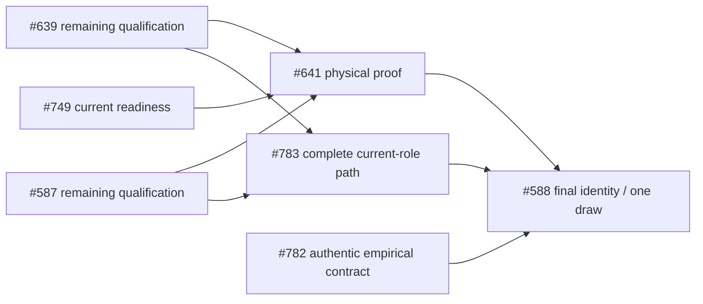

# Next sprint: unblocked source and diagnosis

**S3B: October 19–23, 2026 — 40 engineering hours.** Reviewed all **47 open issues** at source `261092b079044e363ca7a6929116b4a6344429da`; exact GitHub bodies/titles match canonical source. The native graph is unchanged: **27 active completion edges** (26 local, Home Assistant #878→#981) and **24 closed predecessor records** on open issues, with no truncated connection. [All 47 dispositions and original acceptance](ISSUE-REVIEW.md), [machine register](issue-review.json), [native readback](native-readback.json), [graph](DEPENDENCIES.md).

This plan is prepared on `codex/sprint-plan-20261018`. It changes execution allocations only, with all 93 issue contracts, 143 open acceptance clauses, priorities, parentage, states and completion edges preserved. No issue is proposed for closure merely because a packet is selected. Main remains the prior accepted source/evidence; publication on this planning branch does not start execution or claim the shared window.

The previous cohort merged in [#985](https://github.com/VerdifyConsultancy/verdify-platform/pull/985). Reuse its 154 causal YAML cases, strict native/compiler/replay receipts, actual orchestrator packaging and contained role/alert proof. The unchanged-source contained subset is exhausted. Repeating that subset, source inventories already complete, empty blinding projections or the delivered two-message pair is not sprint progress. [Completed cohort and limits](../2026-10-18-execution/README.md).

## Committed packets

| Packet | Issue / role | Hours | Concrete deliverable and packet acceptance |
|---|---|---:|---|
| **P1 — actual fog/vent consumer** | #639 · runtime/control | 8–12 | Extract the actual selected policy branch, helper and relay application; witness selected vs unselected opposite values, actual vent readback vs requested state, exemption and dwell boundaries. The deleted/inverted-consumer witness must fail for the behavior, while missing/ambiguous extraction refuses. Retain source/fragment/toolchain hashes and both complete native results. |
| **P2 — honest prefix input/state admission** | #639 · runtime/control | 6–10 | Extend the existing `source_coverage_report()`/prefix preparation for the fog/vent consumer's required pre-tick state, provenance and timing; classify the other 20 gaps with exact missing requirements. A machine-readable report and meaningful refusal tests must reject same-row `eq_vent`/`eq_fog` outputs used as counterfactual inputs, missing/stale/nonfinite required state, and permissive safety defaults. Keep scope in the existing tools; no generic runner framework or invented telemetry. |
| **P3 — realized solar-night disposition** | #410 · control/data | 4–6 | Bind the installed `fn_realized_solar_night_dryout` definition and reviewed source. Analyze one genuine complete-night pilot, at most three nights total. Retain solar semantics, same-day held-admission counts, relay truth, AH/VPD response, missing/confounded data and original verdicts. Verify MCP/planner sees validity and disposition. A truthful FAIL/incomplete/no-eligible result completes this diagnostic packet but does not close the issue. |
| **P4 — passive heap/reset and recovery custody** | #428 · platform/control; shared #390/#963 preparation | 4–6 | Reuse the passive diagnostics collector; bind current firmware/load/heap/fragmentation and distinguish software resets, watchdogs and reconnects. Locate and hash the independently retained rollback binary/metadata or name the exact missing custody. Produce one shared source/binary/rollback/HA observation matrix. No inferred causal fix, stress test, reset, OTA or last-good promotion. |

**Selected work: 22–34 hours. Reserve: at least 6 hours** for integration, native-result review, issue/evidence reconciliation and an unexpected source defect. This is a new prospective one-week budget, not measured time left in the historical 80-hour S3 envelope. Roll-ups and shared #390/#963 preparation are not counted again.

P1 is the first pull. P2 can specify admission in parallel but finalizes against P1's actual source fragments. P3 and P4 proceed independently using existing read-only data/interfaces. If a source assumption fails, retain the failure and use reserve; do not silently expand to 21 consumer implementations or fill the week with unrelated cleanup.

## Cadence and placement

1. **Day 1:** bind current source and before-images; start P1 extraction/causal witnesses, P2 exact input requirements and the bounded passive P3/P4 inputs. No duplicate implementation of the firmware branch as a new oracle.
2. **Days 2–3:** finish the actual one-consumer source proof and existing-report extension; retain explicit current input/corpus gaps. Complete the real-data and rollback-custody dispositions. Source work can be parallel; use one source integration writer.
3. **Days 4–5:** run only the necessary native checks through the supported current versioned path after shared custody returns and fresh admission. Review actual command exits, terminal completion and output integrity; integrate and update exact scoped GitHub results. Never treat Argo/CI green alone as device or scientific acceptance.

The existing Agents executor holds the finite shared CI/controller/catalog window for **#5048→#5044→#5045**. [The dated handback and receiving-owner acknowledgement](shared-window.json) retain that custody context; they do not establish future admission. This planning work submits **no CI, build, controller or catalog operation**. Returning custody and fresh capacity/admission are normal prerequisites to native execution, not a new completion edge or a request for another blanket approval.

Use context `vallery`, supported namespace/profile and existing identities. Root coordinates at most one Verdify native qualification invocation at a time after checking current quota, requests/limits, worker pressure, other owners and recovery headroom. Use the admitted versioned profile's actual limits; do not edit a shared template, security setting or identity for this sprint. Compile/replay/broad tests stay in k3s. Every invocation gets an exact source, stable name, deadline and retained output/exit receipt.

P3 starts with one night, read-only mode, a two-second statement timeout and at most 500 returned episode rows; at most three nights/three serial queries in this packet. Timeout, missing installed identity or unusable data produces an explicit blocker; no automatic wider scan. Use the bounded function, not the latest-30-night convenience view. Any substantial transformation runs through the admitted cluster path. A negative/incomplete dry-out result does not authorize a new controller setting or become water-removal/crop-safety proof.

P4 uses at most 100 retained diagnostic rows and metadata/artifact reads; no direct extra ESP32 session, induced load or reboot. Hash existing recovery artifacts in their actual custody rather than assuming a fresh worktree contains ignored binaries. The dummy-credential compiler artifacts from #985 are **NONDEPLOYABLE** and cannot serve as rollback/last-good. A passive snapshot does not establish representative worst-case runtime or the complete #428 contract.

## What remains outside commitment

- **#587/#783:** actual active cases remain denied until a legitimate current source-qualified path, real authority and supported own-LOGIN/analyst identities exist. Do not repeat exhausted denials, invent populated assignment data, create credentials or reuse consumed message approvals. Existing completion edges remain.
- **#749:** sealed spread/soil FAIL and four missing wetting criteria remain. Actual binary/equipment/rails/counter measurements and criterion-specific native receipt semantics are required; a hash or boolean cannot release the hold.
- **#782:** authentic crop/contributor/selector/context and complete 18-hour inputs are still absent. Keep the June 1–July 30, 2027 warm candidate and the separate existing November 2 winter observation; neither a new collector nor a draw is scheduled here.
- **#981:** actual Home Assistant #878 is still open. No downstream freshness repair or eligibility claim before owning installed-source qualification. This does not block the selected nine-state #782 preparation.
- **#298/#751/#51/#52/#412 and #398→#45→#297:** use one actual owner field worksheet for crop/probe/reference/plumbing/seasonal decisions. No guessed calibration or automatic irrigation from a topology import.
- **#390/#963/#386:** the source and tooling already delivered are reused. Device delivery/rollback/HA recovery and an eligible natural lighting boundary remain separately observed acceptance. P4 is preparation, not permission to flash or actuate.
- Readout, draw/launch and full pilot work stay downstream. #245 cutover, twin runtime, comparator/MPC and broad firmware cleanup receive no speculative allocation.

**No operator decision blocks P1/P2 source preparation.** At execution time, native admission must return from the current shared owner. Owner-supplied physical/scientific inputs can unlock later work, but this sprint does not depend on their arrival. If a selected diagnostic has no eligible data or rollback artifact, its exact negative disposition is a packet outcome; full issue criteria remain open.

## Dependency and closure rules

The graph gates whole-issue acceptance, not all source preparation. Do not remove an edge to make a packet look runnable; do not add whole #641/#367/#368 as a reverse gate on #639 source work.

The compiled prefix remains **27/48, UNPROVEN** until genuine row-wise downstream coverage and all required recovery/negative cases establish otherwise. A single-consumer scenario is not automatically 28/48; even 48 assignment declarations alone do not qualify safety. This sprint neither changes frozen grid/order/artifact identities nor grants active exposure, physical proof, a launch or an efficacy claim.

Packet done means exact source/input/output hashes, meaningful positive/negative behavior where applicable, actual native exit/terminal/output readback, and an updated residual map. Full issue closure requires every original criterion and appropriate live/physical evidence. Native failures and timeouts are retained; fresh success does not rewrite them.

## Review and publication

All 47 current issue bodies/titles matched canonical source before this plan. This branch changes only execution allocations and planning/evidence views; the 93 `issues` objects are byte-equivalent JSON values to the reviewed source. Acceptance, status, native dependencies, parentage, assignees and milestones are not changed. [Verification](verification.json) records planning checks and fresh issue-contract readback; the campaign comment retains branch publication context. No milestone is marked complete and no PR/build/deployment is submitted by planning publication.
