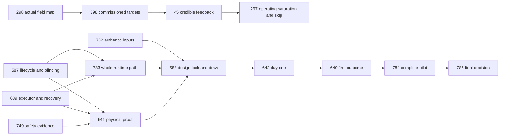

# October 25 unblocked-work and dependency refresh

Reviewed all **41 current open issues**, native parents/blockers, latest receipts,
and the canonical plan at source `a01149a8`. This is a current execution map;
historical audits and original membership remain intact.

## Changes and selected execution

- Reconcile **15 stale open records** to their already-closed GitHub state. Remove
  **19 closed items** from the old 60-item execution queue, leaving exactly41.
  Closed #992 uses its actual retirement acceptance rather than pretending its
  superseded temporary namespace-adoption steps occurred. Closed #1003 records
  the explicit window waiver, not seven elapsed observed days.
- Mirror current GitHub priority labels in the canonical plan without relabelling
  issues. Preserve all original open acceptance clauses and internal blocking edges.
- Correct native #1009's closed network#77 predecessor to open#555. Only its exact
  passive OTA/API path output is required; unrelated #555 work is not imported.
  Remove completed agents#4470 from #1001's blocker list; retain its custody history.
- Execute the next **four private negative SQL/alert cases** for #587/#639 through
  the existing admitted native CI path. Candidate manifest: **17 mandatory cases,
  10 of16 SQL reasons**. Six reasons remain explicitly unexercised. No real Slack
  messages or active/physical/historical-prefix credit. Preexposure mismatch must
  remain critical after synthetic facility closure; do not invent recovery to clear it.
- #386 now has a genuine passive ordinary-cutoff receipt: main at October24
  **20:00 MDT**, grow at **22:00 MDT**, matching reasons, firmware decision epochs
  and device-reported relay OFF. Both had been on over five hours. This does
  **not** exercise an active minimum-on overlap or justify closing #386.
- Reuse delivered #297 evaluator, #368 finite-probe correction, #410 consumer and
  #1081 field/release worksheet. Do not repeat their accepted software packets.

## Boundaries

No new ESP32 connection, cordon, ingestor restart, production experiment mutation,
credential/grant, firmware upload or real message is included. The retained writer
hold remains untouched. The retired rehearsal namespace is not recreated and
production is not a test substitute. Private negative fixture data is not physical
or accepted causal evidence.

Jason can visit as needed. The shared survey is ready; actual field observations
are not supplied yet. CO2 calibration alone requires a reference NDIR meter.
Scientific inputs, analyst identity and physical safety evidence remain real gates.

## Current dependency chain

Parent/roll-up membership is not an execution blocker. The graph above is a
critical-path summary; the full live edge snapshot and canonical generated graph
remain authoritative. No blanket #749→#751 repair dependency is introduced.

## Complete open register

| Issue | Disposition | Open prerequisite / immediate boundary |
|---|---|---|
| [#16](https://github.com/VerdifyConsultancy/verdify-platform/issues/16) | roll-up | roll-up |
| [#31](https://github.com/VerdifyConsultancy/verdify-platform/issues/31) | deferred refactor/oracle | deferred refactor/oracle |
| [#45](https://github.com/VerdifyConsultancy/verdify-platform/issues/45) | commissioned field inputs required | VerdifyConsultancy/verdify-platform#398 |
| [#51](https://github.com/VerdifyConsultancy/verdify-platform/issues/51) | reference meter required | reference meter required |
| [#52](https://github.com/VerdifyConsultancy/verdify-platform/issues/52) | field observation available | field observation available |
| [#75](https://github.com/VerdifyConsultancy/verdify-platform/issues/75) | roll-up | roll-up |
| [#297](https://github.com/VerdifyConsultancy/verdify-platform/issues/297) | commissioned field inputs required | VerdifyConsultancy/verdify-platform#45 |
| [#298](https://github.com/VerdifyConsultancy/verdify-platform/issues/298) | field observation available | field observation available |
| [#299](https://github.com/VerdifyConsultancy/verdify-platform/issues/299) | qualified release/physical outcome required | VerdifyConsultancy/verdify-platform#390 |
| [#350](https://github.com/VerdifyConsultancy/verdify-platform/issues/350) | roll-up | roll-up |
| [#359](https://github.com/VerdifyConsultancy/verdify-platform/issues/359) | roll-up | roll-up |
| [#367](https://github.com/VerdifyConsultancy/verdify-platform/issues/367) | qualified release/physical outcome required | VerdifyConsultancy/verdify-platform#390 |
| [#368](https://github.com/VerdifyConsultancy/verdify-platform/issues/368) | source preparation possible; release pending | source preparation possible; release pending |
| [#369](https://github.com/VerdifyConsultancy/verdify-platform/issues/369) | deferred refactor/oracle | VerdifyConsultancy/verdify-platform#390 |
| [#370](https://github.com/VerdifyConsultancy/verdify-platform/issues/370) | deferred refactor/oracle | VerdifyConsultancy/verdify-platform#367 |
| [#378](https://github.com/VerdifyConsultancy/verdify-platform/issues/378) | predecessor/pilot required | VerdifyConsultancy/verdify-platform#785 |
| [#386](https://github.com/VerdifyConsultancy/verdify-platform/issues/386) | ready bounded observation | ready bounded observation |
| [#390](https://github.com/VerdifyConsultancy/verdify-platform/issues/390) | qualified release/physical outcome required | qualified release/physical outcome required |
| [#398](https://github.com/VerdifyConsultancy/verdify-platform/issues/398) | commissioned field inputs required | VerdifyConsultancy/verdify-platform#298 |
| [#410](https://github.com/VerdifyConsultancy/verdify-platform/issues/410) | ready bounded observation | ready bounded observation |
| [#412](https://github.com/VerdifyConsultancy/verdify-platform/issues/412) | field observation available | field observation available |
| [#430](https://github.com/VerdifyConsultancy/verdify-platform/issues/430) | roll-up | roll-up |
| [#434](https://github.com/VerdifyConsultancy/verdify-platform/issues/434) | qualified release/physical outcome required | VerdifyConsultancy/verdify-platform#299 |
| [#581](https://github.com/VerdifyConsultancy/verdify-platform/issues/581) | roll-up | roll-up |
| [#587](https://github.com/VerdifyConsultancy/verdify-platform/issues/587) | ready private qualification | ready private qualification |
| [#588](https://github.com/VerdifyConsultancy/verdify-platform/issues/588) | predecessor/pilot required | VerdifyConsultancy/verdify-platform#783, VerdifyConsultancy/verdify-platform#782, VerdifyConsultancy/verdify-platform#641 |
| [#639](https://github.com/VerdifyConsultancy/verdify-platform/issues/639) | ready private qualification | ready private qualification |
| [#640](https://github.com/VerdifyConsultancy/verdify-platform/issues/640) | predecessor/pilot required | VerdifyConsultancy/verdify-platform#642 |
| [#641](https://github.com/VerdifyConsultancy/verdify-platform/issues/641) | authentic inputs/physical safety required | VerdifyConsultancy/verdify-platform#749, VerdifyConsultancy/verdify-platform#639, VerdifyConsultancy/verdify-platform#587 |
| [#642](https://github.com/VerdifyConsultancy/verdify-platform/issues/642) | predecessor/pilot required | VerdifyConsultancy/verdify-platform#588 |
| [#749](https://github.com/VerdifyConsultancy/verdify-platform/issues/749) | authentic inputs/physical safety required | authentic inputs/physical safety required |
| [#751](https://github.com/VerdifyConsultancy/verdify-platform/issues/751) | field observation available | field observation available |
| [#775](https://github.com/VerdifyConsultancy/verdify-platform/issues/775) | roll-up | roll-up |
| [#782](https://github.com/VerdifyConsultancy/verdify-platform/issues/782) | authentic inputs/physical safety required | authentic inputs/physical safety required |
| [#783](https://github.com/VerdifyConsultancy/verdify-platform/issues/783) | authentic inputs/physical safety required | VerdifyConsultancy/verdify-platform#639, VerdifyConsultancy/verdify-platform#587 |
| [#784](https://github.com/VerdifyConsultancy/verdify-platform/issues/784) | predecessor/pilot required | VerdifyConsultancy/verdify-platform#640 |
| [#785](https://github.com/VerdifyConsultancy/verdify-platform/issues/785) | predecessor/pilot required | VerdifyConsultancy/verdify-platform#784 |
| [#963](https://github.com/VerdifyConsultancy/verdify-platform/issues/963) | qualified release/physical outcome required | VerdifyConsultancy/verdify-platform#390 |
| [#1001](https://github.com/VerdifyConsultancy/verdify-platform/issues/1001) | deferred external owner output | jvallery/network-infra#602, jvallery/agents#4468 |
| [#1009](https://github.com/VerdifyConsultancy/verdify-platform/issues/1009) | deferred external owner output | jvallery/network-infra#555 (exact passive output) |
| [#1010](https://github.com/VerdifyConsultancy/verdify-platform/issues/1010) | deferred external owner output | jvallery/network-infra#743 |

## Evidence and validation

`closed-status-evidence.json` preserves prior plan records and actual closing
receipts; `native-graph-before.json` preserves the starting graph;
`native-graph-after.json` records verified mutations. `unblocked-register.json`
contains each next action. Lighting queries and returned observations are retained
without changing the device. Earlier failed broad policy reads are not relabelled.

Run the generated-view/schema checks and the required native PR/main CI. Candidate
fixture coverage is accepted only after its exact source-bound native result. This
review does not close an open issue on preparation, synthetic tests or healthy Pods.

Independent source reviews checked the negative fixture/sequence boundaries and
all41 register/allocation memberships. They do not substitute for native CI. The
review corrected stale closed-#1003 instructions that still called its authority
choice unresolved, preserving the original required window and later waiver.
