# Open-work dependency graph (2026-11-06 triage)

Open issues only (88), grouped by execution track. An arrow means the predecessor must finish before the dependent's acceptance. Closed records stay in the canonical graph in [planning/DEPENDENCIES.md](../../DEPENDENCIES.md).

Longest open chain: #298 → #398 → #45 → #297.

```mermaid
flowchart LR
  subgraph T0["T0: Unblock: Cortex egress fix and the in-flight web pin"]
    i1351["#1351 [W5] Audit and remove Verdify's external"]
    i1118["#1118 verdify-vision crop-health analysis step"]
    i1346["#1346 [W5] Write a greenhouse snapshot with th"]
    i1330["#1330 [W5] Add a Crops section: hydro slot gri"]
    i1361["#1361 [W5] Add a Planner section: plan history"]
    i1327["#1327 [W5] Model plantings on the location tre"]
    i1328["#1328 [W5] Let agents record, move and harvest"]
  end
  subgraph T1["T1: Live verification walk (shipped code, no new build)"]
    i1125["#1125 [VD-05] Build the form controls, edit dr"]
    i1130["#1130 [VD-10] Build the Graphs screen (SCR-02)"]
    i1132["#1132 [VD-12] Build the Settings screen (SCR-0"]
    i1135["#1135 [VD-15] Build the Water screen (SCR-04):"]
    i1143["#1143 [VD-26] Ship R1: put the read-only dashb"]
    i1181["#1181 [VD-68] Ship R1.1: put every read screen"]
    i1186["#1186 [VD-73] Ship R4: put the Next screens li"]
    i1300["#1300 Back to automatic leaves a grow light of"]
    i1162["#1162 [VD-47] Remove the Home Assistant button"]
    i1164["#1164 [VD-50] Ship R3: deploy the irrigation p"]
    i1337["#1337 [W5] Redraw Now's band gauges as one tra"]
    i1338["#1338 [W5] Keep the Now headline steady and mo"]
    i1339["#1339 [W5] Replace codes on Now with plain lab"]
    i1340["#1340 [W5] Give Running and next room for its "]
    i1341["#1341 [W5] Show line names everywhere and remo"]
    i1342["#1342 [W5] Add Main and Grow light controls to"]
    i1344["#1344 [W5] Explain VPD control, Manual and Fal"]
    i1347["#1347 [W5] Make the schedule timeline readable"]
    i1349["#1349 [W5] Redesign Water cards for clear line"]
    i1353["#1353 [W5] Show 72 h of history and 72 h of fo"]
    i1355["#1355 [W5] Make event markers on Graphs show w"]
    i1356["#1356 [W5] Redesign the equipment lanes: share"]
    i1357["#1357 [W5] Add a Lighting tab to Graphs: light"]
    i1332["#1332 [W5] Explain every setting: what it does"]
    i1333["#1333 [W5] Define the Settings filters and sta"]
    i1334["#1334 [W5] Research the band math and design a"]
    i1335["#1335 [W5] Give each light circuit a findable "]
    i1336["#1336 [W5] Model one physical line with clean "]
    i1348["#1348 [W5] Separate irrigation runs from VPD m"]
    i1370["#1370 [W5] Turn the lights on when the cameras"]
    i1343["#1343 [W5] Allow a one-time run of any line, m"]
    i1358["#1358 [W5] Research and fix band compliance: g"]
  end
  subgraph T2["T2: Bounded code fixes"]
    i1345["#1345 [W5] Remove plant-specific copy and make"]
    i1354["#1354 [W5] Move chart labels out of the plots "]
    i1322["#1322 dashboard: chart corner labels overlap t"]
    i1329["#1329 [W5] Reconcile greenhouse locations and "]
    i1277["#1277 c1 wire validation: move the firmware pi"]
    i1283["#1283 v_water_meter_daily may read a 25-hour d"]
    i1312["#1312 firmware-replay-diff: rounding lets up t"]
    i1313["#1313 firmware: runtime and drip accounting af"]
    i1389["#1389 experiment-v2 lifecycle/freezer/selector"]
    i1363["#1363 [W5] Pull every Verdify image through th"]
    i1010["#1010 [AUD] Finish trusted client IP attributi"]
    i299["#299 [C6][P1] Preserve center-mister re-fire "]
    i367["#367 [C6][P1] Consolidate anti-chatter into o"]
    i368["#368 [C6][P1] Define shared sensor jump, flat"]
    i369["#369 [C6][P3] Remove dead tunables and code f"]
    i370["#370 [C6][P3] Consolidate equipment conflict "]
    i390["#390 [C4][P1] Gate firmware releases on topol"]
    i386["#386 [C4][P2] Prove grow-light minimum-on beh"]
  end
  subgraph T3["T3: Cortex planner cutover and the A/B study"]
    i1350["#1350 [W5] Replace the Hermes/OpenAI planner w"]
    i1366["#1366 [W5] Research the planner's 60K-token in"]
    i1360["#1360 [W5] Run an AI-planner-versus-baseline s"]
  end
  subgraph T4["T4: Time-gated soaks"]
    i1364["#1364 [W5] Use the estate's local NTP for the "]
    i1365["#1365 [W5] Research sprint: a VPD band the gre"]
    i1352["#1352 [W5] Decommission Slack from Verdify: al"]
    i1165["#1165 [VD-51] Bring the clean lines online: L0"]
  end
  subgraph T5["T5: Hardware, replant and irrigation bring-up (Jason physical)"]
    i51["#51 [C7][P3] Calibrate CO2 against a real re"]
    i751["#751 [C7][P2] Replace the failed south climat"]
    i1183["#1183 [VD-70] Read the YINMIK hydroponic probe"]
    i1184["#1184 [VD-71] Add a PAR light meter: hardware,"]
    i298["#298 [C7]Rebaseline actual crop, pot and prob"]
    i398["#398 [C7]Replace stale soil threshold seeds w"]
    i45["#45 [C7]Commission soil and runoff feedback "]
    i297["#297 [C6]Add saturation alerts and a commissi"]
    i52["#52 [C7][P3] Define species-appropriate seas"]
    i1166["#1166 [VD-52] Bring the fertilizer lines onlin"]
    i1161["#1161 [VD-46] Rework the mist path: membership"]
    i1271["#1271 firmware: give sensor_degraded a boot gr"]
  end
  subgraph T6["T6: External owners, upstream and the repo transfer"]
    i1001["#1001 [OWN] Finish Verdify transitions owned e"]
    i1009["#1009 [AUD] Sign greenhouse ESP32 firmware and"]
    i1113["#1113 security: grafana-image-renderer chromiu"]
    i1397["#1397 Move CI, image builds and pin automation"]
    i31["#31 [C8][P3] Close twin setpoint and actuato"]
  end
  subgraph ROLLUP["ROLLUP: Program roll-ups"]
    i16["#16 [C7][P2] Hardware program: commission on"]
    i75["#75 [C4][P2] Observability program: prove ac"]
    i359["#359 [C6][P1] Control program: truthful crop "]
    i430["#430 [C6][P1] Simplify firmware only while pr"]
    i775["#775 [C0]Campaign: trustworthy greenhouse out"]
    i1120["#1120 [VD-E0] Program: dashboard.verdify.ai an"]
    i1325["#1325 [Epic] Dashboard wave 2: Jason's accepta"]
  end
  i390 --> i367
  i367 --> i370
  i390 --> i369
  i390 --> i299
  i45 --> i297
  i398 --> i297
  i298 --> i398
  i398 --> i45
  i298 --> i45
  i298 --> i52
  i1143 --> i1125
  i1135 --> i1125
  i1164 --> i1125
  i1161 --> i1164
  i1162 --> i1164
  i1329 --> i1165
  i1165 --> i1166
  i1329 --> i1166
  i1300 --> i1186
  i1354 --> i1322
  i1330 --> i1327
  i1330 --> i1328
  i1350 --> i1351
  i1352 --> i1351
  i1350 --> i1352
  i1350 --> i1360
  i1365 --> i1360
  i1389 --> i1360
  i1360 --> i1361
  i1350 --> i1363
  i1350 --> i1366
```

## Edge list

| Predecessor | Dependent |
|---|---|
| #390 | #367 |
| #367 | #370 |
| #390 | #369 |
| #390 | #299 |
| #45 | #297 |
| #398 | #297 |
| #298 | #398 |
| #398 | #45 |
| #298 | #45 |
| #298 | #52 |
| #1143 | #1125 |
| #1135 | #1125 |
| #1164 | #1125 |
| #1161 | #1164 |
| #1162 | #1164 |
| #1329 | #1165 |
| #1165 | #1166 |
| #1329 | #1166 |
| #1300 | #1186 |
| #1354 | #1322 |
| #1330 | #1327 |
| #1330 | #1328 |
| #1350 | #1351 |
| #1352 | #1351 |
| #1350 | #1352 |
| #1350 | #1360 |
| #1365 | #1360 |
| #1389 | #1360 |
| #1360 | #1361 |
| #1350 | #1363 |
| #1350 | #1366 |
