# November 7 open-issue graph (afternoon)

Open issues only, grouped by track (see [README](README.md)). An arrow means the predecessor must finish first. Generated from `planning/backlog.yaml` on 2026-11-07.

```mermaid
flowchart LR
  subgraph R7["R7: Release 7 (software, next attended session)"]
    i1277["#1277 c1 wire validation: move the firmware pin to the"]
    i1351["#1351 Audit and remove Verdify's external dependencies"]
    i1480["#1480 Cortex shadow planner runs out of tokens in reas"]
  end
  subgraph S1["S1: Software backlog (agents, no Jason dependency)"]
    i299["#299 Preserve center-mister re-fire protection throug"]
    i1352["#1352 Decommission Slack from Verdify: alerts on the d"]
    i1432["#1432 VPD: HAF circulation fans now; dehumidifier pilo"]
    i1458["#1458 estate-audit STD-OPS-01: container CVE triage ba"]
  end
  subgraph V1["V1: Jason signed-in walk and attended runs"]
    i1009["#1009 Sign greenhouse ESP32 firmware and flash only re"]
    i1132["#1132 Build the Settings screen (SCR-05) with the edit"]
    i1164["#1164 Ship R3: deploy the irrigation platform and flas"]
    i1181["#1181 Ship R1.1: put every read screen, the water read"]
    i1186["#1186 Ship R4: put the Next screens live"]
    i1322["#1322 dashboard: chart corner labels overlap the band "]
    i1332["#1332 Explain every setting: what it does to the contr"]
    i1333["#1333 Define the Settings filters and states in the UI"]
    i1335["#1335 Give each light circuit a findable Auto / On / O"]
    i1337["#1337 Redraw Now's band gauges as one track with a gre"]
    i1338["#1338 Keep the Now headline steady and move the out-of"]
    i1339["#1339 Replace codes on Now with plain labels and add a"]
    i1341["#1341 Show line names everywhere and remove the L01/L0"]
    i1342["#1342 Add Main and Grow light controls to Now's quick "]
    i1343["#1343 Allow a one-time run of any line, misters includ"]
    i1345["#1345 Remove plant-specific copy and make soil-moistur"]
    i1347["#1347 Make the schedule timeline readable: daylight ba"]
    i1349["#1349 Redesign Water cards for clear line and group de"]
    i1354["#1354 Move chart labels out of the plots and use one c"]
    i1355["#1355 Make event markers on Graphs show what each even"]
    i1356["#1356 Redesign the equipment lanes: shared time axis, "]
    i1358["#1358 Research and fix band compliance: grade time in "]
  end
  subgraph T1["T1: Dated soaks"]
    i367["#367 Consolidate anti-chatter into one explicit dwell"]
    i368["#368 Define shared sensor jump, flatline and contribu"]
    i369["#369 Remove dead tunables and code from a verified co"]
    i386["#386 Prove grow-light minimum-on behavior at the sola"]
    i390["#390 Gate firmware releases on topology, cycling, run"]
    i1346["#1346 Write a greenhouse snapshot with the local Corte"]
    i1365["#1365 Research sprint: a VPD band the greenhouse can a"]
    i1435["#1435 VPD: recheck dry winter nights in December 2026"]
  end
  subgraph H1["H1: Jason on-site hardware, replant and irrigation bring-up"]
    i45["#45 Commission soil and runoff feedback before enabl"]
    i51["#51 Calibrate CO2 against a real reference and publi"]
    i52["#52 Define species-appropriate seasonal dormancy car"]
    i297["#297 Add saturation alerts and a commissioned dispatc"]
    i298["#298 Rebaseline actual crop, pot and probe topology b"]
    i398["#398 Replace stale soil threshold seeds with commissi"]
    i751["#751 Replace the failed south climate probe and diagn"]
    i1161["#1161 Rework the mist path: membership, scheduled puls"]
    i1162["#1162 Remove the Home Assistant buttons, add manual_ov"]
    i1165["#1165 Bring the clean lines online: L01 first, then L0"]
    i1166["#1166 Bring the fertilizer lines online: L02 with L03,"]
    i1183["#1183 Read the YINMIK hydroponic probe directly, witho"]
    i1184["#1184 Add a PAR light meter: hardware, firmware, inges"]
    i1336["#1336 Model one physical line with clean and fertilize"]
    i1370["#1370 Turn the lights on when the cameras see someone "]
    i1424["#1424 heat1 Shelly ch1 power clamp is wired backwards "]
    i1431["#1431 VPD: one-week night moisture-source experiment ("]
  end
  subgraph D1["D1: Blocked on a Jason decision"]
    i1433["#1433 VPD: achievable vs aspirational band in the read"]
  end
  subgraph X1["X1: External owners"]
    i1001["#1001 Finish retired Verdify namespace and hostname cl"]
    i1010["#1010 Finish trusted client IP attribution for success"]
    i1363["#1363 Pull every Verdify image through the local regis"]
    i1364["#1364 Use the estate's local NTP for the greenhouse co"]
    i1397["#1397 Move CI, image builds and pin automation to GitH"]
  end
  subgraph P1["P1: Parked / deferred"]
    i370["#370 Consolidate equipment conflict resolution into o"]
    i1360["#1360 Run an AI-planner-versus-baseline study end to e"]
    i1434["#1434 Planner study #1360: VPD scoring baseline (dry-o"]
    i1459["#1459 ci: split ci / validate into parallel step jobs "]
    i1477["#1477 firmware: retire or justify the activity-mirror "]
  end
  subgraph ROLLUP["ROLLUP: Epics"]
    i16["#16 Hardware program: commission only the sensing an"]
    i75["#75 Observability program: prove actionable health f"]
    i359["#359 Control program: truthful crop corridors before "]
    i430["#430 Simplify firmware only while preserving autonomo"]
    i775["#775 Campaign: trustworthy greenhouse outcomes → qual"]
    i1120["#1120 Program: dashboard.verdify.ai and the irrigation"]
    i1325["#1325 [Epic] Dashboard wave 2: Jason's acceptance feed"]
  end
  i298 --> i45
  i398 --> i45
  i298 --> i52
  i398 --> i297
  i45 --> i297
  i390 --> i299
  i390 --> i367
  i390 --> i369
  i367 --> i370
  i298 --> i398
  i1161 --> i1164
  i1162 --> i1164
  i1164 --> i1165
  i1165 --> i1166
  i1132 --> i1181
  i1354 --> i1322
  i1365 --> i1431
  i1431 --> i1432
  i1365 --> i1434
  i1433 --> i1434
  i1360 --> i1434
```

